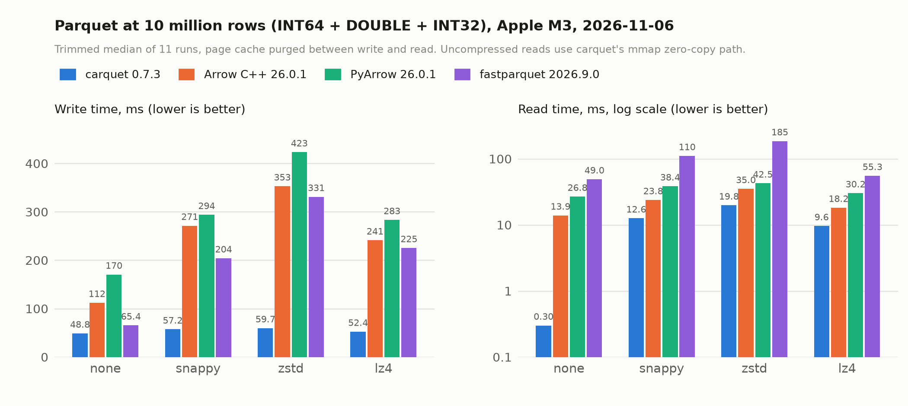

<h1 align="center">
  
</h1>

<p align="center">
  Une bibliothèque C pure et rapide pour lire et écrire des fichiers Apache Parquet.
</p>

<p align="center">
  <a href="https://vitruves.github.io/carquet/"></a>
</p>

<p align="center">
  <a href="https://github.com/Vitruves/carquet/actions/workflows/cpp.yml"></a>
  
  
  <a href="https://github.com/Vitruves/carquet/releases"></a>
  <a href="LICENSE"></a>
  <a href="https://github.com/Vitruves/carquet/graphs/traffic"></a>
  <br/>
  <a href="https://pypi.org/project/carquet/"></a>
  <a href="https://pypi.org/project/carquet/"></a>
  <a href="https://pepy.tech/projects/carquet"></a>
  
</p>

<p align="center">
  <a href="#points-forts">Points forts</a> &nbsp;·&nbsp;
  <a href="#benchmarks">Benchmarks</a> &nbsp;·&nbsp;
  <a href="#installation">Installation</a> &nbsp;·&nbsp;
  <a href="#configurations-de-compilation">Configurations de compilation</a> &nbsp;·&nbsp;
  <a href="#api-c">API C</a> &nbsp;·&nbsp;
  <a href="#api-python">API Python</a> &nbsp;·&nbsp;
  <a href="#outil-en-ligne-de-commande">CLI</a> &nbsp;·&nbsp;
  <a href="#fonctionnalités-parquet-prises-en-charge">Fonctionnalités</a> &nbsp;·&nbsp;
  <a href="docs/README.md">Manuel</a> &nbsp;·&nbsp;
  <a href="CHANGELOG.md">Changelog</a>
</p>

<p align="center">
  <a href="README.md">English</a> &nbsp;·&nbsp;
  <a href="README.zh-CN.md">简体中文</a> &nbsp;·&nbsp;
  <a href="README.ja.md">日本語</a> &nbsp;·&nbsp;
  <a href="README.ko.md">한국어</a> &nbsp;·&nbsp;
  <a href="README.de.md">Deutsch</a> &nbsp;·&nbsp;
  <b>Français</b> &nbsp;·&nbsp;
  <a href="README.pt-BR.md">Português (Brasil)</a>
</p>

<br/>

---

<!-- ────────────────────────────  POINTS FORTS  ──────────────────────────── -->

## Points forts

<div align="center">

| | |
|---|---|
| ⚡ **Rapide** | Écrit **2.3–5.9x plus vite** qu’Arrow C++ et lit les données compressées **1.5–2.1x plus vite** à partir du même fichier (Apple M3, 10 M de lignes). Les lectures non compressées sont servies directement depuis le mmap en **0.30 ms**. SIMD pour SSE4.2 / AVX2 / AVX-512 / NEON / SVE avec sélection à l’exécution. |
| 🪶 **Compacte** | C11 pur, une bibliothèque d’**environ 500 Ko** (Arrow C++ : plus de 50 Mo). Quatre dépendances de compression (zstd, zlib, lz4, brotli), récupérées automatiquement si elles manquent. Se compile en moins d’une minute avec un simple `make` ou `xmake`. |
| 📦 **Complète** | Tous les types physiques et encodages, Snappy / GZIP / LZ4 / ZSTD / Brotli, pages V1 + V2, schémas imbriqués à toute profondeur, filtres de Bloom, index de pages, élagage par statistiques, ajout. [Matrice complète ↓](#fonctionnalités-parquet-prises-en-charge) |
| 🔗 **Interopérable** | Fichiers lus par PyArrow, DuckDB et Spark sans configuration. Passerelle [Arrow C Data Interface](docs/reading.md#export-to-arrow-c-data-interface) sans dépendance (struct / list / map à toute profondeur) et une [API Python](#api-python) complète au-dessus de PyArrow. |
| 🛠 **Outillage** | CLI `carquet` pour inspecter, filtrer, exporter et valider des fichiers, plus `codegen` pour produire un lecteur C prêt à compiler. Un [skill pour agents](#ai-coding-agents) prêt à l’emploi pour Claude Code et Codex. |

</div>

<br/>

---

<!-- ────────────────────────────  BENCHMARKS  ──────────────────────────── -->

## Benchmarks

<p align="center">
  <picture>
    <source media="(prefers-color-scheme: dark)" srcset="res/img/bench_10m_m3_dark.png">
    <source media="(prefers-color-scheme: light)" srcset="res/img/bench_10m_m3_light.png">
    
  </picture>
</p>

<p align="center"><b><a href="https://vitruves.github.io/carquet/">Explorer le benchmark interactif sur le site web →</a></b><br/><sub>basculez entre lecture et écriture, et entre 100K, 1M et 10M de lignes</sub></p>

Accélération de carquet par rapport à Arrow C++ à 10 M de lignes (plus élevé = carquet plus rapide) :

<div align="center">

| | ARM · Apple M3 | | x86 · Windows (Haswell, MSVC) | | x86 · Linux (Xeon D-1531) | |
|---|---:|---:|---:|---:|---:|---:|
| **Codec** | **Écriture** | **Lecture** | **Écriture** | **Lecture** | **Écriture** | **Lecture** |
| snappy | **4.74x** | **1.89x** | **3.39x** | **1.17x** | **1.55x** | **1.25x** |
| zstd | **5.91x** | **1.77x** | **3.83x** | **1.13x** | **1.31x** | **1.04x** |
| lz4 | **4.61x** | **1.89x** | **2.96x** | **1.05x** | **1.02x** | 0.83x |
| none | **2.30x** | **46.3x**\* | **2.10x** | **62.0x**\* | **1.13x** | **40.6x**\* |

</div>

<sub>\* Chemin mmap zéro-copie. Apple M3 : carquet 0.7.3 vs Arrow C++ 26.0.1 (2026-11-06). Windows : carquet 0.7.3 vs Arrow C++ 24.0.0 (2026-11-02). Linux : carquet 0.4.4 vs Arrow C++ 23.0.1, avant le parallélisme d’écriture de 0.7.1, non remesuré depuis.</sub>

Les lectures compressées décodent chaque valeur, et sous Linux et macOS les deux bibliothèques utilisent les mêmes lz4 / zstd système : la vitesse des codecs est donc identique. La comparaison la plus équitable est la **lecture croisée du même fichier** (les deux bibliothèques lisent exactement le même fichier) : carquet est **1.5–2.1x plus rapide** sur M3, 1.6–2.6x sous Linux et 1.04–1.30x sur la VM Windows, dont les lectures à froid sont limitées par le disque virtuel.

<details>
<summary><b>Méthodologie des benchmarks</b></summary>

<br/>

Tous les benchmarks utilisent des données identiques (PRNG LCG déterministe), des réglages Parquet identiques (pas de dictionnaire, BYTE_STREAM_SPLIT pour les flottants, sommes de contrôle de pages, lectures mmap), la médiane tronquée de 11 à 51 itérations, avec purge du cache de pages de l’OS entre les phases d’écriture et de lecture et un temps de refroidissement entre les configurations. Schéma : 3 colonnes (INT64, DOUBLE, INT32). Comparé au lecteur Parquet bas niveau d’Arrow C++ (sans matérialisation en Arrow Table) et à PyArrow.

Le cache de pages est purgé fichier par fichier : `posix_fadvise(DONTNEED)` sous Linux ; sous macOS et Windows, le fichier est copié sans mise en cache (`F_NOCACHE`, `FILE_FLAG_NO_BUFFERING`) et la copie le remplace (`benchmark/bench_purge_win32.h`). Sous Windows, carquet lie les zstd / lz4 qu’il compile lui-même et Arrow C++ ceux de conda-forge, la vitesse des codecs peut donc légèrement différer entre les deux.

Le benchmark de **lecture croisée du même fichier** est la comparaison la plus équitable : les deux bibliothèques lisent exactement le même fichier Parquet (écrit par l’une, lu par les deux). Cela élimine les différences de taille de pages, de choix d’encodage et de disposition des row groups.

Les **lectures non compressées** marquées d’un \* utilisent le **chemin mmap zéro-copie** de Carquet : pour les colonnes requises, de taille fixe, non compressées et encodées en PLAIN, le lecteur par lots renvoie des pointeurs directement dans le fichier mappé en mémoire, sans memcpy. Arrow matérialise toujours dans ses propres tampons. **Les chiffres de lecture compressée sont la mesure la plus représentative du débit de lecture de bout en bout.**

</details>

<details>
<summary><b>Résultats x86 complets</b> (Intel Xeon D-1531, Linux)</summary>

<br/>

*12 threads @ 2.2GHz, 32 Go de RAM, Ubuntu 24.04, ZSTD niveau 1*

#### 10 M de lignes vs Arrow C++

<div align="center">

| Codec | Écriture Carquet | Écriture Arrow C++ | Ratio écr. | Lecture Carquet | Lecture Arrow C++ | Ratio lect. | Taille |
|-------|--------------|-----------------|---------|-------------|----------------|---------|------|
| none | **1557ms** | 1766ms | **1.13x** | **1.25ms** | 50.8ms | **40.6x**\* | 190.7MB |
| snappy | **1002ms** | 1549ms | **1.55x** | **78ms** | 97.8ms | **1.25x** | 125.1MB |
| zstd | **1311ms** | 1714ms | **1.31x** | **76.8ms** | 80.2ms | **1.04x** | 95.3MB |
| lz4 | **1521ms** | 1554ms | **1.02x** | 59.1ms | **49.0ms** | 0.83x | 122.9MB |

</div>

<br/>

#### 1 M de lignes vs Arrow C++

<div align="center">

| Codec | Écriture Carquet | Écriture Arrow C++ | Ratio écr. | Lecture Carquet | Lecture Arrow C++ | Ratio lect. |
|-------|--------------|-----------------|---------|-------------|----------------|---------|
| none | **180ms** | 196ms | **1.09x** | **0.22ms** | 6.2ms | **28x**\* |
| snappy | **141ms** | 148ms | **1.05x** | **8.1ms** | 11.6ms | **1.44x** |
| zstd | **131ms** | 185ms | **1.41x** | 10.3ms | **9.1ms** | 0.88x |
| lz4 | **143ms** | 149ms | **1.04x** | 8.5ms | **6.1ms** | 0.72x |

</div>

<br/>

#### 100 K lignes vs Arrow C++

<div align="center">

| Codec | Écriture Carquet | Écriture Arrow C++ | Ratio écr. | Lecture Carquet | Lecture Arrow C++ | Ratio lect. |
|-------|--------------|-----------------|---------|-------------|----------------|---------|
| none | **14.1ms** | 18.4ms | **1.30x** | **0.11ms** | 2.18ms | **19.8x**\* |
| snappy | **10.1ms** | 10.6ms | **1.05x** | **1.27ms** | 5.97ms | **4.70x** |
| zstd | **8.7ms** | 14.1ms | **1.62x** | **1.58ms** | 3.88ms | **2.46x** |
| lz4 | **9.6ms** | 11.0ms | **1.14x** | **0.77ms** | 2.78ms | **3.61x** |

</div>

<br/>

#### Lecture croisée du même fichier (10 M de lignes)

Les deux bibliothèques lisent le **même** fichier Parquet, la comparaison la plus équitable qui soit.

<div align="center">

| Codec | Écrivain | Lecture Carquet | Lecture Arrow C++ | Ratio |
|-------|--------|-------------|----------------|-------|
| none | Carquet | **0.99ms** | 73.6ms | **74x**\* |
| none | Arrow | **7.6ms** | 51.2ms | **6.8x**\* |
| snappy | Carquet | **41.0ms** | 107ms | **2.61x** |
| snappy | Arrow | **43.4ms** | 101ms | **2.33x** |
| zstd | Carquet | **46.1ms** | 88.4ms | **1.92x** |
| zstd | Arrow | **49.1ms** | 79.5ms | **1.62x** |
| lz4 | Carquet | **34.8ms** | 74.8ms | **2.15x** |
| lz4 | Arrow | **27.4ms** | 52.0ms | **1.90x** |

</div>

<br/>

#### 10 M de lignes vs PyArrow

<div align="center">

| Codec | Écriture Carquet | Écriture PyArrow | Ratio écr. | Lecture Carquet | Lecture PyArrow | Ratio lect. |
|-------|--------------|---------------|---------|-------------|--------------|---------|
| none | **1557ms** | 1806ms | **1.16x** | **1.25ms** | 213ms | **170x**\* |
| snappy | **1002ms** | 1649ms | **1.65x** | **78ms** | 384ms | **4.91x** |
| zstd | **1311ms** | 1796ms | **1.37x** | **76.8ms** | 369ms | **4.81x** |
| lz4 | **1521ms** | 1676ms | **1.10x** | **59.1ms** | 281ms | **4.76x** |

</div>

\* Chemin mmap zéro-copie

</details>

<details>
<summary><b>Résultats ARM complets</b> (Apple M3, macOS)</summary>

<br/>

*Carquet 0.7.3, MacBook Air M3, 16 Go de RAM, macOS 26.5, Arrow C++ 26.0.1, PyArrow 26.0.1, fastparquet 2026.9.0, ZSTD niveau 1, mesuré le 2026-11-06. Rapport brut : [`benchmark/bench_0.7.3_darwin_arm64_20261106.json`](benchmark/bench_0.7.3_darwin_arm64_20261106.json).*

#### 10 M de lignes vs Arrow C++

<div align="center">

| Codec | Écriture Carquet | Écriture Arrow C++ | Ratio écr. | Lecture Carquet | Lecture Arrow C++ | Ratio lect. | Taille |
|-------|--------------|---------|---------|-------------|---------|---------|------|
| none | **48.8ms** | 112ms | **2.30x** | **0.30ms** | 13.9ms | **46.3x**\* | 200.0MB |
| snappy | **57.2ms** | 271ms | **4.74x** | **12.6ms** | 23.8ms | **1.89x** | 131.2MB |
| zstd | **59.7ms** | 353ms | **5.91x** | **19.8ms** | 35.0ms | **1.77x** | 99.9MB |
| lz4 | **52.4ms** | 241ms | **4.61x** | **9.60ms** | 18.2ms | **1.89x** | 128.7MB |

</div>

<br/>

#### 1 M de lignes vs Arrow C++

<div align="center">

| Codec | Écriture Carquet | Écriture Arrow C++ | Ratio écr. | Lecture Carquet | Lecture Arrow C++ | Ratio lect. |
|-------|--------------|---------|---------|-------------|---------|---------|
| none | **6.75ms** | 13.2ms | **1.95x** | **0.07ms** | 1.72ms | **24.6x**\* |
| snappy | **7.02ms** | 24.0ms | **3.42x** | **1.58ms** | 2.49ms | **1.58x** |
| zstd | **7.97ms** | 33.6ms | **4.22x** | **2.16ms** | 3.03ms | **1.40x** |
| lz4 | **6.54ms** | 25.2ms | **3.85x** | **0.97ms** | 1.96ms | **2.02x** |

</div>

<br/>

#### 100 K lignes vs Arrow C++

<div align="center">

| Codec | Écriture Carquet | Écriture Arrow C++ | Ratio écr. | Lecture Carquet | Lecture Arrow C++ | Ratio lect. |
|-------|--------------|---------|---------|-------------|---------|---------|
| none | **1.08ms** | 1.75ms | **1.62x** | **0.02ms** | 0.24ms | **12.0x**\* |
| snappy | **1.80ms** | 2.52ms | **1.40x** | **0.36ms** | 0.90ms | **2.50x** |
| zstd | **1.81ms** | 3.60ms | **1.99x** | **0.63ms** | 1.30ms | **2.06x** |
| lz4 | **1.67ms** | 2.57ms | **1.54x** | **0.29ms** | 0.61ms | **2.10x** |

</div>

<br/>

#### 10 M de lignes vs PyArrow

<div align="center">

| Codec | Écriture Carquet | Écriture PyArrow | Ratio écr. | Lecture Carquet | Lecture PyArrow | Ratio lect. |
|-------|--------------|---------|---------|-------------|---------|---------|
| none | **48.8ms** | 170ms | **3.49x** | **0.30ms** | 26.8ms | **89.2x**\* |
| snappy | **57.2ms** | 294ms | **5.14x** | **12.6ms** | 38.4ms | **3.05x** |
| zstd | **59.7ms** | 423ms | **7.09x** | **19.8ms** | 42.5ms | **2.15x** |
| lz4 | **52.4ms** | 283ms | **5.41x** | **9.60ms** | 30.2ms | **3.15x** |

</div>

<br/>

#### 1 M de lignes vs PyArrow

<div align="center">

| Codec | Écriture Carquet | Écriture PyArrow | Ratio écr. | Lecture Carquet | Lecture PyArrow | Ratio lect. |
|-------|--------------|---------|---------|-------------|---------|---------|
| none | **6.75ms** | 17.0ms | **2.52x** | **0.07ms** | 2.73ms | **39.0x**\* |
| snappy | **7.02ms** | 27.9ms | **3.97x** | **1.58ms** | 3.66ms | **2.32x** |
| zstd | **7.97ms** | 38.8ms | **4.87x** | **2.16ms** | 3.96ms | **1.83x** |
| lz4 | **6.54ms** | 29.2ms | **4.46x** | **0.97ms** | 2.98ms | **3.07x** |

</div>

<br/>

#### 100 K lignes vs PyArrow

<div align="center">

| Codec | Écriture Carquet | Écriture PyArrow | Ratio écr. | Lecture Carquet | Lecture PyArrow | Ratio lect. |
|-------|--------------|---------|---------|-------------|---------|---------|
| none | **1.08ms** | 1.99ms | **1.84x** | **0.02ms** | 0.24ms | **12.0x**\* |
| snappy | **1.80ms** | 2.82ms | **1.57x** | **0.36ms** | 0.66ms | **1.83x** |
| zstd | **1.81ms** | 4.17ms | **2.30x** | **0.63ms** | 0.72ms | **1.14x** |
| lz4 | **1.67ms** | 2.93ms | **1.75x** | **0.29ms** | 0.43ms | **1.48x** |

</div>

<br/>

#### 10 M de lignes vs fastparquet

<div align="center">

| Codec | Écriture Carquet | Écriture fastparquet | Ratio écr. | Lecture Carquet | Lecture fastparquet | Ratio lect. |
|-------|--------------|---------|---------|-------------|---------|---------|
| none | **48.8ms** | 65.4ms | **1.34x** | **0.30ms** | 49.0ms | **163.5x**\* |
| snappy | **57.2ms** | 204ms | **3.57x** | **12.6ms** | 110ms | **8.78x** |
| zstd | **59.7ms** | 331ms | **5.55x** | **19.8ms** | 185ms | **9.39x** |
| lz4 | **52.4ms** | 225ms | **4.30x** | **9.60ms** | 55.3ms | **5.76x** |

</div>

<br/>

#### 1 M de lignes vs fastparquet

<div align="center">

| Codec | Écriture Carquet | Écriture fastparquet | Ratio écr. | Lecture Carquet | Lecture fastparquet | Ratio lect. |
|-------|--------------|---------|---------|-------------|---------|---------|
| none | **6.75ms** | 7.45ms | **1.10x** | **0.07ms** | 3.00ms | **42.9x**\* |
| snappy | **7.02ms** | 22.1ms | **3.16x** | **1.58ms** | 10.1ms | **6.39x** |
| zstd | **7.97ms** | 32.6ms | **4.09x** | **2.16ms** | 18.4ms | **8.54x** |
| lz4 | **6.54ms** | 21.6ms | **3.30x** | **0.97ms** | 5.06ms | **5.22x** |

</div>

<br/>

#### 100 K lignes vs fastparquet

<div align="center">

| Codec | Écriture Carquet | Écriture fastparquet | Ratio écr. | Lecture Carquet | Lecture fastparquet | Ratio lect. |
|-------|--------------|---------|---------|-------------|---------|---------|
| none | 1.08ms | **1.04ms** | 0.96x | **0.02ms** | 0.52ms | **26.0x**\* |
| snappy | **1.80ms** | 2.31ms | **1.28x** | **0.36ms** | 1.20ms | **3.33x** |
| zstd | **1.81ms** | 3.45ms | **1.91x** | **0.63ms** | 2.05ms | **3.25x** |
| lz4 | **1.67ms** | 2.25ms | **1.35x** | **0.29ms** | 0.73ms | **2.52x** |

</div>

<br/>

#### Lecture croisée du même fichier (10 M de lignes)

Les deux bibliothèques lisent le **même** fichier Parquet, la comparaison la plus équitable qui soit.

<div align="center">

| Codec | Écrivain | Lecture Carquet | Lecture Arrow C++ | Ratio |
|-------|--------|-------------|----------------|-------|
| none | Carquet | **0.43ms** | 16.9ms | **39.2x**\* |
| none | Arrow | **0.90ms** | 14.8ms | **16.5x**\* |
| snappy | Carquet | **13.6ms** | 24.5ms | **1.80x** |
| snappy | Arrow | **11.4ms** | 22.9ms | **2.01x** |
| zstd | Carquet | **19.4ms** | 28.6ms | **1.48x** |
| zstd | Arrow | **18.7ms** | 28.7ms | **1.54x** |
| lz4 | Carquet | **9.39ms** | 19.1ms | **2.04x** |
| lz4 | Arrow | **8.97ms** | 18.8ms | **2.09x** |

</div>

\* Chemin mmap zéro-copie. fastparquet lit via pandas et ne sait écrire ni BYTE_STREAM_SPLIT ni sommes de contrôle de pages, ses lignes sont donc moins directement comparables.

</details>

<details>
<summary><b>Résultats Windows complets</b> (VM Intel Haswell, MSVC)</summary>

<br/>

*Carquet 0.7.3 compilé avec MSVC 19.44 (x64 Release, OpenMP), VM OpenStack à 4 vCPU (Intel Haswell, 3.1 GHz), 14.6 Go de RAM, disque SAS virtuel, Windows Server 2025, Arrow C++ 24.0.0 (conda-forge), ZSTD niveau 1, mesuré le 2026-11-02. Les lectures à froid vont jusqu’au disque virtuel, ce qui resserre les ratios de lecture ; les écritures et le chemin zéro-copie sont limités par le CPU.*

#### 10 M de lignes vs Arrow C++

<div align="center">

| Codec | Écriture Carquet | Écriture Arrow C++ | Ratio écr. | Lecture Carquet | Lecture Arrow C++ | Ratio lect. | Taille |
|-------|--------------|-----------------|---------|-------------|----------------|---------|------|
| none | **182ms** | 382ms | **2.10x** | **2.04ms** | 126.5ms | **62.0x**\* | 190.7MB |
| snappy | **175ms** | 594ms | **3.39x** | **115.6ms** | 134.9ms | **1.17x** | 125.1MB |
| zstd | **242ms** | 927ms | **3.83x** | **140.7ms** | 159.2ms | **1.13x** | 95.3MB |
| lz4 | **178ms** | 527ms | **2.96x** | **95.5ms** | 99.9ms | **1.05x** | 122.9MB |

</div>

<br/>

#### 1 M de lignes vs Arrow C++

<div align="center">

| Codec | Écriture Carquet | Écriture Arrow C++ | Ratio écr. | Lecture Carquet | Lecture Arrow C++ | Ratio lect. |
|-------|--------------|-----------------|---------|-------------|----------------|---------|
| none | **15.6ms** | 37.6ms | **2.41x** | **0.44ms** | 13.72ms | **31.2x**\* |
| snappy | **25.4ms** | 61.2ms | **2.41x** | **14.01ms** | 16.31ms | **1.16x** |
| zstd | **30.4ms** | 94.3ms | **3.10x** | **17.09ms** | 18.38ms | **1.08x** |
| lz4 | **26.4ms** | 53.8ms | **2.04x** | 13.07ms | **12.89ms** | 0.99x |

</div>

<br/>

#### 100 K lignes vs Arrow C++

<div align="center">

| Codec | Écriture Carquet | Écriture Arrow C++ | Ratio écr. | Lecture Carquet | Lecture Arrow C++ | Ratio lect. |
|-------|--------------|-----------------|---------|-------------|----------------|---------|
| none | **3.53ms** | 3.95ms | **1.12x** | **0.16ms** | 2.13ms | **13.3x**\* |
| snappy | **5.60ms** | 6.23ms | **1.11x** | **2.79ms** | 3.92ms | **1.41x** |
| zstd | **7.11ms** | 9.79ms | **1.38x** | **2.86ms** | 4.36ms | **1.52x** |
| lz4 | **5.75ms** | 5.82ms | **1.01x** | 2.22ms | **2.15ms** | 0.97x |

</div>

<br/>

#### Lecture croisée du même fichier (10 M de lignes)

<div align="center">

| Codec | Écrivain | Lecture Carquet | Lecture Arrow C++ | Ratio |
|-------|--------|-------------|----------------|-------|
| none | Carquet | **2.65ms** | 116.9ms | **44.1x**\* |
| none | Arrow | **5.29ms** | 126.6ms | **23.9x**\* |
| snappy | Carquet | **115.2ms** | 135.0ms | **1.17x** |
| snappy | Arrow | **112.7ms** | 146.2ms | **1.30x** |
| zstd | Carquet | **137.7ms** | 150.5ms | **1.09x** |
| zstd | Arrow | **134.9ms** | 155.3ms | **1.15x** |
| lz4 | Carquet | **92.1ms** | 95.6ms | **1.04x** |
| lz4 | Arrow | **89.7ms** | 98.1ms | **1.09x** |

</div>

\* Chemin mmap zéro-copie

</details>

<details>
<summary><b>Lancer les benchmarks vous-même</b></summary>

<br/>

```bash
make benchmark                                    # Release build of the benchmark programs into build/
./build/benchmark_carquet                         # carquet alone
python3 benchmark/run_benchmark.py --skip-xlarge  # full comparison with PyArrow (+ Arrow C++ if built)
```

<div align="center">

| Drapeau / variable de `run_benchmark.py` | Effet |
|---|---|
| `--quick` | Uniquement les configurations à 10 M de lignes (celles du graphique) |
| `--skip-xlarge` | Ignorer les configurations à 100 M de lignes (~2 Go par codec, plus de 30 minutes) |
| `--fastparquet` | Comparer aussi fastparquet (`pip install fastparquet pandas`) |
| `--no-pyarrow` / `--no-arrow-cpp` | Ignorer PyArrow / Arrow C++ |
| `--iterations N` | Nombre d’itérations fixe (défaut : auto, 11–51) |
| `--build-dir DIR` / `--temp-dir DIR` | Emplacement des binaires / emplacement où les fichiers de test sont écrits |
| `CARQUET_BENCH_ZSTD_LEVEL=3` | Niveau ZSTD (défaut 1) |

</div>

Mesurez toujours un build **Release** : `make benchmark` reconfigure `build/` en Release ; un `build/` Debug resté en place fait paraître carquet plusieurs fois plus lent. `make native` + `-DCARQUET_BUILD_BENCHMARKS=ON` donne les chiffres optimisés pour la machine hôte.

fastparquet utilise les mêmes données, la même taille de row group, pas de dictionnaire et le même niveau zstd, et LZ4_RAW pour `lz4`. Il ne sait écrire ni BYTE_STREAM_SPLIT ni sommes de contrôle de pages, et il lit via pandas : ses chiffres sont donc moins directement comparables que ceux d’Arrow.

La comparaison Arrow C++ nécessite sa propre cible (Arrow C++ trouvé sur le système, ou désigné avec `CARQUET_ARROW_CPP_ROOT`) :

```bash
cmake -B build -DCMAKE_BUILD_TYPE=Release -DCARQUET_NATIVE_ARCH=ON \
  -DCARQUET_BUILD_BENCHMARKS=ON -DCARQUET_BUILD_ARROW_CPP_BENCHMARK=ON \
  [-DCARQUET_ARROW_CPP_ROOT=/path/to/arrow-prefix]
cmake --build build -j
```

Elle utilise l’API bas niveau `parquet::ParquetFileReader` (sans matérialisation en Arrow Table) avec des lecteurs de row groups parallèles.

Sous Windows (Developer PowerShell for VS), Arrow C++ peut provenir de conda-forge (`micromamba create -p C:\arrow -c conda-forge libarrow libparquet`) ; ses DLL doivent être dans le `PATH` à l’exécution du benchmark :

```powershell
cmake -B build -G Ninja -DCMAKE_BUILD_TYPE=Release -DCARQUET_BUILD_BENCHMARKS=ON `
  -DCARQUET_BUILD_ARROW_CPP_BENCHMARK=ON -DCARQUET_ARROW_CPP_ROOT=C:/arrow/Library
cmake --build build
$env:PATH = "C:\arrow\Library\bin;$env:PATH"
python benchmark\run_benchmark.py --build-dir build --skip-xlarge --no-pyarrow
```

Excluez les dossiers de build et de `--temp-dir` de l’analyse antivirus en temps réel : Windows Defender analyse chaque fichier écrit par le benchmark.

Le graphique du README est tracé à partir du JSON qu’une exécution laisse dans `benchmark/`, en une variante claire et une variante sombre que GitHub choisit selon le thème du lecteur :

```bash
python3 benchmark/plot_readme_chart.py benchmark/bench_<version>_<os>_<arch>_<date>.json   # writes res/img/bench_10m_m3_{light,dark}.png
```

</details>

<br/>

---

<!-- ────────────────────────────  APERÇU RAPIDE  ──────────────────────────── -->

## Trente secondes de carquet

```c
#include <carquet/carquet.h>

carquet_error_t err = CARQUET_ERROR_INIT;
carquet_schema_t* schema = carquet_schema_create(&err);
carquet_schema_add_column(schema, "id", CARQUET_PHYSICAL_INT64, NULL, CARQUET_REPETITION_REQUIRED, 0, 0);

carquet_writer_t* w = carquet_writer_create("ids.parquet", schema, NULL, &err);
int64_t ids[] = {1, 2, 3};
carquet_writer_write_batch(w, 0, ids, 3, NULL, NULL);
carquet_writer_close(w);

carquet_reader_t* r = carquet_reader_open("ids.parquet", NULL, &err);
printf("%lld rows\n", (long long)carquet_reader_num_rows(r));   /* 3 rows */
carquet_reader_close(r);
carquet_schema_free(schema);
```

> **Où se situe carquet.** Arrow reste le bon choix lorsque vous avez besoin de son écosystème (noyaux de calcul, datasets, Flight, chiffrement). carquet s’adresse aux programmes C et C++, aux systèmes embarqués et aux runtimes de langages qui ont seulement besoin de lire et d’écrire du Parquet rapidement et correctement.

<br/>

---

<!-- ────────────────────────────  INSTALLATION  ──────────────────────────── -->

## Installation

Cette section installe la **bibliothèque C, ses en-têtes et la CLI `carquet`**. Les utilisateurs Python ont besoin de l’[API Python](#api-python) séparée (`pip install carquet`).

**Prérequis :** un compilateur C11 (GCC 4.9+, Clang 3.4+, MSVC 2015+) et CMake 3.16+ (ou [xmake](#depuis-les-sources-avec-xmake)). zstd, zlib, lz4 et brotli sont pris sur le système s’ils sont présents et récupérés sinon. OpenMP est optionnel (lectures et écritures parallèles).

<br/>

### Depuis les sources, avec `make`

La voie la plus simple. `make` est un fin wrapper qui appelle CMake avec les bons drapeaux, il n’y a rien d’autre à configurer :

```bash
git clone https://github.com/Vitruves/carquet.git && cd carquet
make                  # optimized Release build into build/
sudo make install     # library, headers, CLI, pkg-config and CMake package files
```

Liez ensuite avec `-lcarquet`, `pkg-config --cflags --libs carquet`, ou `find_package(carquet)` dans CMake.

<br/>

### Depuis les sources, avec `xmake`

[xmake](https://xmake.io) ne nécessite rien d’autre d’installé : il télécharge des versions figées de zstd 1.5.6, zlib 1.3.1, lz4 1.10.0 et brotli 1.1.0 et les lie statiquement, la CLI `carquet` n’a donc aucune dépendance à l’exécution.

```bash
git clone https://github.com/Vitruves/carquet.git && cd carquet
xmake                         # Release static library + CLI into build/<plat>/<arch>/release/
xmake install -o /usr/local   # headers, library and CLI (sudo if the prefix needs it)
```

Une installation statique ne contient que `libcarquet.a` : liez donc les codecs vous-même (`-lcarquet -lzstd -lz -llz4`, plus `-lbrotlienc -lbrotlidec -lbrotlicommon` sauf si compilé avec `--brotli=n`). Configurez plutôt avec `xmake f --shared=y` pour obtenir une bibliothèque partagée autonome intégrant les codecs.

<br/>

### Dans votre projet CMake

```cmake
include(FetchContent)
FetchContent_Declare(carquet GIT_REPOSITORY https://github.com/Vitruves/carquet.git GIT_TAG main)
FetchContent_MakeAvailable(carquet)
target_link_libraries(myapp PRIVATE carquet)
```

Ou, après `make install` : `find_package(carquet REQUIRED)` puis liez `carquet::carquet`.

<br/>

---

<!-- ────────────────────────────  CONFIGURATIONS DE COMPILATION  ──────────────────────────── -->

## Configurations de compilation

### Cibles `make`

Chaque cible configure `build/` et le compile en parallèle. `make help` affiche cette liste. Chacune a un [équivalent xmake](#xmake).

<div align="center">

| Commande | Type de build | Ce que vous obtenez |
|---|---|---|
| `make` / `make release` | Release | Bibliothèque statique + CLI `carquet` (par défaut) |
| `make native` | Release | Idem, optimisé pour ce CPU avec `-march=native` (le binaire ne tourne pas sur des CPU plus anciens) |
| `make shared` | Release | Bibliothèque partagée (`.so` / `.dylib` / `.dll`) au lieu de statique |
| `make benchmark` | Release | Programmes de benchmark (`benchmark_carquet`, cibles de profilage) |
| `make debug` | Debug | Bibliothèque + CLI avec assertions, sans optimisation |
| `make test` | Debug | Suite de tests, puis son exécution avec `ctest` |
| `make dev` | Debug | Tout : tests, exemples, benchmarks, programmes d’interop |
| `make fuzz` | Debug | Cibles libFuzzer (utilisez une toolchain Clang) |
| `make install` | Release | Compile `release`, puis installe dans `PREFIX` |
| `make clean` | | Supprime le répertoire de build |

</div>

<div align="center">

| Variable | Défaut | Exemple |
|---|---|---|
| `PREFIX` | défaut de CMake (`/usr/local` sous Unix) | `make install PREFIX=$HOME/.local` |
| `BUILD` | `build` | `make test BUILD=build-debug` (garder plusieurs configurations côte à côte) |
| `JOBS` | nombre de cœurs | `make JOBS=4` |
| `CMAKE` | `cmake` | `make CMAKE=/opt/cmake/bin/cmake` |

</div>

Toutes les cibles partagent `build/` par défaut : `make test` après `make benchmark` le reconfigure donc en Debug. Utilisez `BUILD=` pour séparer une arborescence Release et une Debug.

<br/>

### Options CMake

Pour tout ce que les cibles `make` ne couvrent pas, appelez CMake directement et passez les options avec `-DOPTION=ON|OFF` :

```bash
cmake -B build -DCMAKE_BUILD_TYPE=Release -DCARQUET_BUILD_SHARED=ON -DCARQUET_ENABLE_BROTLI=OFF
cmake --build build -j
sudo cmake --install build --prefix /usr/local
```

<div align="center">

| Ce qui est compilé | Défaut | |
|---|:---:|---|
| `CARQUET_BUILD_CLI` | ON | Outil en ligne de commande `carquet` |
| `CARQUET_BUILD_SHARED` | OFF | Bibliothèque partagée au lieu de statique |
| `CARQUET_BUILD_DEV` | OFF | Active d’un coup tests, exemples, benchmarks et interop |
| `CARQUET_BUILD_TESTS` | = DEV | Suite de tests (`ctest`) |
| `CARQUET_BUILD_EXAMPLES` | = DEV | Programmes de [`examples/`](examples/) |
| `CARQUET_BUILD_BENCHMARKS` | = DEV | Programmes de benchmark et de profilage |
| `CARQUET_BUILD_ARROW_CPP_BENCHMARK` | OFF | Benchmark comparatif Arrow C++ (nécessite Arrow C++) |
| `CARQUET_BUILD_INTEROP` | = DEV | Programmes d’aller-retour C / Python |
| `CARQUET_BUILD_FUZZ` | OFF | Cibles de fuzzing |
| `CARQUET_BUILD_DOCS` | OFF | Cible `docs`, HTML Doxygen dans `build/docs/html/` |

| Dépendances | Défaut | |
|---|:---:|---|
| `CARQUET_ENABLE_BROTLI` | ON | Codec BROTLI ; OFF supprime la dépendance à libbrotli |
| `CARQUET_BUNDLE_DEPS` | OFF | Toujours récupérer et embarquer statiquement zstd / zlib / lz4 / brotli (artefacts portables, wheel Python) |
| `CARQUET_ZSTD_TARGET`, `_ZLIB_`, `_LZ4_`, `_BROTLI_TARGET` | vide | Lier une cible CMake existante au lieu de rechercher ou de récupérer (voir ci-dessous) |
| `CARQUET_ARROW_CPP_ROOT` | vide | Préfixe d’installation d’Arrow C++ pour le benchmark comparatif |
| `CMAKE_DISABLE_FIND_PACKAGE_OpenMP` | OFF | ON compile sans OpenMP (pas de `libgomp` / `vcomp140.dll` à l’exécution) |

| CPU | Défaut | |
|---|:---:|---|
| `CARQUET_NATIVE_ARCH` | OFF | `-march=native` ; le plus rapide, binaire lié à la machine hôte |
| `CARQUET_ENABLE_SSE`, `_AVX`, `_AVX2`, `_AVX512` | ON | Noyaux SIMD x86, choisis à l’exécution selon ce que le CPU prend en charge |
| `CARQUET_ENABLE_NEON` | ON | Noyaux ARM NEON |
| `CARQUET_ENABLE_SVE` | OFF | Noyaux ARM SVE (expérimental) |
| `CARQUET_MSVC_HARDENING` | ON | MSVC : `/guard:cf` et `/CETCOMPAT` |

</div>

Les noyaux SIMD sont compilés dans la bibliothèque et sélectionnés à l’exécution avec repli scalaire : un build par défaut tourne donc sur n’importe quel CPU de son architecture. Seul `CARQUET_NATIVE_ARCH` lie le binaire à la machine de compilation.

<br/>

### xmake

`xmake.lua` est une alternative complète à CMake avec les mêmes options et valeurs par défaut. Configurez une fois avec `xmake f`, puis `xmake` compile ; la configuration est conservée jusqu’au prochain `xmake f`.

<div align="center">

| Cible `make` | Équivalent xmake |
|---|---|
| `make` | `xmake` |
| `make native` | `xmake f --native_arch=y && xmake` |
| `make shared` | `xmake f --shared=y && xmake` |
| `make benchmark` | `xmake f --benchmarks=y && xmake` |
| `make debug` | `xmake f -m debug && xmake` |
| `make test` | `xmake f -m debug --tests=y && xmake && xmake test` |
| `make dev` | `xmake f -m debug --dev=y && xmake` |
| `make fuzz` | `xmake f -m debug --fuzz=y --toolchain=clang && xmake` |
| `make clean` | `xmake clean` (ou `xmake f -c` pour réinitialiser aussi la configuration) |
| `cmake --build build --target docs` | `xmake docs` (aucun drapeau de configuration nécessaire) |

</div>

Les options reflètent celles de CMake, sans le préfixe `CARQUET_` et en minuscules, sous la forme `--option=y|n`. Combinez-les librement : `xmake f -m release --shared=y --brotli=n --avx512=n`.

<div align="center">

| Option xmake | Défaut | Description |
|--------------|---------|-------------|
| `--dev` | n | Compiler tests, exemples, benchmarks et interop |
| `--tests` / `--examples` / `--benchmarks` / `--interop` | n | Compiler un groupe individuellement |
| `--arrow_cpp_benchmark` | n | Benchmark comparatif Arrow C++ (utilise Arrow depuis le dépôt xmake si disponible) |
| `--cli` | y | Compiler l’outil CLI `carquet` |
| `--shared` | n | Compiler une bibliothèque partagée plutôt que statique |
| `--openmp` | y | Lecture parallèle des colonnes via OpenMP (désactivé automatiquement si indisponible) |
| `--native_arch` | n | `-march=native` pour des performances maximales (binaire lié à la machine hôte) |
| `--sse` / `--avx` / `--avx2` / `--avx512` / `--neon` | y | Jeux d’instructions SIMD (détection automatique) |
| `--sve` | n | ARM SVE (expérimental) |
| `--brotli` | y | Codec BROTLI (libbrotli depuis le dépôt xmake) |
| `--fuzz` | n | Compiler les cibles de fuzzing (utilisez `--toolchain=clang`) ; puis `--fuzz_engine=libFuzzer\|AFL`, `--fuzz_sanitizers=y\|n` |

</div>

<details>
<summary><b>Windows</b> (MSVC, clang-cl, MinGW-w64)</summary>

<br/>

MSVC (x64 et Win32), clang-cl et MinGW-w64 GCC sont tous pris en charge, en statique comme en partagé. `CMakePresets.json` fournit les presets `msvc`, `msvc-shared`, `clang-cl` et `mingw` :

```powershell
# from a Developer PowerShell for VS (or with MinGW-w64 gcc + ninja on PATH for "mingw")
cmake --preset msvc
cmake --build --preset msvc
ctest --preset msvc
```

- Lors d’une configuration manuelle, définissez le compilateur C++ en plus du compilateur C (par exemple `CC=clang-cl CXX=clang-cl`) : le projet zstd récupéré active le C++, et CMake choisit sinon un pilote incompatible.
- Avec `-DCARQUET_BUILD_SHARED=ON`, vous obtenez `carquet.dll` et la bibliothèque d’import `carquet.lib` (`libcarquet.dll` / `libcarquet.dll.a` avec MinGW). Les consommateurs doivent définir `CARQUET_BUILD_SHARED` ; `find_package(carquet)` et `carquet.pc` l’ajoutent pour vous. Placez la DLL à côté de votre exécutable ou dans le `PATH`.
- Libérez la mémoire que carquet vous transmet, comme la sortie de `carquet_writer_get_buffer()`, avec `carquet_free()` et non `free()`. La DLL et votre programme peuvent utiliser des tas de runtime C différents (CRT Debug vs Release, `/MT`, MinGW vs MSVC).
- Les chemins de fichiers peuvent être en UTF-8 (les noms non ASCII fonctionnent). La CLI `carquet` accepte les arguments Unicode et affiche de l’UTF-8 dans la console.
- Les builds MinGW avec OpenMP nécessitent `libgomp-1.dll` et `libwinpthread-1.dll` à l’exécution. Les builds MSVC nécessitent `vcomp140.dll` (fournie par le Visual C++ Redistributable). Passez `-DCMAKE_DISABLE_FIND_PACKAGE_OpenMP=ON` pour un build sans cette dépendance.
- L’heuristique d’apprentissage automatique de Windows Defender peut mettre en quarantaine `test_encoding_roundtrip.exe` et `test_fuzz_regressions.exe` comme `Trojan:Win64/CobaltStrike.RDH!MTB` (un faux positif dû à leurs données de test binaires embarquées ; ctest les signale alors comme « Not Run »). Excluez le répertoire de build de l’analyse pour lancer la suite complète.

</details>

<details>
<summary><b>Utiliser vos propres zstd / zlib / lz4 / brotli</b> (intégrer carquet dans un projet CMake plus large)</summary>

<br/>

Lorsque carquet est intégré via `add_subdirectory()` ou `FetchContent`, il résout chaque bibliothèque de compression dans cet ordre :

1. La cible nommée par `CARQUET_ZSTD_TARGET`, `CARQUET_ZLIB_TARGET`, `CARQUET_LZ4_TARGET` ou `CARQUET_BROTLI_TARGET`, si elle est définie.
2. Une copie système (ignorée lorsque `CARQUET_BUNDLE_DEPS` est ON).
3. Une copie qu’il récupère et compile lui-même. Si votre projet compile déjà la bibliothèque sous son nom de cible habituel (`libzstd_static`, `zlibstatic`, `lz4_static`), carquet réutilise cette cible au lieu d’en récupérer une seconde copie.

Un projet qui embarque ces bibliothèques et n’a pas de copie système n’a donc besoin d’aucune configuration. Pour choisir explicitement, nommez la cible :

```cmake
set(CARQUET_ZLIB_TARGET zlibstatic)
add_subdirectory(carquet)
```

Une cible nommée est liée telle quelle, sans recherche ni récupération, et un nom qui n’est pas une cible est une erreur de configuration et non un repli silencieux. La cible peut être importée ou compilée dans l’arborescence, statique ou partagée, et doit exposer ses répertoires d’en-têtes comme exigence d’utilisation.

</details>

<details>
<summary><b>Tests, sanitizers et documentation de l’API</b></summary>

<br/>

```bash
make test                                    # Debug build + ctest
make dev && ctest --test-dir build           # everything, including examples and interop programs
cmake -B build -DCARQUET_BUILD_DOCS=ON && cmake --build build --target docs   # Doxygen → build/docs/html/
```

[CONTRIBUTING.md](CONTRIBUTING.md) décrit la barrière par pull request (tests, sanitizers, fuzzing, interop, benchmarks).

</details>

<a id="ai-coding-agents"></a>

<details>
<summary><b>Agents de codage IA</b> (un skill prêt à l’emploi pour Claude Code et Codex)</summary>

<br/>

[`.agents/skills/carquet/`](.agents/skills/carquet/) est un [Agent Skill](https://agentskills.io) qui apprend à un agent de codage à intégrer carquet dans votre projet : câblage du build (CMake, FetchContent, pkg-config, xmake), quelle API utiliser pour quoi, recettes complètes, les règles de niveaux / bitmap de nuls / durée de vie, les correspondances de types et les pièges habituels avec leurs correctifs. Copiez-le ou liez-le dans votre dépôt et l’agent le détecte automatiquement :

```bash
mkdir -p .claude/skills && cp -r path/to/carquet/.agents/skills/carquet .claude/skills/   # Claude Code
mkdir -p .agents/skills && cp -r path/to/carquet/.agents/skills/carquet .agents/skills/   # Codex CLI
ln -s ../../third_party/carquet/.agents/skills/carquet .claude/skills/carquet               # vendored: stays in sync
```

Les mêmes fichiers fonctionnent aussi comme skill personnel (`~/.claude/skills/`, `~/.codex/skills/`).

</details>

<br/>

---

<!-- ────────────────────────────  API C  ──────────────────────────── -->

## API C

Un exemple d’écriture et un exemple de lecture ci-dessous ; le [manuel dans `docs/`](docs/README.md) couvre tout le reste.

<br/>

### Écrire un fichier Parquet

```c
#include <carquet/carquet.h>

int main(void) {
    carquet_error_t err = CARQUET_ERROR_INIT;

    // Define schema
    carquet_schema_t* schema = carquet_schema_create(&err);
    carquet_schema_add_column(schema, "id",    CARQUET_PHYSICAL_INT64,  NULL, CARQUET_REPETITION_REQUIRED, 0, 0);
    carquet_schema_add_column(schema, "value", CARQUET_PHYSICAL_DOUBLE, NULL, CARQUET_REPETITION_REQUIRED, 0, 0);

    // Configure writer
    carquet_writer_options_t opts;
    carquet_writer_options_init(&opts);
    opts.compression = CARQUET_COMPRESSION_ZSTD;

    // Write
    carquet_writer_t* w = carquet_writer_create("output.parquet", schema, &opts, &err);

    int64_t ids[]    = {1, 2, 3, 4, 5};
    double values[]  = {1.1, 2.2, 3.3, 4.4, 5.5};
    carquet_writer_write_batch(w, 0, ids, 5, NULL, NULL);
    carquet_writer_write_batch(w, 1, values, 5, NULL, NULL);
    carquet_writer_close(w);

    carquet_schema_free(schema);
    return 0;
}
```

<br/>

### Lire un fichier Parquet

```c
#include <carquet/carquet.h>
#include <stdio.h>

int main(void) {
    carquet_error_t err = CARQUET_ERROR_INIT;

    // Open with mmap for best read performance
    carquet_reader_options_t opts;
    carquet_reader_options_init(&opts);
    opts.use_mmap = true;

    carquet_reader_t* r = carquet_reader_open("output.parquet", &opts, &err);
    if (!r) { printf("Error: %s\n", err.message); return 1; }

    printf("Rows: %lld, Columns: %d\n",
           (long long)carquet_reader_num_rows(r),
           carquet_reader_num_columns(r));

    // Batch reader for efficient iteration
    carquet_batch_reader_config_t cfg;
    carquet_batch_reader_config_init(&cfg);
    cfg.batch_size = 65536;

    carquet_batch_reader_t* br = carquet_batch_reader_create(r, &cfg, &err);
    carquet_row_batch_t* batch = NULL;

    while (carquet_batch_reader_next(br, &batch) == CARQUET_OK && batch) {
        const void* data;
        const uint8_t* nulls;
        int64_t n;
        carquet_row_batch_column(batch, 0, &data, &nulls, &n);
        const int64_t* ids = (const int64_t*)data;
        // process ids[0..n-1] ...
        carquet_row_batch_free(batch);
        batch = NULL;
    }

    carquet_batch_reader_free(br);
    carquet_reader_close(r);
    return 0;
}
```

<br/>

### Autres recettes

Tout ce qui dépasse la lecture/écriture à plat se trouve dans le manuel ; chaque page renvoie vers un exemple exécutable :

<div align="center">

| Vous voulez… | Voir |
|---|---|
| Colonnes nullables, row groups, sortie en mémoire tampon | [`docs/writing.md`](docs/writing.md) |
| Listes, maps, groupes, niveaux de définition/répétition | [`docs/nested-data.md`](docs/nested-data.md) |
| Projection de colonnes, statistiques, inspection des métadonnées | [`docs/reading.md`](docs/reading.md) |
| Predicate pushdown, filtrage au niveau des pages | [`docs/reading.md`](docs/reading.md) |
| Ajouter des row groups à un fichier existant | [`docs/writing.md`](docs/writing.md#append-to-an-existing-file) |
| Compression, codecs personnalisés, réglage de l’écrivain | [`docs/writing.md`](docs/writing.md), [`docs/performance.md`](docs/performance.md) |
| mmap, zéro-copie, pré-chargement, regroupement des E/S | [`docs/performance.md`](docs/performance.md) |
| Codes d’erreur et indications de récupération | [`docs/error-handling.md`](docs/error-handling.md) |

</div>

<br/>

### Référence de l’API

L’API complète se trouve dans [`include/carquet/carquet.h`](include/carquet/carquet.h). Types principaux :

<div align="center">

| Type | Rôle |
|------|---------|
| `carquet_reader_t` | Lecteur de fichier (ouverture depuis un chemin, un `FILE*` ou un tampon mémoire) |
| `carquet_writer_t` | Écrivain de fichier |
| `carquet_batch_reader_t` | Itération par lots de haut niveau |
| `carquet_schema_t` | Définition et introspection du schéma |
| `carquet_error_t` | Informations d’erreur détaillées (code, message, emplacement dans les sources, indication de récupération) |

</div>

Le [manuel](docs/README.md) explique quelle surface utiliser et quand ; l’organisation des sources et l’architecture sont documentées dans [CONTRIBUTING.md](CONTRIBUTING.md). Une référence HTML navigable peut être générée depuis les en-têtes avec Doxygen, voir *Tests, sanitizers et documentation de l’API* sous [Configurations de compilation](#configurations-de-compilation).

<details>
<summary><b>Application d’exemple : MetricStore</b> (<code>mocklib/</code>)</summary>

<br/>

[`mocklib/`](mocklib/) est **MetricStore**, une application d’exemple complète et autonome construite sur carquet, utile à la fois comme référence d’usage réel et comme test d’intégration de bout en bout de l’API publique.

Elle modélise un magasin de télémétrie en séries temporelles (ingestion d’événements, puis introspection et requêtes) et exerce ce faisant **117 des 143 fonctions publiques de carquet (~82 %)** :

- **Côté écriture** : construction de schéma avec types logiques, réglage par colonne de l’encodage / de la compression / des filtres de Bloom, index de pages et statistiques
- **Côté lecture** : projection de colonnes, predicate pushdown, filtrage au niveau des pages, test d’appartenance Bloom, la passerelle Arrow C Data Interface, reconstruction de `LIST` imbriquées, E/S en mémoire tampon et en ajout, introspection des métadonnées

Elle lie carquet comme le ferait n’importe quel projet en aval (`find_package(carquet)` / `add_subdirectory`), fournit un test aller-retour auto-vérifié, et son binaire `write_sample` produit un fichier pour inspection externe. Voir [`mocklib/README.md`](mocklib/README.md).

</details>

<br/>

---

<!-- ────────────────────────────  API PYTHON  ──────────────────────────── -->

## API Python

`carquet` sur PyPI n’est pas un simple wrapper autour des appels C ci-dessus : c’est une **API Pythonique, dans le style de `pyarrow.parquet`** (`read_table`, `ParquetFile`, `ParquetWriter`, `filters` DNF) construite sur le même moteur. La wheel embarque la bibliothèque C avec tous les codecs compilés ; les données passent vers Python via l’Arrow C Data Interface, si bien que le décodage, la décompression et les E/S s’exécutent en C sans le GIL et que PyArrow reçoit directement les tampons.

```bash
pip install "carquet[arrow]"   # with PyArrow: tables, DataFrames, streaming
pip install carquet            # metadata, schema, statistics and validation only
```

```python
import carquet as cq

table = cq.read_table("data.parquet", columns=["id", "price"], filters=[("price", ">", 100)])
df    = cq.read_pandas("data.parquet")                          # pandas.DataFrame, index restored
cq.write_table(table, "out.parquet", compression="zstd")        # also DataFrame, polars, dict, batches

with cq.ParquetFile("data.parquet") as pf:
    for batch in pf.iter_batches(batch_size=50_000, columns=["id"]):
        ...
    pf.metadata.row_group(0).column("price").statistics       # min / max / null_count
```

<div align="center">

| Vous voulez… | Utilisez |
|---|---|
| Lire un fichier, un répertoire, des octets ou un objet fichier | `cq.read_table`, `cq.read_pandas` |
| Parcourir de gros fichiers en flux | `ParquetFile.iter_batches`, `cq.iter_batches` |
| Élaguer avec les statistiques, les index de pages, les filtres de Bloom | `filters=` (DNF ou expression `pyarrow.compute`), `ParquetFile.bloom_filter` |
| Écrire des tables, DataFrames, polars, résultats DuckDB | `cq.write_table`, `cq.ParquetWriter` (incrémental, `append=True`) |
| Inspecter sans PyArrow | `cq.read_metadata`, `cq.read_parquet_schema`, `cq.info`, `cq.validate` |

</div>

Les types font l’aller-retour à l’identique avec `pyarrow.parquet` (fuseaux horaires, catégoriels, décimaux, types large, données imbriquées). La référence complète se trouve dans [`python/README.md`](python/README.md).

<br/>

---

<!-- ────────────────────────────  OUTIL CLI  ──────────────────────────── -->

## Outil en ligne de commande

Carquet est livré avec un outil en ligne de commande pour inspecter les fichiers Parquet et générer du code de lecture C. Il est compilé et installé par défaut avec la bibliothèque.

```
Commands:
  schema     Print file schema
  info       Print detailed file metadata
  head       Print first N rows
  tail       Print last N rows
  cat        Print rows with slicing/column/row filtering
  count      Print total row count
  columns    List column names (one per line)
  stat       Print column statistics
  validate   Verify file integrity
  sample     Print N random rows
  export     Write rows to stdout as CSV
  codegen    Generate C reader code
```

Usage typique :

```bash
carquet schema data.parquet
carquet head -n 20 data.parquet
carquet stat data.parquet
carquet validate data.parquet
```

<br/>

### Filtrage des lignes

`cat`, `count`, `head`, `tail`, `sample` et `export` acceptent `-p / --filter EXPR` pour pousser un prédicat de ligne jusqu’au niveau des pages : seules les pages dont les min/max de l’index de colonnes peuvent satisfaire le prédicat sont décompressées.

```bash
carquet cat -p "price > 100 AND status = 'active'" data.parquet
carquet count --filter "id >= 1000" data.parquet
carquet export --filter "ts IS NOT NULL" -c id,ts data.parquet
```

La grammaire est `column OP value [AND column OP value]...` avec `OP` ∈ {`=`, `==`, `!=`, `<>`, `<`, `<=`, `>`, `>=`}, plus `column IS NULL` / `column IS NOT NULL`.

> Le filtrage nécessite que le fichier possède un index de pages (`write_page_index = true`).

<br/>

### Génération de code

Générez un lecteur C complet et compilable à partir du schéma de n’importe quel fichier Parquet :

```bash
carquet codegen -f data.parquet -o reader.c
# Generated: reader.c
# Compile:   clang -o reader reader.c -I.../include -L.../build -lcarquet ...

./reader                    # reads data.parquet (embedded as default)
./reader other.parquet      # override with a different file
```

<details>
<summary><b>Options de codegen</b></summary>

<br/>

<div align="center">

| Drapeau | Description |
|------|-------------|
| `-f`, `--file FILE` | Fichier Parquet dont inspecter le schéma |
| `-o`, `--output FILE` | Fichier source de sortie (défaut : stdout) |
| `--mmap` | Utiliser des E/S en mémoire mappée dans le code généré |
| `--skeleton` | Générer un `process_batch` vide pour votre propre logique |
| `-c`, `--columns COLS` | Filtre de colonnes séparées par des virgules |
| `-b`, `--batch-size N` | Taille des lots (défaut : 1024) |

</div>

</details>

<br/>

---

<!-- ────────────────────────────  FONCTIONNALITÉS  ──────────────────────────── -->

## Fonctionnalités Parquet prises en charge

Ce que la bibliothèque implémente aujourd’hui, par domaine.

<br/>

### Format

<div align="center">

| Fonctionnalité | État |
|---------|--------|
| Types physiques | ✓  Les 8 (de BOOLEAN à FIXED_LEN_BYTE_ARRAY) |
| Types logiques | ✓  STRING, DATE, TIME, TIMESTAMP, DECIMAL, UUID, JSON, INTERVAL, FLOAT16, VARIANT, GEOMETRY, GEOGRAPHY |
| Encodages | ✓  PLAIN, RLE, DICTIONARY, DELTA_BINARY_PACKED, DELTA_LENGTH_BYTE_ARRAY, DELTA_BYTE_ARRAY, BYTE_STREAM_SPLIT (lecture + écriture) |
| Versions de Data Page | ✓  V1 (défaut) et V2 (lecture + écriture) |
| Compression | ✓  UNCOMPRESSED, SNAPPY, GZIP, LZ4 (tramage Hadoop, codec 5), LZ4_RAW (codec 7), ZSTD, BROTLI (`CARQUET_ENABLE_BROTLI`, ON par défaut) ; LZO via `carquet_register_codec()` |
| Schémas imbriqués | ✓  Groupes, listes, maps avec niveaux de définition/répétition ; découpage automatique des LIST/MAP à un niveau en écriture (`carquet_writer_write_list_column`) et reconstruction des List en lecture ; émission d’`ARROW:schema` imbriqué |
| Chiffrement | ✗ Non pris en charge ; un fichier à pied de page chiffré (`PARE`) est signalé comme `CARQUET_ERROR_NOT_IMPLEMENTED` avec un message explicite |

</div>

<details>
<summary><b>Indexation &amp; élagage</b></summary>

<br/>

<div align="center">

| Fonctionnalité | État |
|---------|--------|
| Filtres de Bloom | ✓  Lecture, écriture et interrogation (`carquet_bloom_filter_check_*`) ; consultés automatiquement pour l’élagage des row groups |
| Index de pages | ✓  Index de colonnes + index d’offsets (lecture + écriture + accès aux statistiques par page) |
| Statistiques | ✓  Min/max/nombre de nuls par column chunk ; `distinct_count` exact pour les colonnes à dictionnaire ; SizeStatistics Parquet 2.9 (octets de byte-array non encodés + histogrammes de niveaux) |
| Predicate pushdown | ✓  Élagage automatique des row groups via statistiques + filtres de Bloom (aucun callback nécessaire) ; filtrage au niveau des pages via l’index de colonnes (`carquet_batch_reader_set_page_filter`) |
| Statistiques géospatiales | ✓  Boîte englobante et types de géométrie par colonne pour GEOMETRY/GEOGRAPHY (`carquet_reader_geospatial_statistics`) |
| Projection de colonnes | ✓  Lire uniquement les colonnes sélectionnées |
| Fenêtre de lignes | ✓  Lire une tranche `[offset, limit)` de lignes en sautant des pages entières (`carquet_batch_reader_set_row_range`) |

</div>

</details>

<details>
<summary><b>E/S &amp; extensibilité</b></summary>

<br/>

<div align="center">

| Fonctionnalité | État |
|---------|--------|
| Ajout | ✓  Ajouter des row groups à un fichier existant (`carquet_writer_open_append`) |
| Codecs personnalisés | ✓  Enregistrer une implémentation compress/decompress personnalisée par emplacement de codec (`carquet_register_codec`) |
| Métadonnées clé-valeur | ✓  Lire et écrire des métadonnées arbitraires dans le pied de page |
| Métadonnées par champ | ✓  `Field.custom_metadata` Arrow (libellés/descriptions de variables) via `ARROW:schema` (lecture + écriture) |
| Options par colonne | ✓  Encodage, compression, statistiques et filtre de Bloom par colonne |
| Écrivain en mémoire | ✓  Écrire du Parquet dans un tampon en mémoire |
| CRC32 | ✓  Vérification au niveau des pages (accélérée matériellement sur ARM) |
| E/S en mémoire mappée | ✓  Lectures zéro-copie pour les données PLAIN non compressées |
| Lectures préservant le dictionnaire | ✓  Renvoyer les indices RLE + le dictionnaire au lieu des valeurs matérialisées (`preserve_dictionaries`, `carquet_row_batch_column_dictionary`) |
| Regroupement des E/S | ✓  Pré-chargement des lectures multi-colonnes en une seule E/S |
| Pied de page spéculatif | ✓  Ouverture de fichier en une seule E/S pour la plupart des fichiers |
| Lectures parallèles OpenMP | ✓  Lorsque disponible |
| Écritures parallèles | ✓  Encodage/compression parallèles au niveau des pages entre colonnes (OpenMP) + E/S des row groups en arrière-plan (`async_io`) |

</div>

</details>

<br/>

---

<!-- ────────────────────────────  INTEROPÉRABILITÉ  ──────────────────────────── -->

## Interopérabilité

Les fichiers Carquet sont entièrement compatibles avec PyArrow, DuckDB, Spark et tout lecteur Parquet.

```python
import pyarrow.parquet as pq
table = pq.read_table("carquet_output.parquet")  # just works
```

```sql
-- DuckDB
SELECT * FROM read_parquet('carquet_output.parquet');
```

<details>
<summary><b>Suite de tests d’interopérabilité</b></summary>

<br/>

Allers-retours bidirectionnels (C écrit / Python lit, et inversement) :

```bash
cmake -B build -DCARQUET_BUILD_INTEROP=ON && cmake --build build
python3 interop/run_interop.py
```

Les gros fichiers Snappy multi-row-group (nombreux row groups, larges colonnes `BYTE_ARRAY`, offsets de pages au-delà de 2 Gio) ont leur propre générateur, qui construit le fichier avec PyArrow et vérifie que carquet décode chaque page :

```bash
CARQUET_BIN=build/carquet python3 interop/snappy_multi_rowgroup.py --rows 150000 --row-groups 92
```

</details>

<br/>

---

<!-- ────────────────────────────  CONTRIBUER & LICENCE  ──────────────────────────── -->

## Contribuer, citer, licence

- **Contribuer** : [CONTRIBUTING.md](CONTRIBUTING.md) couvre l’installation, le style de code et la barrière par pull request (tests, sanitizers, fuzzing, interop, benchmarks). Les notes de version sont dans [CHANGELOG.md](CHANGELOG.md).
- **Citer** : un fichier [`CITATION.cff`](CITATION.cff) est inclus ; le bouton « Cite this repository » de GitHub le formate en BibTeX ou APA.
- **Licence** : MIT, voir [LICENSE](LICENSE).
