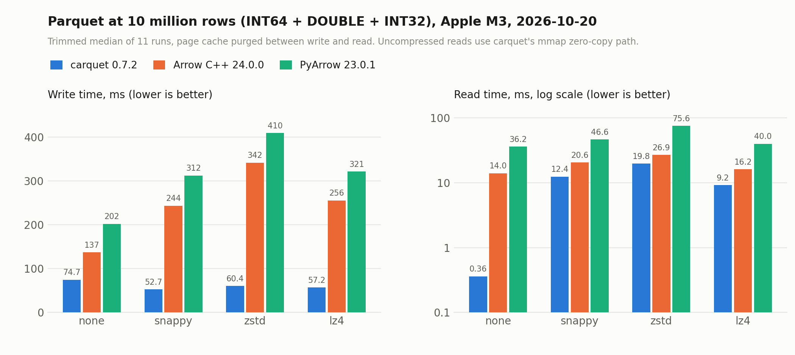

<h1 align="center">
  
</h1>

<p align="center">
  Une bibliothèque C pure et rapide pour lire et écrire des fichiers Apache Parquet.
</p>

<p align="center">
  <a href="https://github.com/Vitruves/carquet/actions/workflows/cpp.yml"></a>
  
  
  <a href="https://github.com/Vitruves/carquet/releases"></a>
  <a href="LICENSE"></a>
  <a href="https://github.com/Vitruves/carquet/stargazers"></a>
  <a href="https://github.com/Vitruves/carquet/graphs/traffic"></a>
  <br/>
  
  
</p>

<p align="center">
  <a href="#points-forts">Points forts</a> &nbsp;·&nbsp;
  <a href="#installation">Installation</a> &nbsp;·&nbsp;
  <a href="#api-c">API C</a> &nbsp;·&nbsp;
  <a href="#outil-en-ligne-de-commande">Outil CLI</a> &nbsp;·&nbsp;
  <a href="#benchmarks">Benchmarks</a> &nbsp;·&nbsp;
  <a href="#fonctionnalités-parquet-prises-en-charge">Fonctionnalités</a> &nbsp;·&nbsp;
  <a href="#interopérabilité">Interopérabilité</a> &nbsp;·&nbsp;
  <a href="#ready-for-ai-coding-agents">Agents IA</a> &nbsp;·&nbsp;
  <a href="docs/README.md">Manuel</a> &nbsp;·&nbsp;
  <a href="CHANGELOG.md">Changelog</a>
</p>

<p align="center">
  <a href="README.md">English</a> &nbsp;·&nbsp;
  <a href="README.zh-CN.md">简体中文</a> &nbsp;·&nbsp;
  <a href="README.ja.md">日本語</a> &nbsp;·&nbsp;
  <a href="README.ko.md">한국어</a> &nbsp;·&nbsp;
  <a href="README.de.md">Deutsch</a> &nbsp;·&nbsp;
  <b>Français</b> &nbsp;·&nbsp;
  <a href="README.pt-BR.md">Português (Brasil)</a>
</p>

<br/>

---

<!-- ────────────────────────────  POINTS FORTS  ──────────────────────────── -->

## Points forts

**Compacte et autonome**

- **C11 pur** avec quatre dépendances externes (zstd, zlib, lz4, brotli), toutes récupérées automatiquement par CMake si elles manquent ; Brotli peut être désactivé
- **Bibliothèque d’environ 500 Ko** (build Release strippé, codecs liés séparément) contre plus de 50 Mo pour Arrow
- **CLI intégrée** pour l’inspection de fichiers (`schema`, `info`, `head`, `tail`, `stat`, …) et la génération de code C (`codegen`)

**Rapide**

- **Lectures 39x plus rapides** qu’Arrow C++ sur données non compressées (mmap zéro-copie), **100x plus rapides** que PyArrow
- **Lectures compressées 1.3–2.1x plus rapides** qu’Arrow C++ sur le même fichier (benchmark de lecture croisée, Apple M3 ; 1.6–2.6x sur x86)
- **Écritures 1.8–5.7x plus rapides** qu’Arrow C++ sur Apple M3 (1.0–1.6x sur l’ancienne mesure x86)
- Lit 10 M de lignes non compressées en **0.36 ms** (mmap zéro-copie sur Apple M3)
- Optimisée SIMD (SSE4.2, AVX2, AVX-512, NEON, SVE) avec détection à l’exécution et repli scalaire

**Complète et compatible**

- Large couverture de Parquet : tous les types physiques et encodages, Snappy / GZIP / LZ4 / ZSTD / Brotli, schémas imbriqués, filtres de Bloom, index de pages ([matrice complète](#fonctionnalités-parquet-prises-en-charge))
- Compatible PyArrow, DuckDB et Spark sans configuration
- Passerelle [Arrow C Data Interface](docs/reading.md#export-to-arrow-c-data-interface) (`carquet_arrow_export_*` / `carquet_arrow_import_*` / `carquet_writer_write_arrow` / `carquet_reader_read_arrow`) pour un échange sans dépendance et quasi sans copie avec l’écosystème Arrow, avec **lecture/écriture imbriquée à profondeur arbitraire** (struct / list / map à n’importe quelle profondeur)

<a id="ready-for-ai-coding-agents"></a>

**Prêt pour les agents de codage IA**

- [`.agents/skills/carquet/`](.agents/skills/carquet/) est un [Agent Skill](https://agentskills.io) (Claude Code, Codex CLI) qui apprend à un agent à intégrer carquet dans votre projet : câblage du build, quelle API pour quelle tâche, recettes complètes, les règles de niveaux / bitmap de nuls / durée de vie, les correspondances de types et les pièges habituels. Copiez-le dans votre dépôt et l’agent l’utilise de lui-même :

  ```bash
  cp -r path/to/carquet/.agents/skills/carquet .claude/skills/   # Claude Code
  cp -r path/to/carquet/.agents/skills/carquet .agents/skills/   # Codex CLI
  ```

<br/>

### Trente secondes de carquet

```c
#include <carquet/carquet.h>

carquet_error_t err = CARQUET_ERROR_INIT;
carquet_schema_t* schema = carquet_schema_create(&err);
carquet_schema_add_column(schema, "id", CARQUET_PHYSICAL_INT64, NULL, CARQUET_REPETITION_REQUIRED, 0, 0);

carquet_writer_t* w = carquet_writer_create("ids.parquet", schema, NULL, &err);
int64_t ids[] = {1, 2, 3};
carquet_writer_write_batch(w, 0, ids, 3, NULL, NULL);
carquet_writer_close(w);

carquet_reader_t* r = carquet_reader_open("ids.parquet", NULL, &err);
printf("%lld rows\n", (long long)carquet_reader_num_rows(r));   /* 3 lignes */
carquet_reader_close(r);
carquet_schema_free(schema);
```

Les boucles complètes d’écriture et de lecture, avec lots et colonnes nullables, se trouvent dans [API C](#api-c).

<br/>

### Où se situe carquet

carquet est l’option compacte et embarquable : une bibliothèque C11 d’environ 500 Ko avec quatre dépendances récupérées automatiquement, qui se compile en moins d’une minute, là où Arrow C++ pèse plus de 50 Mo et une wheel PyArrow environ 100 Mo. Sur le benchmark à 10 M de lignes ci-dessous, elle écrit les fichiers compressés 1.8–5.7x plus vite qu’Arrow C++ et les lit 1.3–2.1x plus vite à partir du même fichier ; les données non compressées sont servies directement depuis le mmap en 0.36 ms. Arrow reste le bon choix lorsque vous avez besoin de son écosystème (noyaux de calcul, datasets, Flight, chiffrement) ; carquet s’adresse aux programmes C et C++, aux systèmes embarqués et aux runtimes de langages qui ont seulement besoin de lire et d’écrire du Parquet rapidement et correctement.

<br/>

---

<!-- ────────────────────────────  INSTALLATION  ──────────────────────────── -->

## Installation

Carquet se compile avec CMake (principal) ou [xmake](https://xmake.io), sous Linux, macOS et Windows.

### Prérequis

- Compilateur C11 (GCC 4.9+, Clang 3.4+, MSVC 2015+)
- CMake 3.16+ (ou [xmake](https://xmake.io), voir [Compiler avec xmake](#compiler-avec-xmake))
- zstd, zlib, lz4, brotli (récupérés automatiquement si absents ; Brotli optionnel, `-DCARQUET_ENABLE_BROTLI=OFF`)
- OpenMP (optionnel, pour la lecture et l’écriture parallèles des colonnes)

<br/>

### Démarrage rapide (make)

Le wrapper `make` pilote un build CMake optimisé et une installation dans `/usr/local` :

```bash
git clone https://github.com/Vitruves/carquet.git
cd carquet
make                              # build optimisé (lancez `make help` pour lister toutes les cibles)
sudo make install                 # installation dans /usr/local (remplacez par PREFIX=/opt/carquet)
```

<br/>

### Compilation et installation (CMake)

Invoquez CMake directement lorsque vous avez besoin d’options de build précises ou d’un préfixe personnalisé :

```bash
cmake -B build -DCMAKE_BUILD_TYPE=Release   # ajoutez des options, p. ex. -DCARQUET_BUILD_SHARED=ON
cmake --build build -j$(nproc)
sudo cmake --install build --prefix /usr/local
```

Les deux chemins installent :

- `libcarquet.a` (ou `.so` / `.dylib` avec `-DCARQUET_BUILD_SHARED=ON`)
- les en-têtes `include/carquet/`
- le binaire CLI `carquet`
- `carquet.pc` (pkg-config) et la configuration de paquet CMake pour `find_package(carquet)`

Après installation, liez avec `-lcarquet`, ou récupérez les drapeaux via `pkg-config --cflags --libs carquet`.

<br/>

### Python (pip)

La wheel `carquet` embarque la bibliothèque et l’expose via l’Arrow C Data Interface : les tables circulent vers et depuis PyArrow sans dupliquer la logique de décodage Parquet :

```bash
pip install carquet
```

```python
import carquet
table = carquet.read_table("data.parquet")                 # pyarrow.Table
carquet.write_table(table, "out.parquet", compression="zstd")
print(carquet.info("out.parquet").num_rows)
```

Le paquet se trouve dans [`python/`](python/) (scikit-build-core, ctypes, PyArrow optionnel à l’exécution) ; consultez son [README](python/README.md) pour l’API et la construction de la wheel.

<br/>

### Options de compilation

Passez-les à l’étape de configuration CMake (`-DOPTION=ON|OFF`) :

<div align="center">

| Option | Défaut | Description |
|--------|---------|-------------|
| `CARQUET_BUILD_DEV` | OFF | Tout compiler (tests, exemples, benchmarks, interop) |
| `CARQUET_BUILD_TESTS` | OFF | Compiler uniquement la suite de tests |
| `CARQUET_BUILD_CLI` | ON | Compiler l’outil CLI `carquet` |
| `CARQUET_BUILD_SHARED` | OFF | Compiler une bibliothèque partagée plutôt que statique |
| `CARQUET_NATIVE_ARCH` | OFF | `-march=native` pour des performances maximales (binaire lié à la machine hôte) |
| `CARQUET_ENABLE_SVE` | OFF | ARM SVE (expérimental) |
| `CARQUET_ENABLE_BROTLI` | ON | Codec BROTLI (libbrotli trouvée ou récupérée ; OFF supprime la dépendance) |

</div>

Toutes les extensions SIMD x86 (SSE, AVX, AVX2, AVX-512) et ARM NEON sont détectées automatiquement et activées par défaut.

<details>
<summary><b>Toutes les options de compilation</b></summary>

<br/>

<div align="center">

| Option | Défaut | Description |
|--------|---------|-------------|
| `CARQUET_BUILD_EXAMPLES` | OFF | Compiler les programmes d’exemple |
| `CARQUET_BUILD_BENCHMARKS` | OFF | Compiler les programmes de benchmark et de profilage |
| `CARQUET_BUILD_ARROW_CPP_BENCHMARK` | OFF | Benchmark comparatif Arrow C++ optionnel |
| `CARQUET_BUILD_INTEROP` | OFF | Compiler les tests d’interopérabilité |
| `CARQUET_BUILD_FUZZ` | OFF | Compiler les cibles de fuzzing |
| `CARQUET_BUILD_DOCS` | OFF | Ajouter une cible `docs` (nécessite Doxygen) |
| `CARQUET_BUNDLE_DEPS` | OFF | Toujours récupérer et lier statiquement zstd/zlib/lz4/brotli (artefacts de release portables) |
| `CARQUET_ZSTD_TARGET` / `CARQUET_ZLIB_TARGET` / `CARQUET_LZ4_TARGET` / `CARQUET_BROTLI_TARGET` | *(vide)* | Cible(s) CMake existante(s) à lier pour cette bibliothèque, au lieu de la rechercher ou de la récupérer |
| `CARQUET_ARROW_CPP_ROOT` | *(vide)* | Chemin vers une installation Arrow C++ personnalisée pour le benchmark comparatif |
| `CARQUET_ENABLE_SSE` | ON | Optimisations SSE (x86, détection automatique) |
| `CARQUET_ENABLE_AVX` | ON | Optimisations AVX (x86, détection automatique) |
| `CARQUET_ENABLE_AVX2` | ON | Optimisations AVX2 (x86, détection automatique) |
| `CARQUET_ENABLE_AVX512` | ON | Optimisations AVX-512 (x86, détection automatique) |
| `CARQUET_ENABLE_NEON` | ON | Optimisations NEON (ARM, détection automatique) |

</div>

</details>

<details>
<summary><b>Utiliser vos propres zstd / zlib / lz4</b> (intégrer carquet dans un projet CMake plus large)</summary>

<br/>

Lorsque carquet est intégré via `add_subdirectory()` ou `FetchContent`, il résout chaque bibliothèque de compression dans cet ordre :

1. La cible nommée par `CARQUET_ZSTD_TARGET`, `CARQUET_ZLIB_TARGET` ou `CARQUET_LZ4_TARGET`, si elle est définie.
2. Une copie système (ignorée lorsque `CARQUET_BUNDLE_DEPS` est ON).
3. Une copie qu’il récupère et compile lui-même. Si votre projet compile déjà la bibliothèque sous son nom de cible habituel (`libzstd_static`, `zlibstatic`, `lz4_static`), carquet réutilise cette cible au lieu d’en récupérer une seconde copie.

Un projet qui embarque ces bibliothèques et n’a pas de copie système n’a donc besoin d’aucune configuration. Pour choisir explicitement, par exemple votre propre zlib plutôt que celle du système, ou votre build partagé plutôt que le statique, nommez la cible :

```cmake
set(CARQUET_ZLIB_TARGET zlibstatic)
add_subdirectory(carquet)
```

La même chose se fait sans rien éditer : `cmake -DCARQUET_ZLIB_TARGET=zlib ...`. Les trois variables sont indépendantes. Une cible nommée est liée telle quelle, sans recherche ni récupération, et un nom qui n’est pas une cible est une erreur de configuration et non un repli silencieux. La cible peut être importée ou compilée dans l’arborescence, statique ou partagée, et doit exposer ses répertoires d’en-têtes comme exigence d’utilisation.

</details>

<details>
<summary><b>Build de développement</b> (tests, exemples, benchmarks)</summary>

<br/>

```bash
cmake -B build -DCMAKE_BUILD_TYPE=Debug -DCARQUET_BUILD_DEV=ON
cmake --build build -j$(nproc)
cd build && ctest --output-on-failure
```

[CONTRIBUTING.md](CONTRIBUTING.md) décrit la barrière par pull request (tests, sanitizers, fuzzing, interop, benchmarks).

</details>

<details>
<summary><b>Documentation de l’API</b> (Doxygen)</summary>

<br/>

Les en-têtes publics sont annotés de commentaires [Doxygen](https://www.doxygen.nl). Générer la référence HTML nécessite `doxygen` installé (plus `graphviz`, optionnel, pour les diagrammes d’inclusion/dépendance) ; aucun des deux n’est requis pour un build normal.

```bash
# CMake — activez la cible à la configuration, puis compilez-la
cmake -B build -DCARQUET_BUILD_DOCS=ON
cmake --build build --target docs

# xmake — tâche autonome, aucun drapeau de configuration nécessaire
xmake docs
```

Les deux écrivent dans `build/docs/html/index.html`. Si Doxygen n’est pas installé, la cible/tâche se contente de le signaler et ne fait rien.

</details>

<details>
<summary><b>Agents de codage IA</b> (Claude Code, Codex : un skill prêt à l’emploi)</summary>

<br/>

[`.agents/skills/carquet/`](.agents/skills/carquet/) est un [Agent Skill](https://agentskills.io) qui apprend à un agent de codage à intégrer carquet dans votre projet : câblage du build (CMake, FetchContent, pkg-config, xmake), quelle API utiliser pour quoi, recettes complètes, les règles de niveaux / bitmap de nuls / durée de vie, les correspondances de types et les pièges habituels avec leurs correctifs. Copiez-le ou liez-le dans votre propre dépôt et l’agent le détecte automatiquement :

```bash
# Claude Code
mkdir -p .claude/skills && cp -r path/to/carquet/.agents/skills/carquet .claude/skills/
# Codex CLI
mkdir -p .agents/skills && cp -r path/to/carquet/.agents/skills/carquet .agents/skills/
# carquet embarqué (vendored) : un lien symbolique le garde synchronisé
ln -s ../../third_party/carquet/.agents/skills/carquet .claude/skills/carquet
```

Les mêmes fichiers fonctionnent aussi comme skill personnel (`~/.claude/skills/`, `~/.codex/skills/`).

</details>

<br/>

### Compiler avec xmake

Un build [xmake](https://xmake.io) (`xmake.lua`) est fourni comme alternative à CMake, avec les mêmes options et valeurs par défaut ; zstd/zlib/lz4 sont liés statiquement, les binaires sont donc autonomes.

```bash
xmake                    # compile la bibliothèque statique + la CLI `carquet` (release)
xmake f --dev=y && xmake # ajoute tests, exemples, benchmarks, interop
xmake test               # lance la suite de tests
```

<details>
<summary><b>Options de configuration</b> (<code>xmake f --option=y|n</code>)</summary>

<br/>

Les options reflètent celles de CMake, sans le préfixe `CARQUET_` et en minuscules :

<div align="center">

| Option xmake | Défaut | Description |
|--------------|---------|-------------|
| `--dev` | n | Compiler tests, exemples, benchmarks et interop |
| `--tests` / `--examples` / `--benchmarks` / `--interop` | n | Compiler un groupe individuellement |
| `--cli` | y | Compiler l’outil CLI `carquet` |
| `--shared` | n | Compiler une bibliothèque partagée plutôt que statique |
| `--openmp` | y | Lecture parallèle des colonnes via OpenMP (désactivé automatiquement si indisponible) |
| `--native_arch` | n | `-march=native` pour des performances maximales (binaire lié à la machine hôte) |
| `--sse` / `--avx` / `--avx2` / `--avx512` / `--neon` | y | Jeux d’instructions SIMD (détection automatique) |
| `--sve` | n | ARM SVE (expérimental) |
| `--brotli` | y | Codec BROTLI (libbrotli depuis le dépôt xmake) |
| `--fuzz` | n | Compiler les cibles de fuzzing (utilisez `--toolchain=clang`) |

</div>

```bash
xmake f -m release --shared=y            # bibliothèque partagée
xmake f --dev=y --avx512=n && xmake      # build de développement, AVX-512 désactivé
```

</details>

<br/>

---

<!-- ────────────────────────────  API C  ──────────────────────────── -->

## API C

Un exemple d’écriture et un exemple de lecture ci-dessous ; le [manuel dans `docs/`](docs/README.md) couvre tout le reste.

### Écrire un fichier Parquet

```c
#include <carquet/carquet.h>

int main(void) {
    carquet_error_t err = CARQUET_ERROR_INIT;

    // Définir le schéma
    carquet_schema_t* schema = carquet_schema_create(&err);
    carquet_schema_add_column(schema, "id",    CARQUET_PHYSICAL_INT64,  NULL, CARQUET_REPETITION_REQUIRED, 0, 0);
    carquet_schema_add_column(schema, "value", CARQUET_PHYSICAL_DOUBLE, NULL, CARQUET_REPETITION_REQUIRED, 0, 0);

    // Configurer l'écrivain
    carquet_writer_options_t opts;
    carquet_writer_options_init(&opts);
    opts.compression = CARQUET_COMPRESSION_ZSTD;

    // Écrire
    carquet_writer_t* w = carquet_writer_create("output.parquet", schema, &opts, &err);

    int64_t ids[]    = {1, 2, 3, 4, 5};
    double values[]  = {1.1, 2.2, 3.3, 4.4, 5.5};
    carquet_writer_write_batch(w, 0, ids, 5, NULL, NULL);
    carquet_writer_write_batch(w, 1, values, 5, NULL, NULL);
    carquet_writer_close(w);

    carquet_schema_free(schema);
    return 0;
}
```

<br/>

### Lire un fichier Parquet

```c
#include <carquet/carquet.h>
#include <stdio.h>

int main(void) {
    carquet_error_t err = CARQUET_ERROR_INIT;

    // Ouvrir avec mmap pour les meilleures performances de lecture
    carquet_reader_options_t opts;
    carquet_reader_options_init(&opts);
    opts.use_mmap = true;

    carquet_reader_t* r = carquet_reader_open("output.parquet", &opts, &err);
    if (!r) { printf("Error: %s\n", err.message); return 1; }

    printf("Rows: %lld, Columns: %d\n",
           (long long)carquet_reader_num_rows(r),
           carquet_reader_num_columns(r));

    // Lecteur par lots pour une itération efficace
    carquet_batch_reader_config_t cfg;
    carquet_batch_reader_config_init(&cfg);
    cfg.batch_size = 65536;

    carquet_batch_reader_t* br = carquet_batch_reader_create(r, &cfg, &err);
    carquet_row_batch_t* batch = NULL;

    while (carquet_batch_reader_next(br, &batch) == CARQUET_OK && batch) {
        const void* data;
        const uint8_t* nulls;
        int64_t n;
        carquet_row_batch_column(batch, 0, &data, &nulls, &n);
        const int64_t* ids = (const int64_t*)data;
        // traiter ids[0..n-1] ...
        carquet_row_batch_free(batch);
        batch = NULL;
    }

    carquet_batch_reader_free(br);
    carquet_reader_close(r);
    return 0;
}
```

<br/>

### Autres recettes

Tout ce qui dépasse la lecture/écriture à plat se trouve dans le manuel ; chaque page renvoie vers un exemple exécutable :

<div align="center">

| Vous voulez… | Voir |
|---|---|
| Colonnes nullables, row groups, sortie en mémoire tampon | [`docs/writing.md`](docs/writing.md) |
| Listes, maps, groupes, niveaux de définition/répétition | [`docs/nested-data.md`](docs/nested-data.md) |
| Projection de colonnes, statistiques, inspection des métadonnées | [`docs/reading.md`](docs/reading.md) |
| Predicate pushdown, filtrage au niveau des pages | [`docs/reading.md`](docs/reading.md) |
| Ajouter des row groups à un fichier existant | [`docs/writing.md`](docs/writing.md#append-to-an-existing-file) |
| Compression, codecs personnalisés, réglage de l’écrivain | [`docs/writing.md`](docs/writing.md), [`docs/performance.md`](docs/performance.md) |
| mmap, zéro-copie, pré-chargement, regroupement des E/S | [`docs/performance.md`](docs/performance.md) |
| Codes d’erreur et indications de récupération | [`docs/error-handling.md`](docs/error-handling.md) |

</div>

<br/>

### Référence de l’API

L’API complète se trouve dans [`include/carquet/carquet.h`](include/carquet/carquet.h). Types principaux :

<div align="center">

| Type | Rôle |
|------|---------|
| `carquet_reader_t` | Lecteur de fichier (ouverture depuis un chemin, un `FILE*` ou un tampon mémoire) |
| `carquet_writer_t` | Écrivain de fichier |
| `carquet_batch_reader_t` | Itération par lots de haut niveau |
| `carquet_schema_t` | Définition et introspection du schéma |
| `carquet_error_t` | Informations d’erreur détaillées (code, message, emplacement dans les sources, indication de récupération) |

</div>

Le [manuel](docs/README.md) explique quelle surface utiliser et quand ; l’organisation des sources et l’architecture sont documentées dans [CONTRIBUTING.md](CONTRIBUTING.md). Une référence HTML navigable peut être générée depuis les en-têtes avec Doxygen, voir le volet *Documentation de l’API* sous [Options de compilation](#options-de-compilation).

<details>
<summary><b>Application d’exemple : MetricStore</b> (<code>mocklib/</code>)</summary>

<br/>

[`mocklib/`](mocklib/) est **MetricStore**, une application d’exemple complète et autonome construite sur carquet, utile à la fois comme référence d’usage réel et comme test d’intégration de bout en bout de l’API publique.

Elle modélise un magasin de télémétrie en séries temporelles (ingestion d’événements, puis introspection et requêtes) et exerce ce faisant **117 des 143 fonctions publiques de carquet (~82 %)** :

- **Côté écriture** : construction de schéma avec types logiques, réglage par colonne de l’encodage / de la compression / des filtres de Bloom, index de pages et statistiques
- **Côté lecture** : projection de colonnes, predicate pushdown, filtrage au niveau des pages, test d’appartenance Bloom, la passerelle Arrow C Data Interface, reconstruction de `LIST` imbriquées, E/S en mémoire tampon et en ajout, introspection des métadonnées

Elle lie carquet comme le ferait n’importe quel projet en aval (`find_package(carquet)` / `add_subdirectory`), fournit un test aller-retour auto-vérifié, et son binaire `write_sample` produit un fichier pour inspection externe. Voir [`mocklib/README.md`](mocklib/README.md).

</details>

<br/>

---

<!-- ────────────────────────────  OUTIL CLI  ──────────────────────────── -->

## Outil en ligne de commande

Carquet est livré avec un outil en ligne de commande pour inspecter les fichiers Parquet et générer du code de lecture C. Il est compilé et installé par défaut avec la bibliothèque.

```
Commands:
  schema     Print file schema
  info       Print detailed file metadata
  head       Print first N rows
  tail       Print last N rows
  cat        Print rows with slicing/column/row filtering
  count      Print total row count
  columns    List column names (one per line)
  stat       Print column statistics
  validate   Verify file integrity
  sample     Print N random rows
  export     Write rows to stdout as CSV
  codegen    Generate C reader code
```

Usage typique :

```bash
carquet schema data.parquet
carquet head -n 20 data.parquet
carquet stat data.parquet
carquet validate data.parquet
```

<br/>

### Filtrage des lignes

`cat`, `count`, `head`, `tail`, `sample` et `export` acceptent `-p / --filter EXPR` pour pousser un prédicat de ligne jusqu’au niveau des pages : seules les pages dont les min/max de l’index de colonnes peuvent satisfaire le prédicat sont décompressées.

```bash
carquet cat -p "price > 100 AND status = 'active'" data.parquet
carquet count --filter "id >= 1000" data.parquet
carquet export --filter "ts IS NOT NULL" -c id,ts data.parquet
```

La grammaire est `column OP value [AND column OP value]...` avec `OP` ∈ {`=`, `==`, `!=`, `<>`, `<`, `<=`, `>`, `>=`}, plus `column IS NULL` / `column IS NOT NULL`.

> Le filtrage nécessite que le fichier possède un index de pages (`write_page_index = true`).

<br/>

### Génération de code

Générez un lecteur C complet et compilable à partir du schéma de n’importe quel fichier Parquet :

```bash
carquet codegen -f data.parquet -o reader.c
# Generated: reader.c
# Compile:   clang -o reader reader.c -I.../include -L.../build -lcarquet ...

./reader                    # lit data.parquet (embarqué par défaut)
./reader other.parquet      # remplace par un autre fichier
```

<details>
<summary><b>Options de codegen</b></summary>

<br/>

<div align="center">

| Drapeau | Description |
|------|-------------|
| `-f`, `--file FILE` | Fichier Parquet dont inspecter le schéma |
| `-o`, `--output FILE` | Fichier source de sortie (défaut : stdout) |
| `--mmap` | Utiliser des E/S en mémoire mappée dans le code généré |
| `--skeleton` | Générer un `process_batch` vide pour votre propre logique |
| `-c`, `--columns COLS` | Filtre de colonnes séparées par des virgules |
| `-b`, `--batch-size N` | Taille des lots (défaut : 1024) |

</div>

</details>

<br/>

---

<!-- ────────────────────────────  BENCHMARKS  ──────────────────────────── -->

## Benchmarks

<p align="center">
  <picture>
    <source media="(prefers-color-scheme: dark)" srcset="res/img/bench_10m_m3_dark.png">
    
  </picture>
</p>

À 10 M de lignes (la taille la plus représentative) ; ratio plus élevé = Carquet plus rapide.

ARM (Apple M3) : Carquet 0.7.2 vs Arrow C++ 24.0.0, mesuré le 2026-10-20. x86 (Xeon D-1531) : Carquet 0.4.4 vs Arrow C++ 23.0.1 ; cette mesure est antérieure au parallélisme d’écriture de 0.7.1 et n’a pas été refaite depuis.

<div align="center">

| | x86 (Xeon D-1531) | | ARM (Apple M3) | |
|---|---|---|---|---|
| **Codec** | **Écriture** | **Lecture** | **Écriture** | **Lecture** |
| snappy | **1.55x** | **1.25x** | **4.63x** | **1.66x** |
| zstd | **1.31x** | **1.04x** | **5.66x** | **1.36x** |
| lz4 | **1.02x** | 0.83x | **4.47x** | **1.76x** |
| none | **1.13x** | **40.6x**\* | **1.83x** | **38.9x**\* |

</div>

\* Les lectures non compressées utilisent le chemin mmap zéro-copie, voir la note de méthodologie.

Les lectures compressées impliquent la décompression et le décodage complets de chaque valeur, sans raccourci, et les deux bibliothèques utilisent les mêmes bibliothèques partagées système lz4/zstd : la vitesse brute du codec est donc identique. La comparaison la plus pertinente est le tableau de **lecture croisée du même fichier** (dans les résultats complets), où les deux bibliothèques lisent exactement le même fichier Parquet : Carquet lit les données compressées **1.3–2.1x plus vite** qu’Arrow C++ sur ce test à armes égales (mesure x86 : 1.6–2.6x).

<details>
<summary><b>Méthodologie des benchmarks</b></summary>

<br/>

Tous les benchmarks utilisent des données identiques (PRNG LCG déterministe), des réglages Parquet identiques (pas de dictionnaire, BYTE_STREAM_SPLIT pour les flottants, sommes de contrôle de pages, lectures mmap), la médiane tronquée de 11 à 51 itérations, avec purge du cache de pages de l’OS entre les phases d’écriture et de lecture et un temps de refroidissement entre les configurations. Schéma : 3 colonnes (INT64, DOUBLE, INT32). Comparé au lecteur Parquet bas niveau d’Arrow C++ (sans matérialisation en Arrow Table) et à PyArrow.

Le benchmark de **lecture croisée du même fichier** est la comparaison la plus équitable : les deux bibliothèques lisent exactement le même fichier Parquet (écrit par l’une, lu par les deux). Cela élimine les différences de taille de pages, de choix d’encodage et de disposition des row groups.

Les **lectures non compressées** marquées d’un \* utilisent le **chemin mmap zéro-copie** de Carquet : pour les colonnes requises, de taille fixe, non compressées et encodées en PLAIN, le lecteur par lots renvoie des pointeurs directement dans le fichier mappé en mémoire, sans memcpy. Arrow matérialise toujours dans ses propres tampons. **Les chiffres de lecture compressée sont la mesure la plus représentative du débit de lecture de bout en bout.**

</details>

<details>
<summary><b>Résultats x86 complets</b> (Intel Xeon D-1531, Linux)</summary>

<br/>

*12 threads @ 2.2 GHz, 32 Go de RAM, Ubuntu 24.04, ZSTD niveau 1*

#### 10 M de lignes vs Arrow C++

<div align="center">

| Codec | Écriture Carquet | Écriture Arrow C++ | Ratio écr. | Lecture Carquet | Lecture Arrow C++ | Ratio lect. | Taille |
|-------|--------------|-----------------|---------|-------------|----------------|---------|------|
| none | **1557ms** | 1766ms | **1.13x** | **1.25ms** | 50.8ms | **40.6x**\* | 190.7MB |
| snappy | **1002ms** | 1549ms | **1.55x** | **78ms** | 97.8ms | **1.25x** | 125.1MB |
| zstd | **1311ms** | 1714ms | **1.31x** | **76.8ms** | 80.2ms | **1.04x** | 95.3MB |
| lz4 | **1521ms** | 1554ms | **1.02x** | 59.1ms | **49.0ms** | 0.83x | 122.9MB |

</div>

<br/>

#### 1 M de lignes vs Arrow C++

<div align="center">

| Codec | Écriture Carquet | Écriture Arrow C++ | Ratio écr. | Lecture Carquet | Lecture Arrow C++ | Ratio lect. |
|-------|--------------|-----------------|---------|-------------|----------------|---------|
| none | **180ms** | 196ms | **1.09x** | **0.22ms** | 6.2ms | **28x**\* |
| snappy | **141ms** | 148ms | **1.05x** | **8.1ms** | 11.6ms | **1.44x** |
| zstd | **131ms** | 185ms | **1.41x** | 10.3ms | **9.1ms** | 0.88x |
| lz4 | **143ms** | 149ms | **1.04x** | 8.5ms | **6.1ms** | 0.72x |

</div>

<br/>

#### 100 K lignes vs Arrow C++

<div align="center">

| Codec | Écriture Carquet | Écriture Arrow C++ | Ratio écr. | Lecture Carquet | Lecture Arrow C++ | Ratio lect. |
|-------|--------------|-----------------|---------|-------------|----------------|---------|
| none | **14.1ms** | 18.4ms | **1.30x** | **0.11ms** | 2.18ms | **19.8x**\* |
| snappy | **10.1ms** | 10.6ms | **1.05x** | **1.27ms** | 5.97ms | **4.70x** |
| zstd | **8.7ms** | 14.1ms | **1.62x** | **1.58ms** | 3.88ms | **2.46x** |
| lz4 | **9.6ms** | 11.0ms | **1.14x** | **0.77ms** | 2.78ms | **3.61x** |

</div>

<br/>

#### Lecture croisée du même fichier (10 M de lignes)

Les deux bibliothèques lisent le **même** fichier Parquet, la comparaison la plus équitable qui soit.

<div align="center">

| Codec | Écrivain | Lecture Carquet | Lecture Arrow C++ | Ratio |
|-------|--------|-------------|----------------|-------|
| none | Carquet | **0.99ms** | 73.6ms | **74x**\* |
| none | Arrow | **7.6ms** | 51.2ms | **6.8x**\* |
| snappy | Carquet | **41.0ms** | 107ms | **2.61x** |
| snappy | Arrow | **43.4ms** | 101ms | **2.33x** |
| zstd | Carquet | **46.1ms** | 88.4ms | **1.92x** |
| zstd | Arrow | **49.1ms** | 79.5ms | **1.62x** |
| lz4 | Carquet | **34.8ms** | 74.8ms | **2.15x** |
| lz4 | Arrow | **27.4ms** | 52.0ms | **1.90x** |

</div>

<br/>

#### 10 M de lignes vs PyArrow

<div align="center">

| Codec | Écriture Carquet | Écriture PyArrow | Ratio écr. | Lecture Carquet | Lecture PyArrow | Ratio lect. |
|-------|--------------|---------------|---------|-------------|--------------|---------|
| none | **1557ms** | 1806ms | **1.16x** | **1.25ms** | 213ms | **170x**\* |
| snappy | **1002ms** | 1649ms | **1.65x** | **78ms** | 384ms | **4.91x** |
| zstd | **1311ms** | 1796ms | **1.37x** | **76.8ms** | 369ms | **4.81x** |
| lz4 | **1521ms** | 1676ms | **1.10x** | **59.1ms** | 281ms | **4.76x** |

</div>

\* Chemin mmap zéro-copie

</details>

<details>
<summary><b>Résultats ARM complets</b> (Apple M3, macOS)</summary>

<br/>

*Carquet 0.7.2, MacBook Air M3, 16 Go de RAM, macOS 26.5, Arrow C++ 24.0.0, PyArrow 23.0.1, ZSTD niveau 1. Les tableaux à 10 M de lignes ont été mesurés le 2026-10-20 ; les tableaux à 1 M et 100 K sont ceux de la mesure 0.7.1 du 2026-10-08 (non refaits).*

#### 10 M de lignes vs Arrow C++

<div align="center">

| Codec | Écriture Carquet | Écriture Arrow C++ | Ratio écr. | Lecture Carquet | Lecture Arrow C++ | Ratio lect. | Taille |
|-------|--------------|-----------------|---------|-------------|----------------|---------|------|
| none | **74.7ms** | 137ms | **1.83x** | **0.36ms** | 14.0ms | **38.9x**\* | 200.0MB |
| snappy | **52.7ms** | 244ms | **4.63x** | **12.4ms** | 20.6ms | **1.66x** | 131.2MB |
| zstd | **60.4ms** | 342ms | **5.66x** | **19.8ms** | 26.9ms | **1.36x** | 99.9MB |
| lz4 | **57.2ms** | 256ms | **4.47x** | **9.22ms** | 16.2ms | **1.76x** | 128.9MB |

</div>

<br/>

#### 1 M de lignes vs Arrow C++

<div align="center">

| Codec | Écriture Carquet | Écriture Arrow C++ | Ratio écr. | Lecture Carquet | Lecture Arrow C++ | Ratio lect. |
|-------|--------------|-----------------|---------|-------------|----------------|---------|
| none | **6.48ms** | 14.82ms | **2.29x** | **0.06ms** | 1.63ms | **27.2x**\* |
| snappy | **14.28ms** | 26.44ms | **1.85x** | **2.14ms** | 2.85ms | **1.33x** |
| zstd | **14.76ms** | 36.17ms | **2.45x** | **2.70ms** | 3.46ms | **1.28x** |
| lz4 | **12.30ms** | 26.10ms | **2.12x** | **1.04ms** | 1.87ms | **1.80x** |

</div>

<br/>

#### 100 K lignes vs Arrow C++

<div align="center">

| Codec | Écriture Carquet | Écriture Arrow C++ | Ratio écr. | Lecture Carquet | Lecture Arrow C++ | Ratio lect. |
|-------|--------------|-----------------|---------|-------------|----------------|---------|
| none | **1.07ms** | 1.79ms | **1.67x** | **0.02ms** | 0.25ms | **12.5x**\* |
| snappy | **1.60ms** | 2.63ms | **1.64x** | **0.34ms** | 0.91ms | **2.68x** |
| zstd | **1.73ms** | 3.63ms | **2.10x** | **0.63ms** | 1.26ms | **2.00x** |
| lz4 | **1.52ms** | 2.62ms | **1.72x** | **0.25ms** | 0.55ms | **2.20x** |

</div>

<br/>

#### Lecture croisée du même fichier (10 M de lignes)

Les deux bibliothèques lisent le **même** fichier Parquet, la comparaison la plus équitable qui soit.

<div align="center">

| Codec | Écrivain | Lecture Carquet | Lecture Arrow C++ | Ratio |
|-------|--------|-------------|----------------|-------|
| none | Carquet | **0.31ms** | 15.7ms | **50.7x**\* |
| none | Arrow | **0.93ms** | 13.7ms | **14.8x**\* |
| snappy | Carquet | **12.6ms** | 22.0ms | **1.74x** |
| snappy | Arrow | **14.3ms** | 21.8ms | **1.52x** |
| zstd | Carquet | **21.3ms** | 28.0ms | **1.31x** |
| zstd | Arrow | **21.1ms** | 30.4ms | **1.44x** |
| lz4 | Carquet | **8.48ms** | 17.7ms | **2.09x** |
| lz4 | Arrow | **7.90ms** | 16.3ms | **2.06x** |

</div>

<br/>

#### 10 M de lignes vs PyArrow

<div align="center">

| Codec | Écriture Carquet | Écriture PyArrow | Ratio écr. | Lecture Carquet | Lecture PyArrow | Ratio lect. |
|-------|--------------|---------------|---------|-------------|--------------|---------|
| none | **74.7ms** | 202ms | **2.71x** | **0.36ms** | 36.2ms | **100.5x**\* |
| snappy | **52.7ms** | 312ms | **5.93x** | **12.4ms** | 46.6ms | **3.75x** |
| zstd | **60.4ms** | 410ms | **6.78x** | **19.8ms** | 75.6ms | **3.82x** |
| lz4 | **57.2ms** | 321ms | **5.62x** | **9.22ms** | 40.0ms | **4.33x** |

</div>

<br/>

#### 1 M de lignes vs PyArrow

<div align="center">

| Codec | Écriture Carquet | Écriture PyArrow | Ratio écr. | Lecture Carquet | Lecture PyArrow | Ratio lect. |
|-------|--------------|-----------------|---------|-------------|--------------|---------|
| none | **6.48ms** | 20.17ms | **3.11x** | **0.06ms** | 2.79ms | **46.5x**\* |
| snappy | **14.28ms** | 31.54ms | **2.21x** | **2.14ms** | 4.01ms | **1.87x** |
| zstd | **14.76ms** | 42.51ms | **2.88x** | **2.70ms** | 4.42ms | **1.64x** |
| lz4 | **12.30ms** | 32.03ms | **2.60x** | **1.04ms** | 3.22ms | **3.10x** |

</div>

<br/>

#### 100 K lignes vs PyArrow

<div align="center">

| Codec | Écriture Carquet | Écriture PyArrow | Ratio écr. | Lecture Carquet | Lecture PyArrow | Ratio lect. |
|-------|--------------|---------------|---------|-------------|--------------|---------|
| none | **1.07ms** | 2.12ms | **1.98x** | **0.02ms** | 0.24ms | **12.0x**\* |
| snappy | **1.60ms** | 3.17ms | **1.98x** | **0.34ms** | 0.60ms | **1.76x** |
| zstd | **1.73ms** | 4.16ms | **2.40x** | **0.63ms** | 0.81ms | **1.29x** |
| lz4 | **1.52ms** | 3.21ms | **2.11x** | **0.25ms** | 0.42ms | **1.68x** |

</div>

\* Chemin mmap zéro-copie

</details>

<details>
<summary><b>Lancer les benchmarks vous-même</b></summary>

<br/>

```bash
# Compiler avec les optimisations maximales
cmake -B build -DCMAKE_BUILD_TYPE=Release -DCARQUET_NATIVE_ARCH=ON -DCARQUET_BUILD_DEV=ON
cmake --build build -j$(nproc)

cd build
./benchmark_carquet                     # Carquet seul
python3 ../benchmark/run_benchmark.py   # Comparaison complète (+ PyArrow, + Arrow C++)

# Ignorer les configurations à 100M lignes (xlarge) : elles écrivent ~2 Go de fichiers par codec
# et peuvent prendre plus de 30 minutes selon le matériel
python3 ../benchmark/run_benchmark.py --skip-xlarge

# Changer le niveau ZSTD (défaut : 1)
CARQUET_BENCH_ZSTD_LEVEL=3 python3 ../benchmark/run_benchmark.py
```

Pour inclure la comparaison Arrow C++, activez sa cible à la configuration :

```bash
cmake -B build -DCMAKE_BUILD_TYPE=Release -DCARQUET_NATIVE_ARCH=ON \
  -DCARQUET_BUILD_BENCHMARKS=ON \
  -DCARQUET_BUILD_ARROW_CPP_BENCHMARK=ON
cmake --build build -j$(nproc)

# Ou pointer vers une installation Arrow personnalisée
cmake -B build ... -DCARQUET_ARROW_CPP_ROOT=/path/to/arrow-prefix
```

Le benchmark Arrow C++ utilise l’API bas niveau `parquet::ParquetFileReader` (sans le surcoût de matérialisation en Arrow Table) avec des lecteurs de row groups parallèles. Le mode **lecture croisée du même fichier** fait lire aux deux bibliothèques exactement le même fichier Parquet, ce qui élimine les différences de taille de pages, d’encodage et de disposition des row groups. Les deux benchmarks utilisent des données identiques, le même dimensionnement des row groups, pas de dictionnaire, des sommes de contrôle de pages, des lectures mmap et BYTE_STREAM_SPLIT pour les flottants.

</details>

<br/>

---

<!-- ────────────────────────────  FONCTIONNALITÉS  ──────────────────────────── -->

## Fonctionnalités Parquet prises en charge

Ce que la bibliothèque implémente aujourd’hui, par domaine.

### Format

<div align="center">

| Fonctionnalité | État |
|---------|--------|
| Types physiques | ✓  Les 8 (de BOOLEAN à FIXED_LEN_BYTE_ARRAY) |
| Types logiques | ✓  STRING, DATE, TIME, TIMESTAMP, DECIMAL, UUID, JSON, INTERVAL, FLOAT16, VARIANT, GEOMETRY, GEOGRAPHY |
| Encodages | ✓  PLAIN, RLE, DICTIONARY, DELTA_BINARY_PACKED, DELTA_LENGTH_BYTE_ARRAY, DELTA_BYTE_ARRAY, BYTE_STREAM_SPLIT (lecture + écriture) |
| Versions de Data Page | ✓  V1 (défaut) et V2 (lecture + écriture) |
| Compression | ✓  UNCOMPRESSED, SNAPPY, GZIP, LZ4 (tramage Hadoop, codec 5), LZ4_RAW (codec 7), ZSTD, BROTLI (`CARQUET_ENABLE_BROTLI`, ON par défaut) ; LZO via `carquet_register_codec()` |
| Schémas imbriqués | ✓  Groupes, listes, maps avec niveaux de définition/répétition ; découpage automatique des LIST/MAP à un niveau en écriture (`carquet_writer_write_list_column`) et reconstruction des List en lecture ; émission d’`ARROW:schema` imbriqué |
| Chiffrement | ✗ Non pris en charge ; un fichier à pied de page chiffré (`PARE`) est signalé comme `CARQUET_ERROR_NOT_IMPLEMENTED` avec un message explicite |

</div>

<details>
<summary><b>Indexation &amp; élagage</b></summary>

<br/>

<div align="center">

| Fonctionnalité | État |
|---------|--------|
| Filtres de Bloom | ✓  Lecture, écriture et interrogation (`carquet_bloom_filter_check_*`) ; consultés automatiquement pour l’élagage des row groups |
| Index de pages | ✓  Index de colonnes + index d’offsets (lecture + écriture + accès aux statistiques par page) |
| Statistiques | ✓  Min/max/nombre de nuls par column chunk ; `distinct_count` exact pour les colonnes à dictionnaire ; SizeStatistics Parquet 2.9 (octets de byte-array non encodés + histogrammes de niveaux) |
| Predicate pushdown | ✓  Élagage automatique des row groups via statistiques + filtres de Bloom (aucun callback nécessaire) ; filtrage au niveau des pages via l’index de colonnes (`carquet_batch_reader_set_page_filter`) |
| Statistiques géospatiales | ✓  Boîte englobante et types de géométrie par colonne pour GEOMETRY/GEOGRAPHY (`carquet_reader_geospatial_statistics`) |
| Projection de colonnes | ✓  Lire uniquement les colonnes sélectionnées |
| Fenêtre de lignes | ✓  Lire une tranche `[offset, limit)` de lignes en sautant des pages entières (`carquet_batch_reader_set_row_range`) |

</div>

</details>

<details>
<summary><b>E/S &amp; extensibilité</b></summary>

<br/>

<div align="center">

| Fonctionnalité | État |
|---------|--------|
| Ajout | ✓  Ajouter des row groups à un fichier existant (`carquet_writer_open_append`) |
| Codecs personnalisés | ✓  Enregistrer une implémentation compress/decompress personnalisée par emplacement de codec (`carquet_register_codec`) |
| Métadonnées clé-valeur | ✓  Lire et écrire des métadonnées arbitraires dans le pied de page |
| Métadonnées par champ | ✓  `Field.custom_metadata` Arrow (libellés/descriptions de variables) via `ARROW:schema` (lecture + écriture) |
| Options par colonne | ✓  Encodage, compression, statistiques et filtre de Bloom par colonne |
| Écrivain en mémoire | ✓  Écrire du Parquet dans un tampon en mémoire |
| CRC32 | ✓  Vérification au niveau des pages (accélérée matériellement sur ARM) |
| E/S en mémoire mappée | ✓  Lectures zéro-copie pour les données PLAIN non compressées |
| Lectures préservant le dictionnaire | ✓  Renvoyer les indices RLE + le dictionnaire au lieu des valeurs matérialisées (`preserve_dictionaries`, `carquet_row_batch_column_dictionary`) |
| Regroupement des E/S | ✓  Pré-chargement des lectures multi-colonnes en une seule E/S |
| Pied de page spéculatif | ✓  Ouverture de fichier en une seule E/S pour la plupart des fichiers |
| Lectures parallèles OpenMP | ✓  Lorsque disponible |
| Écritures parallèles | ✓  Encodage/compression parallèles au niveau des pages entre colonnes (OpenMP) + E/S des row groups en arrière-plan (`async_io`) |

</div>

</details>

<br/>

---

<!-- ────────────────────────────  INTEROPÉRABILITÉ  ──────────────────────────── -->

## Interopérabilité

Les fichiers Carquet sont entièrement compatibles avec PyArrow, DuckDB, Spark et tout lecteur Parquet.

```python
import pyarrow.parquet as pq
table = pq.read_table("carquet_output.parquet")  # fonctionne tel quel
```

```sql
-- DuckDB
SELECT * FROM read_parquet('carquet_output.parquet');
```

<details>
<summary><b>Suite de tests d’interopérabilité</b></summary>

<br/>

Allers-retours bidirectionnels (C écrit / Python lit, et inversement) :

```bash
cmake -B build -DCARQUET_BUILD_INTEROP=ON && cmake --build build
python3 interop/run_interop.py
```

Les gros fichiers Snappy multi-row-group (nombreux row groups, larges colonnes `BYTE_ARRAY`, offsets de pages au-delà de 2 Gio) ont leur propre générateur, qui construit le fichier avec PyArrow et vérifie que carquet décode chaque page :

```bash
CARQUET_BIN=build/carquet python3 interop/snappy_multi_rowgroup.py --rows 150000 --row-groups 92
```

</details>

<br/>

---

<!-- ────────────────────────────  CONTRIBUER & LICENCE  ──────────────────────────── -->

## Contribuer, citer, licence

- **Contribuer** : [CONTRIBUTING.md](CONTRIBUTING.md) couvre l’installation, le style de code et la barrière par pull request (tests, sanitizers, fuzzing, interop, benchmarks). Les notes de version sont dans [CHANGELOG.md](CHANGELOG.md).
- **Citer** : un fichier [`CITATION.cff`](CITATION.cff) est inclus ; le bouton « Cite this repository » de GitHub le formate en BibTeX ou APA.
- **Licence** : MIT, voir [LICENSE](LICENSE).
