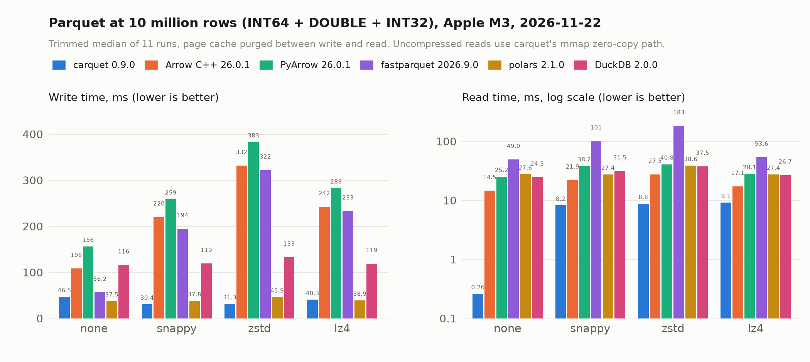

<h1 align="center">
  
</h1>

<p align="center">
  Apache Parquet 파일을 읽고 쓰기 위한 빠른 순수 C 라이브러리입니다.
</p>

<p align="center">
  <a href="https://vitruves.github.io/carquet/"></a>
</p>

<p align="center">
  <a href="https://github.com/Vitruves/carquet/actions/workflows/cpp.yml"></a>
  
  
  <a href="https://github.com/Vitruves/carquet/releases"></a>
  <a href="LICENSE"></a>
  <a href="https://github.com/Vitruves/carquet/graphs/traffic"></a>
  <br/>
  <a href="https://pypi.org/project/carquet/"></a>
  <a href="https://pypi.org/project/carquet/"></a>
  <a href="https://pepy.tech/projects/carquet"></a>
  
</p>

<p align="center">
  <a href="#주요-특징">주요 특징</a> &nbsp;·&nbsp;
  <a href="#벤치마크">벤치마크</a> &nbsp;·&nbsp;
  <a href="#설치">설치</a> &nbsp;·&nbsp;
  <a href="#빌드-구성">빌드 구성</a> &nbsp;·&nbsp;
  <a href="#c-api">C API</a> &nbsp;·&nbsp;
  <a href="#python-api">Python API</a> &nbsp;·&nbsp;
  <a href="#cli-도구">CLI</a> &nbsp;·&nbsp;
  <a href="#parquet-기능-지원">기능</a> &nbsp;·&nbsp;
  <a href="docs/README.md">매뉴얼</a> &nbsp;·&nbsp;
  <a href="CHANGELOG.md">변경 이력</a>
</p>

<p align="center">
  <a href="README.md">English</a> &nbsp;·&nbsp;
  <a href="README.zh-CN.md">简体中文</a> &nbsp;·&nbsp;
  <a href="README.ja.md">日本語</a> &nbsp;·&nbsp;
  <b>한국어</b> &nbsp;·&nbsp;
  <a href="README.de.md">Deutsch</a> &nbsp;·&nbsp;
  <a href="README.fr.md">Français</a> &nbsp;·&nbsp;
  <a href="README.pt-BR.md">Português (Brasil)</a>
</p>

<br/>

---

<!-- ────────────────────────────  주요 특징  ──────────────────────────── -->

## 주요 특징

<div align="center">

| | |
|---|---|
| ⚡ **빠름** | Arrow C++보다 **2.3–10.6x 빠르게** 쓰고, 바로 그 동일한 파일에서 압축 데이터를 **1.5–2.1x 빠르게** 읽습니다(Apple M3, 1천만 행). 코덱을 사용할 때 읽기는 polars보다 **3.0–4.4x**, DuckDB보다 **2.9–4.3x** 빠르기도 합니다. 비압축 읽기는 mmap에서 곧바로 **0.26 ms**에 제공됩니다. 런타임 디스패치를 갖춘 SSE4.2 / AVX2 / AVX-512 / NEON / SVE SIMD. |
| 🪶 **작음** | 순수 C11, **약 500 KB** 라이브러리(Arrow C++: 50 MB 이상). 압축 의존성은 네 가지(zstd, zlib, lz4, brotli)뿐이며 없으면 자동으로 가져옵니다. `make` 또는 `xmake` 한 번으로 1분 안에 빌드됩니다. |
| 📦 **완전함** | 모든 물리 타입과 인코딩, Snappy / GZIP / LZ4 / ZSTD / Brotli, V1 + V2 페이지, 임의 깊이의 중첩 스키마, 블룸 필터, 페이지 인덱스, 통계 기반 프루닝, 추가(append). [전체 매트릭스 ↓](#parquet-기능-지원) |
| 🔗 **상호 운용** | PyArrow, DuckDB, Spark가 별도 설정 없이 파일을 읽습니다. 의존성 없는 [Arrow C Data Interface](docs/reading.md#export-to-arrow-c-data-interface) 브리지(임의 깊이의 struct / list / map)와 의존성 없는 완전한 [Python API](#python-api). |
| 🛠 **도구** | 파일을 검사, 필터링, 내보내기, 검증하는 `carquet` CLI와 바로 컴파일 가능한 C 리더를 생성하는 `codegen`. Claude Code와 Codex용으로 바로 쓸 수 있는 [에이전트 스킬](#ai-coding-agents). |

</div>

<br/>

---

<!-- ────────────────────────────  벤치마크  ──────────────────────────── -->

## 벤치마크

<p align="center">
  <picture>
    <source media="(prefers-color-scheme: dark)" srcset="res/img/bench_10m_m3_dark.png">
    <source media="(prefers-color-scheme: light)" srcset="res/img/bench_10m_m3_light.png">
    
  </picture>
</p>

<p align="center">
  <picture>
    <source media="(prefers-color-scheme: dark)" srcset="res/img/bench_10m_linux_dark.png">
    <source media="(prefers-color-scheme: light)" srcset="res/img/bench_10m_linux_light.png">
    
  </picture>
</p>

<p align="center"><b><a href="https://vitruves.github.io/carquet/">웹사이트에서 인터랙티브 벤치마크 살펴보기 →</a></b><br/><sub>읽기와 쓰기, 그리고 10만, 100만, 1천만 행 사이를 전환할 수 있습니다</sub></p>

1천만 행에서 Arrow C++ 대비 carquet의 속도 향상(높을수록 carquet이 더 빠름):

<div align="center">

| | ARM · Apple M3 | | x86 · Windows (Haswell, MSVC) | | x86 · Linux (Xeon D-1531) | |
|---|---:|---:|---:|---:|---:|---:|
| **코덱** | **쓰기** | **읽기** | **쓰기** | **읽기** | **쓰기** | **읽기** |
| snappy | **7.24x** | **2.68x** | **3.39x** | **1.17x** | **5.82x** | **2.65x** |
| zstd | **10.6x** | **3.14x** | **3.83x** | **1.13x** | **9.93x** | **2.18x** |
| lz4 | **6.01x** | **1.88x** | **2.96x** | **1.05x** | **5.66x** | **1.30x** |
| none | **2.32x** | **55.9x**\* | **2.10x** | **62.0x**\* | **3.55x** | **36.3x**\* |

</div>

<sub>\* mmap 제로 카피 경로. Apple M3: carquet 0.9.0 vs Arrow C++ 26.0.1(2026-11-22). Linux: 동일한 carquet vs Arrow C++ 23.0.1(2026-11-22, 파일은 tmpfs에 기록). Windows: carquet 0.7.3 vs Arrow C++ 24.0.0(2026-11-02), 이후 다시 측정되지 않았습니다. 코덱을 사용할 때 carquet은 두 정수 컬럼을 스스로 딕셔너리 인코딩하지만, 여기서 Arrow C++는 그렇게 하지 않도록 설정되어 있습니다(방법론 참조).</sub>

압축 읽기는 모든 값을 디코딩하며, Linux와 macOS에서는 두 라이브러리가 동일한 시스템 lz4 / zstd를 링크하므로 코덱 속도는 동일합니다. 가장 공정한 비교는 **동일 파일 교차 읽기**(두 라이브러리가 정확히 같은 파일을 읽음)입니다. carquet은 M3에서 Arrow C++보다 **1.5–2.1x**(polars보다 2.0–3.8x), Linux에서 1.7–2.7x(polars보다 1.7–3.9x), Windows VM에서 1.04–1.30x 빠르며, Windows VM의 콜드 읽기는 가상 디스크에 의해 제한됩니다.

<details>
<summary><b>벤치마크 방법론</b></summary>

<br/>

모든 벤치마크는 동일한 데이터(결정론적 LCG PRNG), 동일한 행 그룹, zstd 레벨, 페이지 크기를 사용하며, 11–51회 반복의 절사 중앙값을 취하고, 쓰기와 읽기 단계 사이에 OS 페이지 캐시를 비우며 구성 간에 쿨다운을 둡니다. 스키마: 3개 컬럼(INT64, DOUBLE, INT32). Arrow C++ 저수준 Parquet 리더(Arrow Table 구체화를 우회), PyArrow, fastparquet, polars의 네이티브(Rust) 리더 및 라이터, DuckDB의 네이티브(C++) 리더 및 라이터와 비교했습니다.

인코딩: carquet은 기본값으로 씁니다. 코덱이 없으면 PLAIN이고, 코덱이 있으면 DOUBLE 컬럼에는 BYTE_STREAM_SPLIT을, 정수 컬럼에는 청크 샘플이 이득이라고 판단할 때 딕셔너리를 사용합니다(여기서는 두 정수 컬럼 모두). 페이지 체크섬은 켜져 있습니다. Arrow C++, PyArrow, fastparquet은 이 벤치마크의 이전 버전과 마찬가지로 딕셔너리 없이(쓸 수 있는 경우 double에 BYTE_STREAM_SPLIT) 실행하므로, 압축 파일이 carquet의 것보다 큽니다. polars와 DuckDB는 인코딩을 스스로 선택하며 코덱 유무와 관계없이 두 정수 컬럼을 딕셔너리 인코딩하는데, 이 때문에 두 라이브러리의 비압축 파일은 carquet의 PLAIN 파일보다 45% 작습니다. 파일 크기는 표에 나와 있습니다.

페이지 캐시는 파일별로 비웁니다. Linux에서는 `posix_fadvise(DONTNEED)`를 사용하고, macOS와 Windows에서는 캐시 없이(`F_NOCACHE`, `FILE_FLAG_NO_BUFFERING`) 파일을 복사한 뒤 그 사본으로 원본을 대체합니다(`benchmark/bench_purge_win32.h`). Windows에서는 carquet이 직접 빌드한 zstd / lz4를, Arrow C++는 conda-forge의 것을 링크하므로 두 라이브러리 간 코덱 속도가 약간 다를 수 있습니다.

**동일 파일 교차 읽기** 벤치마크가 가장 공정한 비교입니다. 두 라이브러리가 정확히 같은 Parquet 파일(한쪽이 쓰고 양쪽이 읽음)을 읽으므로 페이지 크기, 인코딩 선택, 행 그룹 레이아웃의 차이가 제거됩니다.

\*로 표시된 **비압축 읽기**는 Carquet의 **mmap 제로 카피 경로**를 사용합니다. PLAIN 인코딩, 비압축, 고정 크기, required 컬럼의 경우 배치 리더가 memcpy 없이 메모리 매핑된 파일을 직접 가리키는 포인터를 반환합니다. Arrow는 항상 자체 버퍼로 구체화합니다. **압축 읽기 수치가 엔드투엔드 읽기 처리량을 가장 대표적으로 보여주는 척도입니다.**

</details>

<details>
<summary><b>전체 x86 결과</b> (Intel Xeon D-1531, Linux)</summary>

<br/>

*Carquet 0.9.0, Xeon D-1531(6 코어 / 12 스레드 @ 2.2GHz, AVX2), 32GB RAM, Ubuntu 24.04, GCC 13.3, Arrow C++ 23.0.1, PyArrow 23.0.0, fastparquet 2026.5.0, polars 2.1.0, DuckDB 1.5.0, ZSTD 레벨 1, 파일은 tmpfs에 기록, 2026-11-22 측정.*

#### 1천만 행 vs Arrow C++

<div align="center">

| 코덱 | Carquet 쓰기 | Arrow C++ 쓰기 | 쓰기 비율 | Carquet 읽기 | Arrow C++ 읽기 | 읽기 비율 | 크기 |
|-------|--------------|---------|---------|-------------|---------|---------|------|
| none | **76.7ms** | 272ms | **3.55x** | **1.41ms** | 51.1ms | **36.3x**\* | 190.7MB |
| snappy | **90.5ms** | 527ms | **5.82x** | **35.7ms** | 94.4ms | **2.65x** | 94.9MB |
| zstd | **90.8ms** | 901ms | **9.93x** | **36.0ms** | 78.6ms | **2.18x** | 91.2MB |
| lz4 | **90.9ms** | 515ms | **5.66x** | **37.4ms** | 48.6ms | **1.30x** | 94.9MB |

</div>

<br/>

#### 100만 행 vs Arrow C++

<div align="center">

| 코덱 | Carquet 쓰기 | Arrow C++ 쓰기 | 쓰기 비율 | Carquet 읽기 | Arrow C++ 읽기 | 읽기 비율 | 크기 |
|-------|--------------|---------|---------|-------------|---------|---------|------|
| none | **8.18ms** | 27.7ms | **3.39x** | **0.19ms** | 6.10ms | **32.1x**\* | 19.1MB |
| snappy | **10.8ms** | 54.9ms | **5.10x** | **4.36ms** | 11.2ms | **2.56x** | 10.6MB |
| zstd | **13.6ms** | 91.3ms | **6.71x** | **4.70ms** | 9.13ms | **1.94x** | 9.74MB |
| lz4 | **11.1ms** | 53.5ms | **4.83x** | **4.27ms** | 5.79ms | **1.36x** | 10.6MB |

</div>

<br/>

#### 10만 행 vs Arrow C++

<div align="center">

| 코덱 | Carquet 쓰기 | Arrow C++ 쓰기 | 쓰기 비율 | Carquet 읽기 | Arrow C++ 읽기 | 읽기 비율 | 크기 |
|-------|--------------|---------|---------|-------------|---------|---------|------|
| none | **0.97ms** | 3.18ms | **3.28x** | **0.04ms** | 1.73ms | **43.2x**\* | 1.91MB |
| snappy | **3.10ms** | 5.47ms | **1.76x** | **0.68ms** | 5.14ms | **7.56x** | 1.06MB |
| zstd | **3.69ms** | 9.36ms | **2.54x** | **1.02ms** | 3.83ms | **3.75x** | 0.97MB |
| lz4 | **3.30ms** | 5.25ms | **1.59x** | **0.55ms** | 2.27ms | **4.13x** | 1.06MB |

</div>

<br/>

#### 1천만 행 vs PyArrow

<div align="center">

| 코덱 | Carquet 쓰기 | PyArrow 쓰기 | 쓰기 비율 | Carquet 읽기 | PyArrow 읽기 | 읽기 비율 | 크기 |
|-------|--------------|---------|---------|-------------|---------|---------|------|
| none | **76.7ms** | 362ms | **4.72x** | **1.41ms** | 211ms | **149.7x**\* | 190.7MB |
| snappy | **90.5ms** | 612ms | **6.77x** | **35.7ms** | 349ms | **9.80x** | 94.9MB |
| zstd | **90.8ms** | 968ms | **10.7x** | **36.0ms** | 336ms | **9.31x** | 91.2MB |
| lz4 | **90.9ms** | 607ms | **6.68x** | **37.4ms** | 245ms | **6.55x** | 94.9MB |

</div>

<br/>

#### 100만 행 vs PyArrow

<div align="center">

| 코덱 | Carquet 쓰기 | PyArrow 쓰기 | 쓰기 비율 | Carquet 읽기 | PyArrow 읽기 | 읽기 비율 | 크기 |
|-------|--------------|---------|---------|-------------|---------|---------|------|
| none | **8.18ms** | 36.6ms | **4.47x** | **0.19ms** | 8.92ms | **46.9x**\* | 19.1MB |
| snappy | **10.8ms** | 62.9ms | **5.85x** | **4.36ms** | 17.1ms | **3.92x** | 10.6MB |
| zstd | **13.6ms** | 99.5ms | **7.31x** | **4.70ms** | 18.6ms | **3.95x** | 9.74MB |
| lz4 | **11.1ms** | 62.6ms | **5.65x** | **4.27ms** | 10.4ms | **2.45x** | 10.6MB |

</div>

<br/>

#### 10만 행 vs PyArrow

<div align="center">

| 코덱 | Carquet 쓰기 | PyArrow 쓰기 | 쓰기 비율 | Carquet 읽기 | PyArrow 읽기 | 읽기 비율 | 크기 |
|-------|--------------|---------|---------|-------------|---------|---------|------|
| none | **0.97ms** | 3.60ms | **3.71x** | **0.04ms** | 1.49ms | **37.2x**\* | 1.91MB |
| snappy | **3.10ms** | 6.33ms | **2.04x** | **0.68ms** | 5.21ms | **7.66x** | 1.06MB |
| zstd | **3.69ms** | 9.94ms | **2.69x** | **1.02ms** | 5.45ms | **5.34x** | 0.97MB |
| lz4 | **3.30ms** | 6.28ms | **1.90x** | **0.55ms** | 2.30ms | **4.18x** | 1.06MB |

</div>

<br/>

#### 1천만 행 vs fastparquet

<div align="center">

| 코덱 | Carquet 쓰기 | fastparquet 쓰기 | 쓰기 비율 | Carquet 읽기 | fastparquet 읽기 | 읽기 비율 | 크기 |
|-------|--------------|---------|---------|-------------|---------|---------|------|
| none | **76.7ms** | 222ms | **2.90x** | **1.41ms** | 105ms | **74.2x**\* | 190.7MB |
| snappy | **90.5ms** | 499ms | **5.51x** | **35.7ms** | 243ms | **6.82x** | 94.9MB |
| zstd | **90.8ms** | 929ms | **10.2x** | **36.0ms** | 410ms | **11.4x** | 91.2MB |
| lz4 | **90.9ms** | 484ms | **5.32x** | **37.4ms** | 174ms | **4.66x** | 94.9MB |

</div>

<br/>

#### 100만 행 vs fastparquet

<div align="center">

| 코덱 | Carquet 쓰기 | fastparquet 쓰기 | 쓰기 비율 | Carquet 읽기 | fastparquet 읽기 | 읽기 비율 | 크기 |
|-------|--------------|---------|---------|-------------|---------|---------|------|
| none | **8.18ms** | 32.6ms | **3.99x** | **0.19ms** | 9.84ms | **51.8x**\* | 19.1MB |
| snappy | **10.8ms** | 59.6ms | **5.54x** | **4.36ms** | 23.7ms | **5.43x** | 10.6MB |
| zstd | **13.6ms** | 99.4ms | **7.31x** | **4.70ms** | 39.8ms | **8.46x** | 9.74MB |
| lz4 | **11.1ms** | 58.9ms | **5.31x** | **4.27ms** | 16.3ms | **3.81x** | 10.6MB |

</div>

<br/>

#### 10만 행 vs fastparquet

<div align="center">

| 코덱 | Carquet 쓰기 | fastparquet 쓰기 | 쓰기 비율 | Carquet 읽기 | fastparquet 읽기 | 읽기 비율 | 크기 |
|-------|--------------|---------|---------|-------------|---------|---------|------|
| none | **0.97ms** | 3.46ms | **3.57x** | **0.04ms** | 1.90ms | **47.5x**\* | 1.91MB |
| snappy | **3.10ms** | 6.22ms | **2.01x** | **0.68ms** | 3.35ms | **4.93x** | 1.06MB |
| zstd | **3.69ms** | 10.4ms | **2.82x** | **1.02ms** | 4.95ms | **4.85x** | 0.97MB |
| lz4 | **3.30ms** | 6.19ms | **1.88x** | **0.55ms** | 2.62ms | **4.76x** | 1.06MB |

</div>

<br/>

#### 1천만 행 vs polars

<div align="center">

| 코덱 | Carquet 쓰기 | polars 쓰기 | 쓰기 비율 | Carquet 읽기 | polars 읽기 | 읽기 비율 | Carquet 크기 | polars 크기 |
|-------|--------------|---------|---------|-------------|---------|---------|------|------|
| none | **76.7ms** | 106ms | **1.38x** | **1.41ms** | 122ms | **86.8x**\* | 190.7MB | 105.1MB |
| snappy | **90.5ms** | 110ms | **1.22x** | **35.7ms** | 88.0ms | **2.47x** | 94.9MB | 103.8MB |
| zstd | **90.8ms** | 125ms | **1.38x** | **36.0ms** | 123ms | **3.41x** | 91.2MB | 98.1MB |
| lz4 | **90.9ms** | 107ms | **1.18x** | **37.4ms** | 98.0ms | **2.62x** | 94.9MB | 104.2MB |

</div>

<br/>

#### 100만 행 vs polars

<div align="center">

| 코덱 | Carquet 쓰기 | polars 쓰기 | 쓰기 비율 | Carquet 읽기 | polars 읽기 | 읽기 비율 | Carquet 크기 | polars 크기 |
|-------|--------------|---------|---------|-------------|---------|---------|------|------|
| none | **8.18ms** | 13.3ms | **1.63x** | **0.19ms** | 8.83ms | **46.5x**\* | 19.1MB | 12.6MB |
| snappy | **10.8ms** | 14.0ms | **1.30x** | **4.36ms** | 11.1ms | **2.54x** | 10.6MB | 11.5MB |
| zstd | **13.6ms** | 16.1ms | **1.18x** | **4.70ms** | 13.9ms | **2.95x** | 9.74MB | 10.1MB |
| lz4 | **11.1ms** | 14.4ms | **1.30x** | **4.27ms** | 11.1ms | **2.60x** | 10.6MB | 11.5MB |

</div>

<br/>

#### 10만 행 vs polars

<div align="center">

| 코덱 | Carquet 쓰기 | polars 쓰기 | 쓰기 비율 | Carquet 읽기 | polars 읽기 | 읽기 비율 | Carquet 크기 | polars 크기 |
|-------|--------------|---------|---------|-------------|---------|---------|------|------|
| none | **0.97ms** | 6.43ms | **6.63x** | **0.04ms** | 4.45ms | **111.2x**\* | 1.91MB | 1.26MB |
| snappy | **3.10ms** | 8.57ms | **2.76x** | **0.68ms** | 5.71ms | **8.40x** | 1.06MB | 1.15MB |
| zstd | **3.69ms** | 10.7ms | **2.89x** | **1.02ms** | 9.13ms | **8.95x** | 0.97MB | 1.01MB |
| lz4 | **3.30ms** | 8.96ms | **2.72x** | **0.55ms** | 5.93ms | **10.8x** | 1.06MB | 1.15MB |

</div>

<br/>

#### 1천만 행 vs DuckDB

<div align="center">

| 코덱 | Carquet 쓰기 | DuckDB 쓰기 | 쓰기 비율 | Carquet 읽기 | DuckDB 읽기 | 읽기 비율 | Carquet 크기 | DuckDB 크기 |
|-------|--------------|---------|---------|-------------|---------|---------|------|------|
| none | **76.7ms** | 404ms | **5.27x** | **1.41ms** | 215ms | **152.5x**\* | 190.7MB | 106.9MB |
| snappy | **90.5ms** | 422ms | **4.67x** | **35.7ms** | 218ms | **6.10x** | 94.9MB | 105.7MB |
| zstd | **90.8ms** | 491ms | **5.41x** | **36.0ms** | 283ms | **7.84x** | 91.2MB | 100.2MB |
| lz4 | **90.9ms** | 436ms | **4.80x** | **37.4ms** | 229ms | **6.11x** | 94.9MB | 106.1MB |

</div>

<br/>

#### 100만 행 vs DuckDB

<div align="center">

| 코덱 | Carquet 쓰기 | DuckDB 쓰기 | 쓰기 비율 | Carquet 읽기 | DuckDB 읽기 | 읽기 비율 | Carquet 크기 | DuckDB 크기 |
|-------|--------------|---------|---------|-------------|---------|---------|------|------|
| none | **8.18ms** | 53.1ms | **6.49x** | **0.19ms** | 17.6ms | **92.4x**\* | 19.1MB | 16.1MB |
| snappy | **10.8ms** | 54.0ms | **5.02x** | **4.36ms** | 23.8ms | **5.45x** | 10.6MB | 12.4MB |
| zstd | **13.6ms** | 55.9ms | **4.11x** | **4.70ms** | 30.8ms | **6.56x** | 9.74MB | 9.92MB |
| lz4 | **11.1ms** | 57.0ms | **5.14x** | **4.27ms** | 20.2ms | **4.72x** | 10.6MB | 12.3MB |

</div>

<br/>

#### 10만 행 vs DuckDB

<div align="center">

| 코덱 | Carquet 쓰기 | DuckDB 쓰기 | 쓰기 비율 | Carquet 읽기 | DuckDB 읽기 | 읽기 비율 | Carquet 크기 | DuckDB 크기 |
|-------|--------------|---------|---------|-------------|---------|---------|------|------|
| none | **0.97ms** | 7.03ms | **7.25x** | **0.04ms** | 3.21ms | **80.2x**\* | 1.91MB | 1.61MB |
| snappy | **3.10ms** | 8.53ms | **2.75x** | **0.68ms** | 4.45ms | **6.54x** | 1.06MB | 1.24MB |
| zstd | **3.69ms** | 11.5ms | **3.12x** | **1.02ms** | 5.55ms | **5.44x** | 0.97MB | 0.99MB |
| lz4 | **3.30ms** | 8.82ms | **2.67x** | **0.55ms** | 3.64ms | **6.62x** | 1.06MB | 1.23MB |

</div>

<br/>

#### 동일 파일 교차 읽기 (1천만 행)

두 라이브러리가 **동일한** Parquet 파일을 읽는, 가장 공정한 동일 조건 비교입니다.

<div align="center">

| 코덱 | 라이터 | Carquet 읽기 | Arrow C++ 읽기 | 비율 |
|-------|--------|-------------|----------------|-------|
| none | Carquet | **1.67ms** | 72.8ms | **43.6x**\* |
| none | Arrow | **7.49ms** | 51.7ms | **6.91x**\* |
| snappy | Carquet | **38.5ms** | 79.2ms | **2.06x** |
| snappy | Arrow | **34.2ms** | 93.7ms | **2.74x** |
| zstd | Carquet | **36.1ms** | 80.0ms | **2.22x** |
| zstd | Arrow | **45.0ms** | 76.3ms | **1.70x** |
| lz4 | Carquet | **36.0ms** | 82.2ms | **2.28x** |
| lz4 | Arrow | **27.4ms** | 49.4ms | **1.81x** |

</div>

<br/>

#### 동일 파일 교차 읽기 vs polars (1천만 행)

각 라이브러리는 carquet 벤치마크가 쓴 파일과 polars가 자체 설정으로 쓴 파일을 읽습니다.

<div align="center">

| 코덱 | 라이터 | Carquet 읽기 | polars 읽기 | 비율 | 파일 |
|-------|--------|-------------|-------------|-------|------|
| none | Carquet | **1.65ms** | 76.2ms | **46.2x**\* | 190.7MB |
| none | polars | **42.0ms** | 75.8ms | **1.81x** | 105.1MB |
| snappy | Carquet | **36.9ms** | 103ms | **2.78x** | 94.9MB |
| snappy | polars | **45.0ms** | 95.5ms | **2.12x** | 103.8MB |
| zstd | Carquet | **38.6ms** | 149ms | **3.85x** | 91.2MB |
| zstd | polars | **46.0ms** | 89.3ms | **1.94x** | 98.1MB |
| lz4 | Carquet | **39.8ms** | 135ms | **3.40x** | 94.9MB |
| lz4 | polars | **46.3ms** | 79.4ms | **1.71x** | 104.2MB |

</div>

\* 제로 카피 mmap 경로. fastparquet은 pandas를 통해 읽으며 BYTE_STREAM_SPLIT이나 페이지 체크섬을 쓸 수 없으므로, 해당 행들은 직접 비교하기에 덜 적합합니다.

polars는 자체 Rust Parquet 리더와 라이터(`use_pyarrow=False`, 기본값)를, DuckDB는 자체 C++ 리더와 라이터(인메모리 테이블에서 `COPY ... TO`, `read_parquet` 결과를 Arrow 테이블로 가져옴)를 사용하며, 동일한 데이터, 행 그룹 크기, zstd 레벨을 사용하고 `lz4`에는 LZ4_RAW를 사용합니다. polars는 BYTE_STREAM_SPLIT이나 페이지 체크섬을 쓸 수 없습니다. 둘 다 인코딩을 스스로 고르며, 코덱 유무와 관계없이 `id`와 `category`를 딕셔너리 인코딩합니다. 코덱이 없을 때 carquet은 PLAIN을 유지하여 그런 파일을 mmap에서 곧바로 읽을 수 있게 합니다. 이 경우 polars와 DuckDB가 105 MB를 쓰는 데 비해 carquet은 190.7 MB를 쓰며, 비압축 쓰기 시간은 파일 시스템을 거치는 바이트 수를 따라갑니다. 읽기는 동일 파일 표로 공정하게 비교됩니다.

</details>

<details>
<summary><b>전체 ARM 결과</b> (Apple M3, macOS)</summary>

<br/>

*Carquet 0.9.0, MacBook Air M3, 16GB RAM, macOS 26.5, Arrow C++ 26.0.1, PyArrow 26.0.1, fastparquet 2026.9.0, polars 2.1.0, DuckDB 2.0.0, ZSTD 레벨 1, 2026-11-22 측정. 원본 보고서: [`site/bench.json`](site/bench.json).*

#### 1천만 행 vs Arrow C++

<div align="center">

| 코덱 | Carquet 쓰기 | Arrow C++ 쓰기 | 쓰기 비율 | Carquet 읽기 | Arrow C++ 읽기 | 읽기 비율 | 크기 |
|-------|--------------|---------|---------|-------------|---------|---------|------|
| none | **46.5ms** | 108ms | **2.32x** | **0.26ms** | 14.5ms | **55.9x**\* | 190.7MB |
| snappy | **30.4ms** | 220ms | **7.24x** | **8.19ms** | 21.9ms | **2.68x** | 94.9MB |
| zstd | **31.3ms** | 332ms | **10.6x** | **8.77ms** | 27.5ms | **3.14x** | 91.2MB |
| lz4 | **40.3ms** | 242ms | **6.01x** | **9.12ms** | 17.1ms | **1.88x** | 95.0MB |

</div>

<br/>

#### 100만 행 vs Arrow C++

<div align="center">

| 코덱 | Carquet 쓰기 | Arrow C++ 쓰기 | 쓰기 비율 | Carquet 읽기 | Arrow C++ 읽기 | 읽기 비율 | 크기 |
|-------|--------------|---------|---------|-------------|---------|---------|------|
| none | **5.60ms** | 11.6ms | **2.08x** | **0.05ms** | 1.55ms | **31.0x**\* | 19.1MB |
| snappy | **3.99ms** | 23.0ms | **5.77x** | **0.90ms** | 2.43ms | **2.70x** | 10.6MB |
| zstd | **4.23ms** | 33.3ms | **7.87x** | **1.18ms** | 3.02ms | **2.56x** | 9.74MB |
| lz4 | **3.85ms** | 24.1ms | **6.26x** | **0.91ms** | 1.82ms | **2.00x** | 10.6MB |

</div>

<br/>

#### 10만 행 vs Arrow C++

<div align="center">

| 코덱 | Carquet 쓰기 | Arrow C++ 쓰기 | 쓰기 비율 | Carquet 읽기 | Arrow C++ 읽기 | 읽기 비율 | 크기 |
|-------|--------------|---------|---------|-------------|---------|---------|------|
| none | **1.01ms** | 1.58ms | **1.56x** | **0.02ms** | 0.22ms | **11.0x**\* | 1.91MB |
| snappy | **1.20ms** | 2.47ms | **2.06x** | **0.28ms** | 0.84ms | **3.00x** | 1.06MB |
| zstd | **1.24ms** | 3.39ms | **2.73x** | **0.36ms** | 1.23ms | **3.42x** | 0.97MB |
| lz4 | **1.17ms** | 2.51ms | **2.15x** | **0.25ms** | 0.58ms | **2.32x** | 1.06MB |

</div>

<br/>

#### 1천만 행 vs PyArrow

<div align="center">

| 코덱 | Carquet 쓰기 | PyArrow 쓰기 | 쓰기 비율 | Carquet 읽기 | PyArrow 읽기 | 읽기 비율 | 크기 |
|-------|--------------|---------|---------|-------------|---------|---------|------|
| none | **46.5ms** | 156ms | **3.35x** | **0.26ms** | 25.2ms | **96.9x**\* | 190.7MB |
| snappy | **30.4ms** | 259ms | **8.52x** | **8.19ms** | 38.2ms | **4.67x** | 94.9MB |
| zstd | **31.3ms** | 383ms | **12.2x** | **8.77ms** | 40.8ms | **4.65x** | 91.2MB |
| lz4 | **40.3ms** | 283ms | **7.01x** | **9.12ms** | 28.1ms | **3.08x** | 95.0MB |

</div>

<br/>

#### 100만 행 vs PyArrow

<div align="center">

| 코덱 | Carquet 쓰기 | PyArrow 쓰기 | 쓰기 비율 | Carquet 읽기 | PyArrow 읽기 | 읽기 비율 | 크기 |
|-------|--------------|---------|---------|-------------|---------|---------|------|
| none | **5.60ms** | 16.8ms | **3.00x** | **0.05ms** | 2.68ms | **53.6x**\* | 19.1MB |
| snappy | **3.99ms** | 26.8ms | **6.72x** | **0.90ms** | 3.68ms | **4.09x** | 10.6MB |
| zstd | **4.23ms** | 38.4ms | **9.09x** | **1.18ms** | 3.78ms | **3.20x** | 9.74MB |
| lz4 | **3.85ms** | 27.8ms | **7.22x** | **0.91ms** | 2.90ms | **3.19x** | 10.6MB |

</div>

<br/>

#### 10만 행 vs PyArrow

<div align="center">

| 코덱 | Carquet 쓰기 | PyArrow 쓰기 | 쓰기 비율 | Carquet 읽기 | PyArrow 읽기 | 읽기 비율 | 크기 |
|-------|--------------|---------|---------|-------------|---------|---------|------|
| none | **1.01ms** | 1.95ms | **1.93x** | **0.02ms** | 0.25ms | **12.5x**\* | 1.91MB |
| snappy | **1.20ms** | 2.80ms | **2.33x** | **0.28ms** | 0.63ms | **2.25x** | 1.06MB |
| zstd | **1.24ms** | 3.80ms | **3.06x** | **0.36ms** | 0.69ms | **1.92x** | 0.97MB |
| lz4 | **1.17ms** | 2.89ms | **2.47x** | **0.25ms** | 0.42ms | **1.68x** | 1.06MB |

</div>

<br/>

#### 1천만 행 vs fastparquet

<div align="center">

| 코덱 | Carquet 쓰기 | fastparquet 쓰기 | 쓰기 비율 | Carquet 읽기 | fastparquet 읽기 | 읽기 비율 | 크기 |
|-------|--------------|---------|---------|-------------|---------|---------|------|
| none | **46.5ms** | 56.2ms | **1.21x** | **0.26ms** | 49.0ms | **188.4x**\* | 190.7MB |
| snappy | **30.4ms** | 194ms | **6.40x** | **8.19ms** | 101ms | **12.3x** | 94.9MB |
| zstd | **31.3ms** | 322ms | **10.3x** | **8.77ms** | 183ms | **20.8x** | 91.2MB |
| lz4 | **40.3ms** | 233ms | **5.78x** | **9.12ms** | 53.6ms | **5.88x** | 95.0MB |

</div>

<br/>

#### 100만 행 vs fastparquet

<div align="center">

| 코덱 | Carquet 쓰기 | fastparquet 쓰기 | 쓰기 비율 | Carquet 읽기 | fastparquet 읽기 | 읽기 비율 | 크기 |
|-------|--------------|---------|---------|-------------|---------|---------|------|
| none | **5.60ms** | 7.38ms | **1.32x** | **0.05ms** | 2.90ms | **58.0x**\* | 19.1MB |
| snappy | **3.99ms** | 21.3ms | **5.33x** | **0.90ms** | 9.94ms | **11.0x** | 10.6MB |
| zstd | **4.23ms** | 32.4ms | **7.65x** | **1.18ms** | 17.7ms | **15.0x** | 9.74MB |
| lz4 | **3.85ms** | 20.9ms | **5.42x** | **0.91ms** | 5.01ms | **5.51x** | 10.6MB |

</div>

<br/>

#### 10만 행 vs fastparquet

<div align="center">

| 코덱 | Carquet 쓰기 | fastparquet 쓰기 | 쓰기 비율 | Carquet 읽기 | fastparquet 읽기 | 읽기 비율 | 크기 |
|-------|--------------|---------|---------|-------------|---------|---------|------|
| none | 1.01ms | **1.00ms** | 0.99x | **0.02ms** | 0.49ms | **24.5x**\* | 1.91MB |
| snappy | **1.20ms** | 2.26ms | **1.88x** | **0.28ms** | 1.11ms | **3.96x** | 1.06MB |
| zstd | **1.24ms** | 3.21ms | **2.59x** | **0.36ms** | 1.98ms | **5.50x** | 0.97MB |
| lz4 | **1.17ms** | 2.15ms | **1.84x** | **0.25ms** | 0.67ms | **2.68x** | 1.06MB |

</div>

<br/>

#### 1천만 행 vs polars

<div align="center">

| 코덱 | Carquet 쓰기 | polars 쓰기 | 쓰기 비율 | Carquet 읽기 | polars 읽기 | 읽기 비율 | Carquet 크기 | polars 크기 |
|-------|--------------|---------|---------|-------------|---------|---------|------|------|
| none | 46.5ms | **37.5ms** | 0.81x | **0.26ms** | 27.6ms | **106.2x**\* | 190.7MB | 105.1MB |
| snappy | **30.4ms** | 37.8ms | **1.25x** | **8.19ms** | 27.4ms | **3.35x** | 94.9MB | 103.8MB |
| zstd | **31.3ms** | 45.9ms | **1.47x** | **8.77ms** | 38.6ms | **4.40x** | 91.2MB | 98.1MB |
| lz4 | 40.3ms | **38.9ms** | 0.96x | **9.12ms** | 27.4ms | **3.00x** | 95.0MB | 104.2MB |

</div>

<br/>

#### 100만 행 vs polars

<div align="center">

| 코덱 | Carquet 쓰기 | polars 쓰기 | 쓰기 비율 | Carquet 읽기 | polars 읽기 | 읽기 비율 | Carquet 크기 | polars 크기 |
|-------|--------------|---------|---------|-------------|---------|---------|------|------|
| none | 5.60ms | **4.16ms** | 0.74x | **0.05ms** | 2.67ms | **53.4x**\* | 19.1MB | 12.6MB |
| snappy | **3.99ms** | 4.44ms | **1.11x** | **0.90ms** | 2.87ms | **3.19x** | 10.6MB | 11.5MB |
| zstd | **4.23ms** | 5.32ms | **1.26x** | **1.18ms** | 3.82ms | **3.24x** | 9.74MB | 10.1MB |
| lz4 | **3.85ms** | 4.41ms | **1.15x** | **0.91ms** | 2.77ms | **3.04x** | 10.6MB | 11.5MB |

</div>

<br/>

#### 10만 행 vs polars

<div align="center">

| 코덱 | Carquet 쓰기 | polars 쓰기 | 쓰기 비율 | Carquet 읽기 | polars 읽기 | 읽기 비율 | Carquet 크기 | polars 크기 |
|-------|--------------|---------|---------|-------------|---------|---------|------|------|
| none | 1.01ms | **0.68ms** | 0.67x | **0.02ms** | 0.32ms | **16.0x**\* | 1.91MB | 1.26MB |
| snappy | 1.20ms | **0.90ms** | 0.75x | **0.28ms** | 0.43ms | **1.54x** | 1.06MB | 1.15MB |
| zstd | 1.24ms | **1.04ms** | 0.84x | **0.36ms** | 1.01ms | **2.81x** | 0.97MB | 1.01MB |
| lz4 | 1.17ms | **0.93ms** | 0.79x | **0.25ms** | 0.42ms | **1.68x** | 1.06MB | 1.15MB |

</div>

<br/>

#### 1천만 행 vs DuckDB

<div align="center">

| 코덱 | Carquet 쓰기 | DuckDB 쓰기 | 쓰기 비율 | Carquet 읽기 | DuckDB 읽기 | 읽기 비율 | Carquet 크기 | DuckDB 크기 |
|-------|--------------|---------|---------|-------------|---------|---------|------|------|
| none | **46.5ms** | 116ms | **2.49x** | **0.26ms** | 24.5ms | **94.4x**\* | 190.7MB | 105.7MB |
| snappy | **30.4ms** | 119ms | **3.91x** | **8.19ms** | 31.5ms | **3.84x** | 94.9MB | 104.5MB |
| zstd | **31.3ms** | 133ms | **4.25x** | **8.77ms** | 37.5ms | **4.28x** | 91.2MB | 99.1MB |
| lz4 | **40.3ms** | 119ms | **2.94x** | **9.12ms** | 26.7ms | **2.92x** | 95.0MB | 104.9MB |

</div>

<br/>

#### 100만 행 vs DuckDB

<div align="center">

| 코덱 | Carquet 쓰기 | DuckDB 쓰기 | 쓰기 비율 | Carquet 읽기 | DuckDB 읽기 | 읽기 비율 | Carquet 크기 | DuckDB 크기 |
|-------|--------------|---------|---------|-------------|---------|---------|------|------|
| none | **5.60ms** | 10.2ms | **1.82x** | **0.05ms** | 3.05ms | **61.0x**\* | 19.1MB | 16.1MB |
| snappy | **3.99ms** | 10.4ms | **2.61x** | **0.90ms** | 3.70ms | **4.11x** | 10.6MB | 12.3MB |
| zstd | **4.23ms** | 11.3ms | **2.68x** | **1.18ms** | 5.16ms | **4.37x** | 9.74MB | 9.92MB |
| lz4 | **3.85ms** | 10.6ms | **2.75x** | **0.91ms** | 3.04ms | **3.34x** | 10.6MB | 12.3MB |

</div>

<br/>

#### 10만 행 vs DuckDB

<div align="center">

| 코덱 | Carquet 쓰기 | DuckDB 쓰기 | 쓰기 비율 | Carquet 읽기 | DuckDB 읽기 | 읽기 비율 | Carquet 크기 | DuckDB 크기 |
|-------|--------------|---------|---------|-------------|---------|---------|------|------|
| none | **1.01ms** | 1.79ms | **1.77x** | **0.02ms** | 0.54ms | **27.0x**\* | 1.91MB | 1.61MB |
| snappy | **1.20ms** | 2.43ms | **2.03x** | **0.28ms** | 0.93ms | **3.32x** | 1.06MB | 1.23MB |
| zstd | **1.24ms** | 3.40ms | **2.74x** | **0.36ms** | 1.59ms | **4.42x** | 0.97MB | 0.99MB |
| lz4 | **1.17ms** | 2.75ms | **2.35x** | **0.25ms** | 0.72ms | **2.88x** | 1.06MB | 1.23MB |

</div>

<br/>

#### 동일 파일 교차 읽기 (1천만 행)

두 라이브러리가 **동일한** Parquet 파일을 읽는, 가장 공정한 동일 조건 비교입니다.

<div align="center">

| 코덱 | 라이터 | Carquet 읽기 | Arrow C++ 읽기 | 비율 |
|-------|--------|-------------|----------------|-------|
| none | Carquet | **0.28ms** | 16.4ms | **58.4x**\* |
| none | Arrow | **0.91ms** | 14.0ms | **15.3x**\* |
| snappy | Carquet | **8.08ms** | 17.1ms | **2.12x** |
| snappy | Arrow | **12.4ms** | 23.4ms | **1.88x** |
| zstd | Carquet | **9.40ms** | 18.3ms | **1.95x** |
| zstd | Arrow | **20.3ms** | 29.8ms | **1.47x** |
| lz4 | Carquet | **9.17ms** | 18.4ms | **2.01x** |
| lz4 | Arrow | **9.62ms** | 17.1ms | **1.78x** |

</div>

<br/>

#### 동일 파일 교차 읽기 vs polars (1천만 행)

각 라이브러리는 carquet 벤치마크가 쓴 파일과 polars가 자체 설정으로 쓴 파일을 읽습니다.

<div align="center">

| 코덱 | 라이터 | Carquet 읽기 | polars 읽기 | 비율 | 파일 |
|-------|--------|-------------|-------------|-------|------|
| none | Carquet | **0.29ms** | 30.0ms | **103.6x**\* | 190.7MB |
| none | polars | **9.53ms** | 23.3ms | **2.45x** | 105.1MB |
| snappy | Carquet | **8.34ms** | 31.6ms | **3.79x** | 94.9MB |
| snappy | polars | **11.0ms** | 24.7ms | **2.24x** | 103.8MB |
| zstd | Carquet | **8.89ms** | 32.8ms | **3.69x** | 91.2MB |
| zstd | polars | **17.0ms** | 34.0ms | **2.00x** | 98.1MB |
| lz4 | Carquet | **8.53ms** | 32.2ms | **3.77x** | 95.0MB |
| lz4 | polars | **11.2ms** | 24.4ms | **2.17x** | 104.2MB |

</div>

\* 제로 카피 mmap 경로. fastparquet은 pandas를 통해 읽으며 BYTE_STREAM_SPLIT이나 페이지 체크섬을 쓸 수 없으므로, 해당 행들은 직접 비교하기에 덜 적합합니다.

polars는 자체 Rust Parquet 리더와 라이터(`use_pyarrow=False`, 기본값)를, DuckDB는 자체 C++ 리더와 라이터(인메모리 테이블에서 `COPY ... TO`, `read_parquet` 결과를 Arrow 테이블로 가져옴)를 사용하며, 동일한 데이터, 행 그룹 크기, zstd 레벨을 사용하고 `lz4`에는 LZ4_RAW를 사용합니다. polars는 BYTE_STREAM_SPLIT이나 페이지 체크섬을 쓸 수 없습니다. 둘 다 인코딩을 스스로 고르며, 코덱 유무와 관계없이 `id`와 `category`를 딕셔너리 인코딩합니다. 코덱이 없을 때 carquet은 PLAIN을 유지하여 그런 파일을 mmap에서 곧바로 읽을 수 있게 합니다. 이 경우 polars와 DuckDB가 105 MB를 쓰는 데 비해 carquet은 190.7 MB를 쓰며, 비압축 쓰기 시간은 파일 시스템을 거치는 바이트 수를 따라갑니다. 읽기는 동일 파일 표로 공정하게 비교됩니다.

</details>

<details>
<summary><b>전체 Windows 결과</b> (Intel Haswell VM, MSVC)</summary>

<br/>

*MSVC 19.44(x64 Release, OpenMP)로 빌드한 Carquet 0.7.3, 4 vCPU(Intel Haswell, 3.1 GHz) OpenStack VM, 14.6GB RAM, 가상 SAS 디스크, Windows Server 2025, Arrow C++ 24.0.0(conda-forge), ZSTD 레벨 1, 2026-11-02 측정. 콜드 읽기는 가상 디스크로 가므로 읽기 비율이 좁아집니다. 쓰기와 제로 카피 경로는 CPU에 의해 제한됩니다.*

#### 1천만 행 vs Arrow C++

<div align="center">

| 코덱 | Carquet 쓰기 | Arrow C++ 쓰기 | 쓰기 비율 | Carquet 읽기 | Arrow C++ 읽기 | 읽기 비율 | 크기 |
|-------|--------------|-----------------|---------|-------------|----------------|---------|------|
| none | **182ms** | 382ms | **2.10x** | **2.04ms** | 126.5ms | **62.0x**\* | 190.7MB |
| snappy | **175ms** | 594ms | **3.39x** | **115.6ms** | 134.9ms | **1.17x** | 125.1MB |
| zstd | **242ms** | 927ms | **3.83x** | **140.7ms** | 159.2ms | **1.13x** | 95.3MB |
| lz4 | **178ms** | 527ms | **2.96x** | **95.5ms** | 99.9ms | **1.05x** | 122.9MB |

</div>

<br/>

#### 100만 행 vs Arrow C++

<div align="center">

| 코덱 | Carquet 쓰기 | Arrow C++ 쓰기 | 쓰기 비율 | Carquet 읽기 | Arrow C++ 읽기 | 읽기 비율 |
|-------|--------------|-----------------|---------|-------------|----------------|---------|
| none | **15.6ms** | 37.6ms | **2.41x** | **0.44ms** | 13.72ms | **31.2x**\* |
| snappy | **25.4ms** | 61.2ms | **2.41x** | **14.01ms** | 16.31ms | **1.16x** |
| zstd | **30.4ms** | 94.3ms | **3.10x** | **17.09ms** | 18.38ms | **1.08x** |
| lz4 | **26.4ms** | 53.8ms | **2.04x** | 13.07ms | **12.89ms** | 0.99x |

</div>

<br/>

#### 10만 행 vs Arrow C++

<div align="center">

| 코덱 | Carquet 쓰기 | Arrow C++ 쓰기 | 쓰기 비율 | Carquet 읽기 | Arrow C++ 읽기 | 읽기 비율 |
|-------|--------------|-----------------|---------|-------------|----------------|---------|
| none | **3.53ms** | 3.95ms | **1.12x** | **0.16ms** | 2.13ms | **13.3x**\* |
| snappy | **5.60ms** | 6.23ms | **1.11x** | **2.79ms** | 3.92ms | **1.41x** |
| zstd | **7.11ms** | 9.79ms | **1.38x** | **2.86ms** | 4.36ms | **1.52x** |
| lz4 | **5.75ms** | 5.82ms | **1.01x** | 2.22ms | **2.15ms** | 0.97x |

</div>

<br/>

#### 동일 파일 교차 읽기 (1천만 행)

<div align="center">

| 코덱 | 라이터 | Carquet 읽기 | Arrow C++ 읽기 | 비율 |
|-------|--------|-------------|----------------|-------|
| none | Carquet | **2.65ms** | 116.9ms | **44.1x**\* |
| none | Arrow | **5.29ms** | 126.6ms | **23.9x**\* |
| snappy | Carquet | **115.2ms** | 135.0ms | **1.17x** |
| snappy | Arrow | **112.7ms** | 146.2ms | **1.30x** |
| zstd | Carquet | **137.7ms** | 150.5ms | **1.09x** |
| zstd | Arrow | **134.9ms** | 155.3ms | **1.15x** |
| lz4 | Carquet | **92.1ms** | 95.6ms | **1.04x** |
| lz4 | Arrow | **89.7ms** | 98.1ms | **1.09x** |

</div>

\* 제로 카피 mmap 경로

</details>

<details>
<summary><b>직접 벤치마크 실행하기</b></summary>

<br/>

```bash
make benchmark                                    # Release build of the benchmark programs into build/
./build/benchmark_carquet                         # carquet alone
python3 benchmark/run_benchmark.py --skip-xlarge  # full comparison with PyArrow (+ Arrow C++ if built)
```

<div align="center">

| `run_benchmark.py` 플래그 / 변수 | 효과 |
|---|---|
| `--quick` | 1천만 행 구성만(차트에 표시되는 것) |
| `--skip-xlarge` | 1억 행 구성 건너뛰기(코덱당 약 2 GB, 30분 이상) |
| `--fastparquet` | fastparquet도 비교(`pip install fastparquet pandas`) |
| `--polars` | polars 자체 Rust Parquet 리더 / 라이터도 비교(`pip install polars`) |
| `--duckdb` | DuckDB 자체 C++ Parquet 리더 / 라이터도 비교(`pip install duckdb pyarrow`) |
| `--no-pyarrow` / `--no-arrow-cpp` | PyArrow / Arrow C++ 건너뛰기 |
| `--iterations N` | 고정 반복 횟수(기본값: 자동, 11–51) |
| `--build-dir DIR` / `--temp-dir DIR` | 바이너리가 있는 위치 / 테스트 파일을 쓰는 위치 |
| `CARQUET_BENCH_ZSTD_LEVEL=3` | ZSTD 레벨(기본값 1) |
| `CARQUET_BENCH_PHASE=write` | `benchmark_carquet` 전용: 한 단계(`write`, `read`, `read_nommap`)만 시간을 측정하고, 나머지는 한 번만 실행(프로파일링용) |

</div>

항상 **Release** 빌드로 벤치마크하세요. `make benchmark`는 `build/`를 Release로 재구성합니다. 남아 있는 Debug `build/`는 carquet을 몇 배나 느려 보이게 만듭니다. `make native` + `-DCARQUET_BUILD_BENCHMARKS=ON`은 호스트에 맞춰 튜닝된 수치를 제공합니다.

fastparquet은 동일한 데이터, 행 그룹 크기, 딕셔너리 없음, zstd 레벨을 사용하고 `lz4`에는 LZ4_RAW를 사용합니다. BYTE_STREAM_SPLIT이나 페이지 체크섬을 쓸 수 없고 pandas를 통해 읽기 때문에, 그 수치는 Arrow의 수치보다 직접 비교하기에 덜 적합합니다.

polars는 네이티브 리더와 라이터(PyArrow를 거치지 않음)로 실행하며, 동일한 데이터, 행 그룹 크기, zstd 레벨을 사용하고 `lz4`에는 LZ4_RAW를 사용합니다. BYTE_STREAM_SPLIT이나 페이지 체크섬을 쓸 수 없고 딕셔너리 인코딩을 스스로 선택하므로(옵션 없음), 이 데이터에서는 파일이 더 작아집니다.

Arrow C++ 비교에는 별도의 타깃이 필요합니다(시스템에서 찾은 Arrow C++, 또는 `CARQUET_ARROW_CPP_ROOT`로 지정한 경로):

```bash
cmake -B build -DCMAKE_BUILD_TYPE=Release -DCARQUET_NATIVE_ARCH=ON \
  -DCARQUET_BUILD_BENCHMARKS=ON -DCARQUET_BUILD_ARROW_CPP_BENCHMARK=ON \
  [-DCARQUET_ARROW_CPP_ROOT=/path/to/arrow-prefix]
cmake --build build -j
```

병렬 행 그룹 리더와 함께 저수준 `parquet::ParquetFileReader` API(Arrow Table 구체화 없음)를 사용합니다.

Windows(Developer PowerShell for VS)에서는 Arrow C++를 conda-forge에서 가져올 수 있습니다(`micromamba create -p C:\arrow -c conda-forge libarrow libparquet`). 벤치마크 실행 시 해당 DLL이 `PATH`에 있어야 합니다:

```powershell
cmake -B build -G Ninja -DCMAKE_BUILD_TYPE=Release -DCARQUET_BUILD_BENCHMARKS=ON `
  -DCARQUET_BUILD_ARROW_CPP_BENCHMARK=ON -DCARQUET_ARROW_CPP_ROOT=C:/arrow/Library
cmake --build build
$env:PATH = "C:\arrow\Library\bin;$env:PATH"
python benchmark\run_benchmark.py --build-dir build --skip-xlarge --no-pyarrow
```

빌드 폴더와 `--temp-dir` 폴더는 실시간 바이러스 검사에서 제외하세요. Windows Defender는 벤치마크가 쓰는 모든 파일을 검사합니다.

README 차트는 실행 후 `benchmark/`에 남는 JSON으로 그려지며, GitHub가 독자의 테마에 따라 고르는 라이트와 다크 두 가지 버전이 있습니다:

```bash
python3 benchmark/plot_readme_chart.py benchmark/bench_<version>_<os>_<arch>_<date>.json   # writes res/img/bench_10m_m3_{light,dark}.png (--name bench_10m_linux for the Linux figure)
```

</details>

<br/>

---

<!-- ────────────────────────────  한눈에 보기  ──────────────────────────── -->

## 30초로 보는 carquet

```c
#include <carquet/carquet.h>

carquet_error_t err = CARQUET_ERROR_INIT;
carquet_schema_t* schema = carquet_schema_create(&err);
carquet_schema_add_column(schema, "id", CARQUET_PHYSICAL_INT64, NULL, CARQUET_REPETITION_REQUIRED, 0, 0);

carquet_writer_t* w = carquet_writer_create("ids.parquet", schema, NULL, &err);
int64_t ids[] = {1, 2, 3};
carquet_writer_write_batch(w, 0, ids, 3, NULL, NULL);
carquet_writer_close(w);

carquet_reader_t* r = carquet_reader_open("ids.parquet", NULL, &err);
printf("%lld rows\n", (long long)carquet_reader_num_rows(r));   /* 3 rows */
carquet_reader_close(r);
carquet_schema_free(schema);
```

> **carquet이 적합한 자리.** Arrow의 생태계(컴퓨트 커널, 데이터셋, Flight, 암호화)가 필요하다면 여전히 Arrow가 올바른 선택입니다. carquet은 Parquet을 빠르고 정확하게 읽고 쓰기만 하면 되는 C 및 C++ 프로그램, 임베디드 시스템, 언어 런타임을 위한 것입니다.

<br/>

---

<!-- ────────────────────────────  설치  ──────────────────────────── -->

## 설치

이 섹션은 **C 라이브러리, 헤더, `carquet` CLI**를 설치합니다. Python 사용자는 별도의 [Python API](#python-api)(`pip install carquet`)를 이용하세요.

**요구 사항:** C11 컴파일러(GCC 4.9+, Clang 3.4+, MSVC 2015+)와 CMake 3.16+(또는 [xmake](#소스에서-빌드-xmake-사용)). zstd, zlib, lz4, brotli는 시스템에 있으면 그것을 사용하고, 없으면 가져옵니다. OpenMP는 선택 사항입니다(병렬 읽기 및 쓰기).

<br/>

### 소스에서 빌드, `make` 사용

가장 간단한 방법입니다. `make`는 올바른 플래그로 CMake를 호출하는 얇은 래퍼이므로 따로 설정할 것이 없습니다:

```bash
git clone https://github.com/Vitruves/carquet.git && cd carquet
make                  # optimized Release build into build/
sudo make install     # library, headers, CLI, pkg-config and CMake package files
```

그런 다음 `-lcarquet`, `pkg-config --cflags --libs carquet`, 또는 CMake의 `find_package(carquet)`로 링크합니다.

<br/>

### 소스에서 빌드, `xmake` 사용

[xmake](https://xmake.io)는 다른 설치가 전혀 필요 없습니다. 버전이 고정된 zstd 1.5.6, zlib 1.4, lz4 1.10.0, brotli 1.1.0을 내려받아 정적으로 링크하므로 `carquet` CLI에는 런타임 의존성이 없습니다.

```bash
git clone https://github.com/Vitruves/carquet.git && cd carquet
xmake                         # Release static library + CLI into build/<plat>/<arch>/release/
xmake install -o /usr/local   # headers, library and CLI (sudo if the prefix needs it)
```

정적 설치에는 `libcarquet.a`만 포함되므로 코덱은 직접 링크해야 합니다(`-lcarquet -lzstd -lz -llz4`, `--brotli=n`으로 빌드하지 않았다면 `-lbrotlienc -lbrotlidec -lbrotlicommon`도 추가). 대신 `xmake f --shared=y`로 구성하면 코덱이 내장된 자체 완결적 공유 라이브러리를 얻습니다.

<br/>

### CMake 프로젝트에서 사용

```cmake
include(FetchContent)
FetchContent_Declare(carquet GIT_REPOSITORY https://github.com/Vitruves/carquet.git GIT_TAG main)
FetchContent_MakeAvailable(carquet)
target_link_libraries(myapp PRIVATE carquet)
```

또는 `make install` 후에 `find_package(carquet REQUIRED)`를 사용하고 `carquet::carquet`을 링크합니다.

<br/>

---

<!-- ────────────────────────────  빌드 구성  ──────────────────────────── -->

## 빌드 구성

### `make` 타깃

모든 타깃은 `build/`를 구성하고 병렬로 빌드합니다. `make help`가 이 목록을 출력합니다. 각 타깃에는 [xmake 대응 명령](#xmake)이 있습니다.

<div align="center">

| 명령 | 빌드 유형 | 결과물 |
|---|---|---|
| `make` / `make release` | Release | 정적 라이브러리 + `carquet` CLI(기본값) |
| `make native` | Release | 동일하지만 `-march=native`로 이 CPU에 맞춰 튜닝(구형 CPU에서는 바이너리가 실행되지 않음) |
| `make shared` | Release | 정적 대신 공유 라이브러리(`.so` / `.dylib` / `.dll`) |
| `make benchmark` | Release | 벤치마크 프로그램(`benchmark_carquet`, 프로파일링 타깃) |
| `make debug` | Debug | 어서션 포함, 최적화 없는 라이브러리 + CLI |
| `make test` | Debug | 테스트 스위트를 빌드한 뒤 `ctest`로 실행 |
| `make dev` | Debug | 전부: 테스트, 예제, 벤치마크, 상호 운용성 프로그램 |
| `make fuzz` | Debug | libFuzzer 타깃(Clang 툴체인 사용) |
| `make install` | Release | `release`를 빌드한 뒤 `PREFIX`에 설치 |
| `make clean` | | 빌드 디렉터리 삭제 |

</div>

<div align="center">

| 변수 | 기본값 | 예시 |
|---|---|---|
| `PREFIX` | CMake 기본값(Unix에서는 `/usr/local`) | `make install PREFIX=$HOME/.local` |
| `BUILD` | `build` | `make test BUILD=build-debug`(여러 구성을 나란히 유지) |
| `JOBS` | 코어 수 | `make JOBS=4` |
| `CMAKE` | `cmake` | `make CMAKE=/opt/cmake/bin/cmake` |

</div>

모든 타깃은 기본적으로 `build/`를 공유하므로, `make benchmark` 후에 `make test`를 실행하면 Debug로 재구성됩니다. Release 트리와 Debug 트리를 분리하려면 `BUILD=`를 사용하세요.

<br/>

### CMake 옵션

`make` 타깃이 다루지 않는 경우에는 CMake를 직접 호출하고 `-DOPTION=ON|OFF`로 옵션을 전달합니다:

```bash
cmake -B build -DCMAKE_BUILD_TYPE=Release -DCARQUET_BUILD_SHARED=ON -DCARQUET_ENABLE_BROTLI=OFF
cmake --build build -j
sudo cmake --install build --prefix /usr/local
```

<div align="center">

| 빌드 대상 | 기본값 | |
|---|:---:|---|
| `CARQUET_BUILD_CLI` | ON | `carquet` 명령줄 도구 |
| `CARQUET_BUILD_SHARED` | OFF | 정적 대신 공유 라이브러리 |
| `CARQUET_BUILD_DEV` | OFF | 테스트, 예제, 벤치마크, 상호 운용성을 한 번에 켬 |
| `CARQUET_BUILD_TESTS` | = DEV | 테스트 스위트(`ctest`) |
| `CARQUET_BUILD_EXAMPLES` | = DEV | [`examples/`](examples/)의 프로그램 |
| `CARQUET_BUILD_BENCHMARKS` | = DEV | 벤치마크 및 프로파일링 프로그램 |
| `CARQUET_BUILD_ARROW_CPP_BENCHMARK` | OFF | Arrow C++ 비교 벤치마크(Arrow C++ 필요) |
| `CARQUET_BUILD_INTEROP` | = DEV | C / Python 라운드트립 프로그램 |
| `CARQUET_BUILD_FUZZ` | OFF | 퍼즈 타깃 |
| `CARQUET_BUILD_DOCS` | OFF | `docs` 타깃, `build/docs/html/`에 Doxygen HTML 생성 |

| 의존성 | 기본값 | |
|---|:---:|---|
| `CARQUET_ENABLE_BROTLI` | ON | BROTLI 코덱; OFF이면 libbrotli 의존성 제거 |
| `CARQUET_BUNDLE_DEPS` | OFF | zstd / zlib / lz4 / brotli를 항상 가져와 정적으로 번들(이식 가능한 아티팩트, Python 휠) |
| `CARQUET_ZSTD_TARGET`, `_ZLIB_`, `_LZ4_`, `_BROTLI_TARGET` | 비어 있음 | 검색하거나 가져오는 대신 기존 CMake 타깃을 링크(아래 참조) |
| `CARQUET_ARROW_CPP_ROOT` | 비어 있음 | 비교 벤치마크용 Arrow C++ 설치 접두사 |
| `CMAKE_DISABLE_FIND_PACKAGE_OpenMP` | OFF | ON이면 OpenMP 없이 빌드(런타임에 `libgomp` / `vcomp140.dll` 불필요) |

| CPU | 기본값 | |
|---|:---:|---|
| `CARQUET_NATIVE_ARCH` | OFF | `-march=native`; 가장 빠르지만 호스트 전용 바이너리 |
| `CARQUET_ENABLE_SSE`, `_AVX`, `_AVX2`, `_AVX512` | ON | x86 SIMD 커널, CPU가 지원하는 것을 런타임에 선택 |
| `CARQUET_ENABLE_NEON` | ON | ARM NEON 커널 |
| `CARQUET_ENABLE_SVE` | OFF | ARM SVE 커널(실험적) |
| `CARQUET_MSVC_HARDENING` | ON | MSVC: `/guard:cf` 및 `/CETCOMPAT` |

</div>

SIMD 커널은 컴파일되어 포함되고 스칼라 폴백과 함께 런타임에 선택되므로, 기본 빌드는 해당 아키텍처의 어떤 CPU에서든 실행됩니다. `CARQUET_NATIVE_ARCH`만이 바이너리를 빌드 머신에 묶습니다.

<br/>

### xmake

`xmake.lua`는 동일한 옵션과 기본값을 가진 CMake의 완전한 대안입니다. `xmake f`로 한 번 구성한 뒤 `xmake`로 빌드하며, 구성은 다음 `xmake f`까지 기억됩니다.

<div align="center">

| `make` 타깃 | xmake 대응 명령 |
|---|---|
| `make` | `xmake` |
| `make native` | `xmake f --native_arch=y && xmake` |
| `make shared` | `xmake f --shared=y && xmake` |
| `make benchmark` | `xmake f --benchmarks=y && xmake` |
| `make debug` | `xmake f -m debug && xmake` |
| `make test` | `xmake f -m debug --tests=y && xmake && xmake test` |
| `make dev` | `xmake f -m debug --dev=y && xmake` |
| `make fuzz` | `xmake f -m debug --fuzz=y --toolchain=clang && xmake` |
| `make clean` | `xmake clean`(구성까지 초기화하려면 `xmake f -c`) |
| `cmake --build build --target docs` | `xmake docs`(구성 플래그 불필요) |

</div>

옵션은 CMake 옵션과 동일하되 `CARQUET_` 접두사가 없고 소문자이며, `--option=y|n` 형식입니다. 자유롭게 조합할 수 있습니다: `xmake f -m release --shared=y --brotli=n --avx512=n`.

<div align="center">

| xmake 옵션 | 기본값 | 설명 |
|--------------|---------|-------------|
| `--dev` | n | 테스트, 예제, 벤치마크, 상호 운용성 빌드 |
| `--tests` / `--examples` / `--benchmarks` / `--interop` | n | 그룹 하나만 개별 빌드 |
| `--arrow_cpp_benchmark` | n | Arrow C++ 비교 벤치마크(가능하면 xmake 저장소의 Arrow 사용) |
| `--cli` | y | `carquet` CLI 도구 빌드 |
| `--shared` | n | 정적 대신 공유 라이브러리 빌드 |
| `--openmp` | y | OpenMP 병렬 컬럼 읽기(사용 불가 시 자동 비활성화) |
| `--native_arch` | n | 최대 성능을 위한 `-march=native`(호스트 전용 바이너리) |
| `--sse` / `--avx` / `--avx2` / `--avx512` / `--neon` | y | SIMD 명령어 집합(자동 감지) |
| `--sve` | n | ARM SVE(실험적) |
| `--brotli` | y | BROTLI 코덱(xmake 저장소의 libbrotli) |
| `--fuzz` | n | 퍼즈 타깃 빌드(`--toolchain=clang` 사용); 이어서 `--fuzz_engine=libFuzzer\|AFL`, `--fuzz_sanitizers=y\|n` |

</div>

<details>
<summary><b>Windows</b> (MSVC, clang-cl, MinGW-w64)</summary>

<br/>

MSVC(x64 및 Win32), clang-cl, MinGW-w64 GCC를 모두 정적 또는 공유로 지원합니다. `CMakePresets.json`에는 `msvc`, `msvc-shared`, `clang-cl`, `mingw` 프리셋이 있습니다:

```powershell
# from a Developer PowerShell for VS (or with MinGW-w64 gcc + ninja on PATH for "mingw")
cmake --preset msvc
cmake --build --preset msvc
ctest --preset msvc
```

- 직접 구성할 때는 C 컴파일러뿐 아니라 C++ 컴파일러도 설정하세요(예: `CC=clang-cl CXX=clang-cl`). 가져온 zstd 프로젝트가 C++를 활성화하므로, 그렇지 않으면 CMake가 일치하지 않는 드라이버를 선택합니다.
- `-DCARQUET_BUILD_SHARED=ON`으로 빌드하면 `carquet.dll`과 `carquet.lib` 임포트 라이브러리를 얻습니다(MinGW에서는 `libcarquet.dll` / `libcarquet.dll.a`). 사용하는 쪽에서는 `CARQUET_BUILD_SHARED`를 정의해야 하며, `find_package(carquet)`와 `carquet.pc`가 자동으로 추가해 줍니다. DLL은 실행 파일 옆이나 `PATH`에 두세요.
- `carquet_writer_get_buffer()` 출력처럼 carquet이 넘겨준 메모리는 `free()`가 아니라 `carquet_free()`로 해제하세요. DLL과 프로그램이 서로 다른 C 런타임 힙을 사용할 수 있습니다(Debug vs Release CRT, `/MT`, MinGW vs MSVC).
- 파일 경로는 UTF-8일 수 있습니다(비 ASCII 이름도 동작). `carquet` CLI는 유니코드 인자를 받고 콘솔에 UTF-8로 출력합니다.
- OpenMP를 사용하는 MinGW 빌드는 런타임에 `libgomp-1.dll`과 `libwinpthread-1.dll`이 필요합니다. MSVC 빌드는 `vcomp140.dll`(Visual C++ 재배포 가능 패키지에 포함)이 필요합니다. 해당 의존성 없이 빌드하려면 `-DCMAKE_DISABLE_FIND_PACKAGE_OpenMP=ON`을 전달하세요.
- Windows Defender의 머신러닝 휴리스틱이 `test_encoding_roundtrip.exe`와 `test_fuzz_regressions.exe`를 `Trojan:Win64/CobaltStrike.RDH!MTB`로 격리할 수 있습니다(내장된 바이너리 테스트 데이터에 대한 오탐이며, 이 경우 ctest는 "Not Run"으로 보고합니다). 전체 스위트를 실행하려면 빌드 디렉터리를 검사 대상에서 제외하세요.

</details>

<details>
<summary><b>직접 준비한 zstd / zlib / lz4 / brotli 사용하기</b> (더 큰 CMake 프로젝트에 carquet 임베드)</summary>

<br/>

carquet을 `add_subdirectory()`나 `FetchContent`로 가져오면 각 압축 라이브러리를 다음 순서로 결정합니다:

1. `CARQUET_ZSTD_TARGET`, `CARQUET_ZLIB_TARGET`, `CARQUET_LZ4_TARGET` 또는 `CARQUET_BROTLI_TARGET`에 지정된 타깃(설정된 경우).
2. 시스템 사본(`CARQUET_BUNDLE_DEPS`가 ON이면 건너뜀).
3. 직접 가져와 빌드하는 사본. 프로젝트가 이미 해당 라이브러리를 일반적인 타깃 이름(`libzstd_static`, `zlibstatic`, `lz4_static`)으로 빌드하고 있다면, carquet은 두 번째 사본을 가져오는 대신 그 타깃을 재사용합니다.

따라서 이 라이브러리들을 벤더링하고 시스템 사본이 없는 프로젝트는 아무 설정도 필요 없습니다. 명시적으로 선택하려면 타깃 이름을 지정합니다:

```cmake
set(CARQUET_ZLIB_TARGET zlibstatic)
add_subdirectory(carquet)
```

지정된 타깃은 검색이나 가져오기 없이 그대로 링크되며, 타깃이 아닌 이름은 조용한 폴백이 아니라 구성 오류가 됩니다. 타깃은 임포트된 것이든 트리 내에서 빌드된 것이든, 정적이든 공유든 상관없지만, 인클루드 디렉터리를 사용 요구 사항(usage requirement)으로 가지고 있어야 합니다.

</details>

<details>
<summary><b>테스트, 새니타이저, API 문서</b></summary>

<br/>

```bash
make test                                    # Debug build + ctest
make dev && ctest --test-dir build           # everything, including examples and interop programs
cmake -B build -DCARQUET_BUILD_DOCS=ON && cmake --build build --target docs   # Doxygen → build/docs/html/
```

[CONTRIBUTING.md](CONTRIBUTING.md)에 풀 리퀘스트별 게이트(테스트, 새니타이저, 퍼징, 상호 운용성, 벤치마크)가 설명되어 있습니다.

</details>

<a id="ai-coding-agents"></a>

<details>
<summary><b>AI 코딩 에이전트</b> (Claude Code와 Codex용으로 바로 쓸 수 있는 스킬)</summary>

<br/>

[`.agents/skills/carquet/`](.agents/skills/carquet/)는 코딩 에이전트에게 carquet을 프로젝트에 통합하는 방법을 가르치는 [Agent Skill](https://agentskills.io)입니다: 빌드 연결(CMake, FetchContent, pkg-config, xmake), 어떤 API를 어디에 쓸지, 완전한 레시피, 레벨 / 널 비트맵 / 수명 규칙, 타입 매핑, 그리고 흔한 함정과 해결책을 다룹니다. 자신의 리포지토리에 복사하거나 링크해 두면 에이전트가 자동으로 인식합니다:

```bash
mkdir -p .claude/skills && cp -r path/to/carquet/.agents/skills/carquet .claude/skills/   # Claude Code
mkdir -p .agents/skills && cp -r path/to/carquet/.agents/skills/carquet .agents/skills/   # Codex CLI
ln -s ../../third_party/carquet/.agents/skills/carquet .claude/skills/carquet               # vendored: stays in sync
```

같은 파일을 개인 스킬(`~/.claude/skills/`, `~/.codex/skills/`)로도 사용할 수 있습니다.

</details>

<br/>

---

<!-- ────────────────────────────  C API  ──────────────────────────── -->

## C API

아래에 쓰기와 읽기 예제가 하나씩 있습니다. 나머지는 모두 [`docs/`의 매뉴얼](docs/README.md)에서 다룹니다.

<br/>

### Parquet 파일 쓰기

```c
#include <carquet/carquet.h>

int main(void) {
    carquet_error_t err = CARQUET_ERROR_INIT;

    // Define schema
    carquet_schema_t* schema = carquet_schema_create(&err);
    carquet_schema_add_column(schema, "id",    CARQUET_PHYSICAL_INT64,  NULL, CARQUET_REPETITION_REQUIRED, 0, 0);
    carquet_schema_add_column(schema, "value", CARQUET_PHYSICAL_DOUBLE, NULL, CARQUET_REPETITION_REQUIRED, 0, 0);

    // Configure writer
    carquet_writer_options_t opts;
    carquet_writer_options_init(&opts);
    opts.compression = CARQUET_COMPRESSION_ZSTD;

    // Write
    carquet_writer_t* w = carquet_writer_create("output.parquet", schema, &opts, &err);

    int64_t ids[]    = {1, 2, 3, 4, 5};
    double values[]  = {1.1, 2.2, 3.3, 4.4, 5.5};
    carquet_writer_write_batch(w, 0, ids, 5, NULL, NULL);
    carquet_writer_write_batch(w, 1, values, 5, NULL, NULL);
    carquet_writer_close(w);

    carquet_schema_free(schema);
    return 0;
}
```

<br/>

### Parquet 파일 읽기

```c
#include <carquet/carquet.h>
#include <stdio.h>

int main(void) {
    carquet_error_t err = CARQUET_ERROR_INIT;

    // Open with mmap for best read performance
    carquet_reader_options_t opts;
    carquet_reader_options_init(&opts);
    opts.use_mmap = true;

    carquet_reader_t* r = carquet_reader_open("output.parquet", &opts, &err);
    if (!r) { printf("Error: %s\n", err.message); return 1; }

    printf("Rows: %lld, Columns: %d\n",
           (long long)carquet_reader_num_rows(r),
           carquet_reader_num_columns(r));

    // Batch reader for efficient iteration
    carquet_batch_reader_config_t cfg;
    carquet_batch_reader_config_init(&cfg);
    cfg.batch_size = 65536;

    carquet_batch_reader_t* br = carquet_batch_reader_create(r, &cfg, &err);
    carquet_row_batch_t* batch = NULL;

    while (carquet_batch_reader_next(br, &batch) == CARQUET_OK && batch) {
        const void* data;
        const uint8_t* nulls;
        int64_t n;
        carquet_row_batch_column(batch, 0, &data, &nulls, &n);
        const int64_t* ids = (const int64_t*)data;
        // process ids[0..n-1] ...
        carquet_row_batch_free(batch);
        batch = NULL;
    }

    carquet_batch_reader_free(br);
    carquet_reader_close(r);
    return 0;
}
```

<br/>

### 더 많은 레시피

플랫 읽기/쓰기를 넘어서는 모든 내용은 매뉴얼에 있으며, 각 페이지는 실행 가능한 예제로 연결됩니다:

<div align="center">

| 하려는 작업 | 참조 |
|---|---|
| 널 허용 컬럼, 행 그룹, 버퍼 출력 | [`docs/writing.md`](docs/writing.md) |
| 리스트, 맵, 그룹, definition/repetition 레벨 | [`docs/nested-data.md`](docs/nested-data.md) |
| 컬럼 프로젝션, 통계, 메타데이터 검사 | [`docs/reading.md`](docs/reading.md) |
| 프레디킷 푸시다운, 페이지 수준 필터링 | [`docs/reading.md`](docs/reading.md) |
| 기존 파일에 행 그룹 추가 | [`docs/writing.md`](docs/writing.md#append-to-an-existing-file) |
| 압축, 사용자 지정 코덱, 라이터 튜닝 | [`docs/writing.md`](docs/writing.md), [`docs/performance.md`](docs/performance.md) |
| mmap, 제로 카피, 프리버퍼링, I/O 병합 | [`docs/performance.md`](docs/performance.md) |
| 오류 코드와 복구 힌트 | [`docs/error-handling.md`](docs/error-handling.md) |

</div>

<br/>

### API 레퍼런스

전체 API는 [`include/carquet/carquet.h`](include/carquet/carquet.h)에 있습니다. 주요 타입:

<div align="center">

| 타입 | 용도 |
|------|---------|
| `carquet_reader_t` | 파일 리더(경로, `FILE*` 또는 메모리 버퍼에서 열기) |
| `carquet_writer_t` | 파일 라이터 |
| `carquet_batch_reader_t` | 고수준 배치 순회 |
| `carquet_schema_t` | 스키마 정의 및 인트로스펙션 |
| `carquet_error_t` | 풍부한 오류 정보(코드, 메시지, 소스 위치, 복구 힌트) |

</div>

[매뉴얼](docs/README.md)은 언제 어떤 인터페이스를 써야 하는지 설명하고, 소스 레이아웃과 아키텍처는 [CONTRIBUTING.md](CONTRIBUTING.md)에 문서화되어 있습니다. 탐색 가능한 HTML 레퍼런스는 Doxygen으로 헤더에서 생성할 수 있습니다. [빌드 구성](#빌드-구성) 아래의 *테스트, 새니타이저, API 문서*를 참조하세요.

<details>
<summary><b>예제 애플리케이션: MetricStore</b> (<code>mocklib/</code>)</summary>

<br/>

[`mocklib/`](mocklib/)은 carquet 위에 구축된 완전하고 자체 완결적인 예제 애플리케이션 **MetricStore**로, 실제 사용 사례의 참고 자료이자 공개 API의 엔드투엔드 통합 테스트로 유용합니다.

시계열 텔레메트리 저장소(이벤트를 수집한 뒤 검사하고 질의)를 모델링하며, 그 과정에서 **carquet의 공개 함수 143개 중 117개(약 82 %)**를 사용합니다:

- **쓰기 측**: 논리 타입을 포함한 스키마 구성, 컬럼별 인코딩 / 압축 / 블룸 튜닝, 페이지 인덱스와 통계
- **읽기 측**: 컬럼 프로젝션, 프레디킷 푸시다운, 페이지 수준 필터링, 블룸 멤버십, Arrow C Data Interface 브리지, 중첩 `LIST` 재구성, 버퍼/추가 I/O 및 메타데이터 인트로스펙션

여느 다운스트림 프로젝트와 같은 방식으로 carquet을 링크하고(`find_package(carquet)` / `add_subdirectory`), 자체 검증 라운드트립 테스트를 포함하며, `write_sample` 바이너리는 외부 검사를 위한 파일을 생성합니다. [`mocklib/README.md`](mocklib/README.md)를 참조하세요.

</details>

<br/>

---

<!-- ────────────────────────────  PYTHON API  ──────────────────────────── -->

## Python API

PyPI의 `carquet`은 위 C 호출을 감싼 래퍼가 아닙니다. 같은 엔진 위에 구축된 **Python다운 `pyarrow.parquet` 스타일 API**(`read_table`, `ParquetFile`, `ParquetWriter`, DNF `filters`)입니다. 휠은 모든 코덱이 컴파일되어 포함된 C 라이브러리를 번들합니다. 데이터는 Arrow C Data Interface를 통해 Python으로 넘어가므로, 디코딩, 압축 해제, I/O는 GIL 없이 C에서 실행됩니다. **의존성이 없습니다**. 읽기 결과는 `carquet.Table`이며, 자체적으로 Python 값, NumPy, pandas로 변환되고 polars, DuckDB, PyArrow는 복사 없이 받아 갑니다.

```bash
pip install carquet              # no dependencies: no PyArrow, no NumPy needed
pip install "carquet[pandas]"    # with pandas + NumPy, for read_pandas() / to_pandas()
```

```python
import carquet as cq

table = cq.read_table("data.parquet", columns=["id", "price"], filters=[("price", ">", 100)])
df    = cq.read_pandas("data.parquet")                          # pandas.DataFrame, index restored
cq.write_table(table, "out.parquet", compression="zstd")        # also DataFrame, polars, dict, batches

with cq.ParquetFile("data.parquet") as pf:
    for batch in pf.iter_batches(batch_size=50_000, columns=["id"]):
        ...
    pf.metadata.row_group(0).column("price").statistics       # min / max / null_count
```

<div align="center">

| 하려는 작업 | 사용 |
|---|---|
| 파일, 디렉터리, 바이트 또는 파일 객체 읽기 | `cq.read_table`, `cq.read_pandas` |
| 대용량 파일 스트리밍 | `ParquetFile.iter_batches`, `cq.iter_batches` |
| 통계, 페이지 인덱스, 블룸 필터로 프루닝 | `filters=`(DNF, 정확한 결과), `ParquetFile.bloom_filter` |
| 테이블, DataFrame, polars, DuckDB 결과 쓰기 | `cq.write_table`, `cq.ParquetWriter`(증분, `append=True`) |
| pandas, NumPy, polars, DuckDB, PyArrow로 데이터 전달 | `t.to_pandas()`, `t.column("x").to_numpy()`, `polars.DataFrame(t)`, `pyarrow.table(t)` |
| 데이터를 읽지 않고 파일 검사 | `cq.read_metadata`, `cq.read_parquet_schema`, `cq.info`, `cq.validate` |

</div>

타입은 `pyarrow.parquet`과 정확히 라운드트립됩니다(시간대, 범주형, 십진수, large 타입, 중첩 데이터). 전체 레퍼런스는 [`python/README.md`](python/README.md)에 있습니다.

<br/>

---

<!-- ────────────────────────────  CLI 도구  ──────────────────────────── -->

## CLI 도구

Carquet에는 Parquet 파일을 검사하고 C 리더 코드를 생성하는 명령줄 도구가 포함되어 있습니다. 라이브러리와 함께 기본으로 빌드 및 설치됩니다.

```
Commands:
  schema     Print file schema
  info       Print detailed file metadata
  head       Print first N rows
  tail       Print last N rows
  cat        Print rows with slicing/column/row filtering
  count      Print total row count
  columns    List column names (one per line)
  stat       Print column statistics
  validate   Verify file integrity
  sample     Print N random rows
  export     Write rows to stdout as CSV
  codegen    Generate C reader code
```

일반적인 사용법:

```bash
carquet schema data.parquet
carquet head -n 20 data.parquet
carquet stat data.parquet
carquet validate data.parquet
```

<br/>

### 행 필터링

`cat`, `count`, `head`, `tail`, `sample`, `export`는 `-p / --filter EXPR`를 받아 행 프레디킷을 페이지 수준까지 푸시다운합니다. 컬럼 인덱스의 min/max가 프레디킷과 일치할 수 있는 페이지만 압축 해제됩니다.

```bash
carquet cat -p "price > 100 AND status = 'active'" data.parquet
carquet count --filter "id >= 1000" data.parquet
carquet export --filter "ts IS NOT NULL" -c id,ts data.parquet
```

문법은 `column OP value [AND column OP value]...`이며 `OP` ∈ {`=`, `==`, `!=`, `<>`, `<`, `<=`, `>`, `>=`}이고, 추가로 `column IS NULL` / `column IS NOT NULL`을 지원합니다.

> 필터링하려면 파일에 페이지 인덱스가 있어야 합니다(`write_page_index = true`).

<br/>

### 코드 생성

어떤 Parquet 파일의 스키마에서든 완전하고 컴파일 가능한 C 리더를 생성합니다:

```bash
carquet codegen -f data.parquet -o reader.c
# Generated: reader.c
# Compile:   clang -o reader reader.c -I.../include -L.../build -lcarquet ...

./reader                    # reads data.parquet (embedded as default)
./reader other.parquet      # override with a different file
```

<details>
<summary><b>codegen 옵션</b></summary>

<br/>

<div align="center">

| 플래그 | 설명 |
|------|-------------|
| `-f`, `--file FILE` | 스키마를 검사할 Parquet 파일 |
| `-o`, `--output FILE` | 출력 소스 파일(기본값: stdout) |
| `--mmap` | 생성된 코드에서 메모리 매핑 I/O 사용 |
| `--skeleton` | 사용자 지정 로직을 위한 빈 `process_batch` 생성 |
| `-c`, `--columns COLS` | 쉼표로 구분된 컬럼 필터 |
| `-b`, `--batch-size N` | 배치 크기(기본값: 1024) |

</div>

</details>

<br/>

---

<!-- ────────────────────────────  기능 지원  ──────────────────────────── -->

## Parquet 기능 지원

현재 라이브러리가 구현하는 내용을 영역별로 정리했습니다.

<br/>

### 포맷

<div align="center">

| 기능 | 상태 |
|---------|--------|
| 물리 타입 | ✓  8개 모두(BOOLEAN부터 FIXED_LEN_BYTE_ARRAY까지) |
| 논리 타입 | ✓  STRING, DATE, TIME, TIMESTAMP, DECIMAL, UUID, JSON, INTERVAL, FLOAT16, VARIANT, GEOMETRY, GEOGRAPHY |
| 인코딩 | ✓  PLAIN, RLE, DICTIONARY, DELTA_BINARY_PACKED, DELTA_LENGTH_BYTE_ARRAY, DELTA_BYTE_ARRAY, BYTE_STREAM_SPLIT(읽기 + 쓰기) |
| 데이터 페이지 버전 | ✓  V1(기본값) 및 V2(읽기 + 쓰기) |
| 압축 | ✓  UNCOMPRESSED, SNAPPY, GZIP, LZ4(Hadoop 프레임, 코덱 5), LZ4_RAW(코덱 7), ZSTD, BROTLI(`CARQUET_ENABLE_BROTLI`, 기본 ON); LZO는 `carquet_register_codec()`으로 |
| 중첩 스키마 | ✓  definition/repetition 레벨을 사용하는 그룹, 리스트, 맵; 쓰기 시 단일 레벨 LIST/MAP 자동 셰레딩(`carquet_writer_write_list_column`)과 읽기 시 List 재구성; 중첩 `ARROW:schema` 생성 |
| 암호화 | ✗ 지원하지 않음; 암호화된 푸터 파일(`PARE`)은 명시적 메시지와 함께 `CARQUET_ERROR_NOT_IMPLEMENTED`로 보고됨 |

</div>

<details>
<summary><b>인덱싱 &amp; 프루닝</b></summary>

<br/>

<div align="center">

| 기능 | 상태 |
|---------|--------|
| 블룸 필터 | ✓  읽기, 쓰기, 질의(`carquet_bloom_filter_check_*`); 행 그룹 프루닝에 자동으로 활용 |
| 페이지 인덱스 | ✓  컬럼 인덱스 + 오프셋 인덱스(읽기 + 쓰기 + 페이지별 통계 접근) |
| 통계 | ✓  컬럼 청크별 min/max/null count; 딕셔너리 컬럼의 정확한 `distinct_count`; Parquet 2.9 SizeStatistics(비인코딩 바이트 배열 바이트 수 + 레벨 히스토그램) |
| 프레디킷 푸시다운 | ✓  통계 + 블룸 필터를 통한 자동 행 그룹 프루닝(콜백 불필요); 컬럼 인덱스를 통한 페이지 수준 필터링(`carquet_batch_reader_set_page_filter`) |
| 지리공간 통계 | ✓  GEOMETRY/GEOGRAPHY의 컬럼별 경계 상자 및 지오메트리 타입(`carquet_reader_geospatial_statistics`) |
| 컬럼 프로젝션 | ✓  선택한 컬럼만 읽기 |
| 행 범위 | ✓  행의 `[offset, limit)` 구간을 읽고 페이지를 통째로 건너뜀(`carquet_batch_reader_set_row_range`) |

</div>

</details>

<details>
<summary><b>I/O &amp; 확장성</b></summary>

<br/>

<div align="center">

| 기능 | 상태 |
|---------|--------|
| 추가(Append) | ✓  기존 파일에 행 그룹 추가(`carquet_writer_open_append`) |
| 사용자 지정 코덱 | ✓  코덱 슬롯별로 사용자 지정 압축/압축 해제 구현 등록(`carquet_register_codec`) |
| 키-값 메타데이터 | ✓  임의의 푸터 메타데이터 읽기 및 쓰기 |
| 필드별 메타데이터 | ✓  `ARROW:schema`를 통한 Arrow `Field.custom_metadata`(변수 레이블/설명)(읽기 + 쓰기) |
| 컬럼별 옵션 | ✓  컬럼별 인코딩, 압축, 통계, 블룸 필터 |
| 버퍼 라이터 | ✓  메모리 내 버퍼에 Parquet 쓰기 |
| CRC32 | ✓  페이지 수준 검증(ARM에서 하드웨어 가속) |
| 메모리 매핑 I/O | ✓  비압축 PLAIN 데이터의 제로 카피 읽기 |
| 딕셔너리 보존 읽기 | ✓  구체화된 값 대신 RLE 인덱스 + 딕셔너리 반환(`preserve_dictionaries`, `carquet_row_batch_column_dictionary`) |
| I/O 병합 | ✓  다중 컬럼 읽기를 단일 I/O로 프리버퍼링 |
| 추측적 푸터 읽기 | ✓  대부분의 파일을 단일 I/O로 열기 |
| OpenMP 병렬 읽기 | ✓  사용 가능할 때 |
| 병렬 쓰기 | ✓  컬럼 전반의 페이지 수준 병렬 인코딩/압축(OpenMP) + 백그라운드 행 그룹 I/O(`async_io`) |

</div>

</details>

<br/>

---

<!-- ────────────────────────────  상호 운용성  ──────────────────────────── -->

## 상호 운용성

Carquet 파일은 PyArrow, DuckDB, Spark 및 모든 Parquet 리더와 완전히 호환됩니다.

```python
import pyarrow.parquet as pq
table = pq.read_table("carquet_output.parquet")  # just works
```

```sql
-- DuckDB
SELECT * FROM read_parquet('carquet_output.parquet');
```

<details>
<summary><b>상호 운용성 테스트 스위트</b></summary>

<br/>

양방향 라운드트립(C가 쓰고 Python이 읽기, 그리고 그 반대):

```bash
cmake -B build -DCARQUET_BUILD_INTEROP=ON && cmake --build build
python3 interop/run_interop.py
```

대용량 다중 행 그룹 Snappy 파일(많은 행 그룹, 넓은 `BYTE_ARRAY` 컬럼, 2 GiB를 넘는 페이지 오프셋)에는 별도의 생성기가 있어, PyArrow로 파일을 만들고 carquet이 모든 페이지를 디코딩하는지 확인합니다:

```bash
CARQUET_BIN=build/carquet python3 interop/snappy_multi_rowgroup.py --rows 150000 --row-groups 92
```

</details>

<br/>

---

<!-- ────────────────────────────  기여 & 라이선스  ──────────────────────────── -->

## 기여, 인용, 라이선스

- **기여**: [CONTRIBUTING.md](CONTRIBUTING.md)는 설정, 코드 스타일, 풀 리퀘스트별 게이트(테스트, 새니타이저, 퍼징, 상호 운용성, 벤치마크)를 다룹니다. 릴리스 노트는 [CHANGELOG.md](CHANGELOG.md)에 있습니다.
- **인용**: [`CITATION.cff`](CITATION.cff)가 포함되어 있습니다. GitHub의 "Cite this repository" 버튼이 이를 BibTeX 또는 APA 형식으로 만들어 줍니다.
- **라이선스**: MIT, [LICENSE](LICENSE)를 참조하세요.
