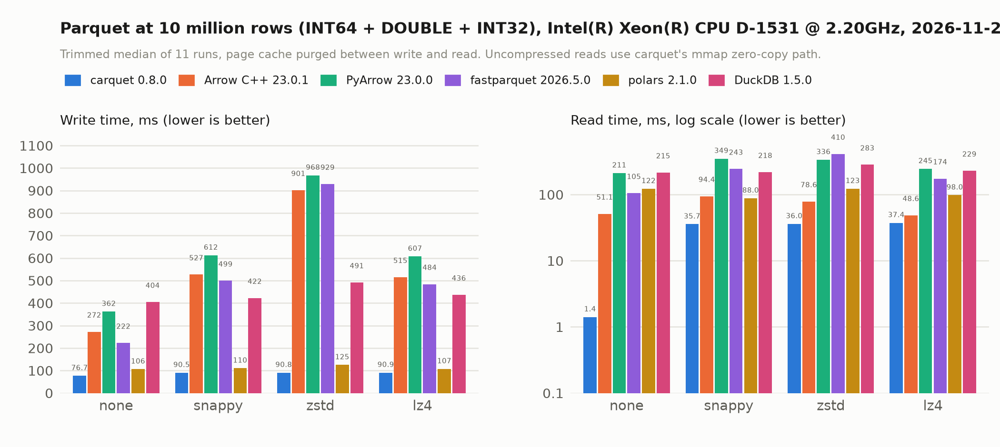

<h1 align="center">
  
</h1>

<p align="center">
  A fast, pure C library for reading and writing Apache Parquet files.
</p>

<p align="center">
  <a href="https://vitruves.github.io/carquet/"></a>
</p>

<p align="center">
  <a href="https://github.com/Vitruves/carquet/actions/workflows/cpp.yml"></a>
  
  
  <a href="https://github.com/Vitruves/carquet/releases"></a>
  <a href="LICENSE"></a>
  <a href="https://github.com/Vitruves/carquet/graphs/traffic"></a>
  <br/>
  <a href="https://pypi.org/project/carquet/"></a>
  <a href="https://pypi.org/project/carquet/"></a>
  <a href="https://pepy.tech/projects/carquet"></a>
  
</p>

<p align="center">
  <a href="#highlights">Highlights</a> &nbsp;·&nbsp;
  <a href="#benchmarks">Benchmarks</a> &nbsp;·&nbsp;
  <a href="#installation">Installation</a> &nbsp;·&nbsp;
  <a href="#build-configurations">Build configurations</a> &nbsp;·&nbsp;
  <a href="#c-api">C API</a> &nbsp;·&nbsp;
  <a href="#python-api">Python API</a> &nbsp;·&nbsp;
  <a href="#cli-tool">CLI</a> &nbsp;·&nbsp;
  <a href="#parquet-feature-support">Features</a> &nbsp;·&nbsp;
  <a href="docs/README.md">Manual</a> &nbsp;·&nbsp;
  <a href="CHANGELOG.md">Changelog</a>
</p>

<p align="center">
  <b>English</b> &nbsp;·&nbsp;
  <a href="README.zh-CN.md">简体中文</a> &nbsp;·&nbsp;
  <a href="README.ja.md">日本語</a> &nbsp;·&nbsp;
  <a href="README.ko.md">한국어</a> &nbsp;·&nbsp;
  <a href="README.de.md">Deutsch</a> &nbsp;·&nbsp;
  <a href="README.fr.md">Français</a> &nbsp;·&nbsp;
  <a href="README.pt-BR.md">Português (Brasil)</a>
</p>

<br/>
<br/>


### Highlights

<div align="center">

| | |
|---|---|
| &nbsp; **Fast** | Writes **2.3–10.6x faster** than Arrow C++ and reads compressed data **1.5–2.1x faster** from the very same file (Apple M3, 10M rows); with a codec, reads are also **3.0–4.4x faster** than polars and **2.9–4.3x faster** than DuckDB. Uncompressed reads are served straight from the mmap in **0.26 ms**. |
| &nbsp; **SIMD** | 30+ hand-written vector kernels for **SSE4.2, AVX, AVX2, AVX-512, NEON and SVE**: bit-unpacking and RLE levels, dictionary gathers, byte-stream split, min/max statistics, null bitmaps, Snappy / LZ4 match copies. One portable binary picks the widest kernel at runtime, with a scalar fallback. |
| &nbsp; **Small** | Pure C11, a **~500 KB** library (Arrow C++: 50 MB+). Four compression dependencies (zstd, zlib, lz4, brotli), fetched automatically when missing. Builds in under a minute with a single `make` or `xmake`. |
| &nbsp; **Complete** | All physical types and encodings, Snappy / GZIP / LZ4 / ZSTD / Brotli, V1 + V2 pages, nested schemas at any depth, bloom filters, page indexes, statistics-based pruning, append. [Full matrix ↓](#parquet-feature-support) |
| &nbsp; **Interoperable** | Files read by PyArrow, DuckDB and Spark out of the box. Zero-dependency [Arrow C Data Interface](docs/reading.md#export-to-arrow-c-data-interface) bridge (struct / list / map at any depth) and a full [Python API](#python-api) with no dependencies. |
| &nbsp; **Tooling** | `carquet` CLI to inspect, filter, export and validate files, plus `codegen` to emit a ready-to-compile C reader. A ready-made [agent skill](#ai-coding-agents) for Claude Code and Codex. |

</div>

<br/>
<br/>


### Benchmarks

<p align="center">
  <picture>
    <source media="(prefers-color-scheme: dark)" srcset="res/img/bench_10m_m3_dark.png">
    <source media="(prefers-color-scheme: light)" srcset="res/img/bench_10m_m3_light.png">
    
  </picture>
</p>

<p align="center">
  <picture>
    <source media="(prefers-color-scheme: dark)" srcset="res/img/bench_10m_linux_dark.png">
    <source media="(prefers-color-scheme: light)" srcset="res/img/bench_10m_linux_light.png">
    
  </picture>
</p>

<p align="center"><b><a href="https://vitruves.github.io/carquet/">Explore the interactive benchmark on the website →</a></b><br/><sub>switch between read and write, and between 100K, 1M and 10M rows</sub></p>

Speed-up of carquet over Arrow C++ at 10M rows (higher = carquet faster):

<div align="center">

| | ARM · Apple M3 | | x86 · Windows (Haswell, MSVC) | | x86 · Linux (Xeon D-1531) | |
|---|---:|---:|---:|---:|---:|---:|
| **Codec** | **Write** | **Read** | **Write** | **Read** | **Write** | **Read** |
| snappy | **7.24x** | **2.68x** | **3.39x** | **1.17x** | **5.82x** | **2.65x** |
| zstd | **10.6x** | **3.14x** | **3.83x** | **1.13x** | **9.93x** | **2.18x** |
| lz4 | **6.01x** | **1.88x** | **2.96x** | **1.05x** | **5.66x** | **1.30x** |
| none | **2.32x** | **55.9x**\* | **2.10x** | **62.0x**\* | **3.55x** | **36.3x**\* |

</div>

<sub>\* mmap zero-copy path. Apple M3: carquet `main` after 0.8.0 vs Arrow C++ 26.0.1 (2026-11-22). Linux: the same carquet vs Arrow C++ 23.0.1 (2026-11-22, files on tmpfs). Windows: carquet 0.7.3 vs Arrow C++ 24.0.0 (2026-11-02), not re-measured since. With a codec carquet dictionary-encodes the two integer columns on its own, which Arrow C++ is asked not to do here (see the methodology).</sub>

Compressed reads decode every value, and on Linux and macOS both libraries link the same system lz4 / zstd, so codec speed is identical. The fairest comparison is the **same-file cross-read** (both libraries read the exact same file): carquet is **1.5–2.1x faster** than Arrow C++ on M3 (2.0–3.8x faster than polars), 1.7–2.7x on Linux (1.7–3.9x faster than polars) and 1.04–1.30x on the Windows VM, whose cold reads are bound by the virtual disk.

<details>
<summary><b>Benchmark methodology</b></summary>

<br/>

All benchmarks use identical data (deterministic LCG PRNG), the same row groups, zstd level and page size, trimmed median of 11–51 iterations, with the OS page cache purged between write and read phases and a cooldown between configurations. Schema: 3 columns (INT64, DOUBLE, INT32). Compared against the Arrow C++ low-level Parquet reader (bypassing Arrow Table materialization), PyArrow, fastparquet, polars' native (Rust) reader and writer and DuckDB's native (C++) ones.

Encodings: carquet writes with its defaults, which are PLAIN without a codec and, with one, BYTE_STREAM_SPLIT for the DOUBLE column and a dictionary on an integer column when a sample of the chunk says it pays (both integer columns here); page checksums are on. Arrow C++, PyArrow and fastparquet are run without dictionary (BYTE_STREAM_SPLIT for the doubles where they can write it), as in earlier versions of this benchmark, so their compressed files are larger than carquet's; polars and DuckDB choose their encodings themselves and dictionary-encode the two integer columns with or without a codec, which is why their uncompressed files are 45% smaller than carquet's PLAIN ones. The file sizes are in the tables.

The page cache is purged per file: `posix_fadvise(DONTNEED)` on Linux; on macOS and Windows the file is copied without caching (`F_NOCACHE`, `FILE_FLAG_NO_BUFFERING`) and the copy replaces it (`benchmark/bench_purge_win32.h`). On Windows, carquet links the zstd / lz4 it builds itself and Arrow C++ the conda-forge ones, so codec speed can differ slightly between the two.

The **same-file cross-read** benchmark is the fairest comparison: both libraries read the exact same Parquet file (written by one, read by both). This eliminates differences in page sizes, encoding choices, and row group layout.

**Uncompressed reads** marked with \* use Carquet's **mmap zero-copy path**: for PLAIN-encoded, uncompressed, fixed-size, required columns, the batch reader returns pointers directly into the memory-mapped file with no memcpy. Arrow always materializes into its own buffers. **The compressed read numbers are the most representative measure of end-to-end read throughput.**

</details>

<details>
<summary><b>Full x86 results</b> (Intel Xeon D-1531, Linux)</summary>

<br/>

*Carquet `main` after 0.8.0, Xeon D-1531 (6 cores / 12 threads @ 2.2GHz, AVX2), 32GB RAM, Ubuntu 24.04, GCC 13.3, Arrow C++ 23.0.1, PyArrow 23.0.0, fastparquet 2026.5.0, polars 2.1.0, DuckDB 1.5.0, ZSTD level 1, files on tmpfs, measured on 2026-11-22.*

##### 10M rows vs Arrow C++

<div align="center">

| Codec | Carquet Write | Arrow C++ Write | W ratio | Carquet Read | Arrow C++ Read | R ratio | Size |
|-------|--------------|---------|---------|-------------|---------|---------|------|
| none | **76.7ms** | 272ms | **3.55x** | **1.41ms** | 51.1ms | **36.3x**\* | 190.7MB |
| snappy | **90.5ms** | 527ms | **5.82x** | **35.7ms** | 94.4ms | **2.65x** | 94.9MB |
| zstd | **90.8ms** | 901ms | **9.93x** | **36.0ms** | 78.6ms | **2.18x** | 91.2MB |
| lz4 | **90.9ms** | 515ms | **5.66x** | **37.4ms** | 48.6ms | **1.30x** | 94.9MB |

</div>

<br/>

##### 1M rows vs Arrow C++

<div align="center">

| Codec | Carquet Write | Arrow C++ Write | W ratio | Carquet Read | Arrow C++ Read | R ratio | Size |
|-------|--------------|---------|---------|-------------|---------|---------|------|
| none | **8.18ms** | 27.7ms | **3.39x** | **0.19ms** | 6.10ms | **32.1x**\* | 19.1MB |
| snappy | **10.8ms** | 54.9ms | **5.10x** | **4.36ms** | 11.2ms | **2.56x** | 10.6MB |
| zstd | **13.6ms** | 91.3ms | **6.71x** | **4.70ms** | 9.13ms | **1.94x** | 9.74MB |
| lz4 | **11.1ms** | 53.5ms | **4.83x** | **4.27ms** | 5.79ms | **1.36x** | 10.6MB |

</div>

<br/>

##### 100K rows vs Arrow C++

<div align="center">

| Codec | Carquet Write | Arrow C++ Write | W ratio | Carquet Read | Arrow C++ Read | R ratio | Size |
|-------|--------------|---------|---------|-------------|---------|---------|------|
| none | **0.97ms** | 3.18ms | **3.28x** | **0.04ms** | 1.73ms | **43.2x**\* | 1.91MB |
| snappy | **3.10ms** | 5.47ms | **1.76x** | **0.68ms** | 5.14ms | **7.56x** | 1.06MB |
| zstd | **3.69ms** | 9.36ms | **2.54x** | **1.02ms** | 3.83ms | **3.75x** | 0.97MB |
| lz4 | **3.30ms** | 5.25ms | **1.59x** | **0.55ms** | 2.27ms | **4.13x** | 1.06MB |

</div>

<br/>

##### 10M rows vs PyArrow

<div align="center">

| Codec | Carquet Write | PyArrow Write | W ratio | Carquet Read | PyArrow Read | R ratio | Size |
|-------|--------------|---------|---------|-------------|---------|---------|------|
| none | **76.7ms** | 362ms | **4.72x** | **1.41ms** | 211ms | **149.7x**\* | 190.7MB |
| snappy | **90.5ms** | 612ms | **6.77x** | **35.7ms** | 349ms | **9.80x** | 94.9MB |
| zstd | **90.8ms** | 968ms | **10.7x** | **36.0ms** | 336ms | **9.31x** | 91.2MB |
| lz4 | **90.9ms** | 607ms | **6.68x** | **37.4ms** | 245ms | **6.55x** | 94.9MB |

</div>

<br/>

##### 1M rows vs PyArrow

<div align="center">

| Codec | Carquet Write | PyArrow Write | W ratio | Carquet Read | PyArrow Read | R ratio | Size |
|-------|--------------|---------|---------|-------------|---------|---------|------|
| none | **8.18ms** | 36.6ms | **4.47x** | **0.19ms** | 8.92ms | **46.9x**\* | 19.1MB |
| snappy | **10.8ms** | 62.9ms | **5.85x** | **4.36ms** | 17.1ms | **3.92x** | 10.6MB |
| zstd | **13.6ms** | 99.5ms | **7.31x** | **4.70ms** | 18.6ms | **3.95x** | 9.74MB |
| lz4 | **11.1ms** | 62.6ms | **5.65x** | **4.27ms** | 10.4ms | **2.45x** | 10.6MB |

</div>

<br/>

##### 100K rows vs PyArrow

<div align="center">

| Codec | Carquet Write | PyArrow Write | W ratio | Carquet Read | PyArrow Read | R ratio | Size |
|-------|--------------|---------|---------|-------------|---------|---------|------|
| none | **0.97ms** | 3.60ms | **3.71x** | **0.04ms** | 1.49ms | **37.2x**\* | 1.91MB |
| snappy | **3.10ms** | 6.33ms | **2.04x** | **0.68ms** | 5.21ms | **7.66x** | 1.06MB |
| zstd | **3.69ms** | 9.94ms | **2.69x** | **1.02ms** | 5.45ms | **5.34x** | 0.97MB |
| lz4 | **3.30ms** | 6.28ms | **1.90x** | **0.55ms** | 2.30ms | **4.18x** | 1.06MB |

</div>

<br/>

##### 10M rows vs fastparquet

<div align="center">

| Codec | Carquet Write | fastparquet Write | W ratio | Carquet Read | fastparquet Read | R ratio | Size |
|-------|--------------|---------|---------|-------------|---------|---------|------|
| none | **76.7ms** | 222ms | **2.90x** | **1.41ms** | 105ms | **74.2x**\* | 190.7MB |
| snappy | **90.5ms** | 499ms | **5.51x** | **35.7ms** | 243ms | **6.82x** | 94.9MB |
| zstd | **90.8ms** | 929ms | **10.2x** | **36.0ms** | 410ms | **11.4x** | 91.2MB |
| lz4 | **90.9ms** | 484ms | **5.32x** | **37.4ms** | 174ms | **4.66x** | 94.9MB |

</div>

<br/>

##### 1M rows vs fastparquet

<div align="center">

| Codec | Carquet Write | fastparquet Write | W ratio | Carquet Read | fastparquet Read | R ratio | Size |
|-------|--------------|---------|---------|-------------|---------|---------|------|
| none | **8.18ms** | 32.6ms | **3.99x** | **0.19ms** | 9.84ms | **51.8x**\* | 19.1MB |
| snappy | **10.8ms** | 59.6ms | **5.54x** | **4.36ms** | 23.7ms | **5.43x** | 10.6MB |
| zstd | **13.6ms** | 99.4ms | **7.31x** | **4.70ms** | 39.8ms | **8.46x** | 9.74MB |
| lz4 | **11.1ms** | 58.9ms | **5.31x** | **4.27ms** | 16.3ms | **3.81x** | 10.6MB |

</div>

<br/>

##### 100K rows vs fastparquet

<div align="center">

| Codec | Carquet Write | fastparquet Write | W ratio | Carquet Read | fastparquet Read | R ratio | Size |
|-------|--------------|---------|---------|-------------|---------|---------|------|
| none | **0.97ms** | 3.46ms | **3.57x** | **0.04ms** | 1.90ms | **47.5x**\* | 1.91MB |
| snappy | **3.10ms** | 6.22ms | **2.01x** | **0.68ms** | 3.35ms | **4.93x** | 1.06MB |
| zstd | **3.69ms** | 10.4ms | **2.82x** | **1.02ms** | 4.95ms | **4.85x** | 0.97MB |
| lz4 | **3.30ms** | 6.19ms | **1.88x** | **0.55ms** | 2.62ms | **4.76x** | 1.06MB |

</div>

<br/>

##### 10M rows vs polars

<div align="center">

| Codec | Carquet Write | polars Write | W ratio | Carquet Read | polars Read | R ratio | Carquet Size | polars Size |
|-------|--------------|---------|---------|-------------|---------|---------|------|------|
| none | **76.7ms** | 106ms | **1.38x** | **1.41ms** | 122ms | **86.8x**\* | 190.7MB | 105.1MB |
| snappy | **90.5ms** | 110ms | **1.22x** | **35.7ms** | 88.0ms | **2.47x** | 94.9MB | 103.8MB |
| zstd | **90.8ms** | 125ms | **1.38x** | **36.0ms** | 123ms | **3.41x** | 91.2MB | 98.1MB |
| lz4 | **90.9ms** | 107ms | **1.18x** | **37.4ms** | 98.0ms | **2.62x** | 94.9MB | 104.2MB |

</div>

<br/>

##### 1M rows vs polars

<div align="center">

| Codec | Carquet Write | polars Write | W ratio | Carquet Read | polars Read | R ratio | Carquet Size | polars Size |
|-------|--------------|---------|---------|-------------|---------|---------|------|------|
| none | **8.18ms** | 13.3ms | **1.63x** | **0.19ms** | 8.83ms | **46.5x**\* | 19.1MB | 12.6MB |
| snappy | **10.8ms** | 14.0ms | **1.30x** | **4.36ms** | 11.1ms | **2.54x** | 10.6MB | 11.5MB |
| zstd | **13.6ms** | 16.1ms | **1.18x** | **4.70ms** | 13.9ms | **2.95x** | 9.74MB | 10.1MB |
| lz4 | **11.1ms** | 14.4ms | **1.30x** | **4.27ms** | 11.1ms | **2.60x** | 10.6MB | 11.5MB |

</div>

<br/>

##### 100K rows vs polars

<div align="center">

| Codec | Carquet Write | polars Write | W ratio | Carquet Read | polars Read | R ratio | Carquet Size | polars Size |
|-------|--------------|---------|---------|-------------|---------|---------|------|------|
| none | **0.97ms** | 6.43ms | **6.63x** | **0.04ms** | 4.45ms | **111.2x**\* | 1.91MB | 1.26MB |
| snappy | **3.10ms** | 8.57ms | **2.76x** | **0.68ms** | 5.71ms | **8.40x** | 1.06MB | 1.15MB |
| zstd | **3.69ms** | 10.7ms | **2.89x** | **1.02ms** | 9.13ms | **8.95x** | 0.97MB | 1.01MB |
| lz4 | **3.30ms** | 8.96ms | **2.72x** | **0.55ms** | 5.93ms | **10.8x** | 1.06MB | 1.15MB |

</div>

<br/>

##### 10M rows vs DuckDB

<div align="center">

| Codec | Carquet Write | DuckDB Write | W ratio | Carquet Read | DuckDB Read | R ratio | Carquet Size | DuckDB Size |
|-------|--------------|---------|---------|-------------|---------|---------|------|------|
| none | **76.7ms** | 404ms | **5.27x** | **1.41ms** | 215ms | **152.5x**\* | 190.7MB | 106.9MB |
| snappy | **90.5ms** | 422ms | **4.67x** | **35.7ms** | 218ms | **6.10x** | 94.9MB | 105.7MB |
| zstd | **90.8ms** | 491ms | **5.41x** | **36.0ms** | 283ms | **7.84x** | 91.2MB | 100.2MB |
| lz4 | **90.9ms** | 436ms | **4.80x** | **37.4ms** | 229ms | **6.11x** | 94.9MB | 106.1MB |

</div>

<br/>

##### 1M rows vs DuckDB

<div align="center">

| Codec | Carquet Write | DuckDB Write | W ratio | Carquet Read | DuckDB Read | R ratio | Carquet Size | DuckDB Size |
|-------|--------------|---------|---------|-------------|---------|---------|------|------|
| none | **8.18ms** | 53.1ms | **6.49x** | **0.19ms** | 17.6ms | **92.4x**\* | 19.1MB | 16.1MB |
| snappy | **10.8ms** | 54.0ms | **5.02x** | **4.36ms** | 23.8ms | **5.45x** | 10.6MB | 12.4MB |
| zstd | **13.6ms** | 55.9ms | **4.11x** | **4.70ms** | 30.8ms | **6.56x** | 9.74MB | 9.92MB |
| lz4 | **11.1ms** | 57.0ms | **5.14x** | **4.27ms** | 20.2ms | **4.72x** | 10.6MB | 12.3MB |

</div>

<br/>

##### 100K rows vs DuckDB

<div align="center">

| Codec | Carquet Write | DuckDB Write | W ratio | Carquet Read | DuckDB Read | R ratio | Carquet Size | DuckDB Size |
|-------|--------------|---------|---------|-------------|---------|---------|------|------|
| none | **0.97ms** | 7.03ms | **7.25x** | **0.04ms** | 3.21ms | **80.2x**\* | 1.91MB | 1.61MB |
| snappy | **3.10ms** | 8.53ms | **2.75x** | **0.68ms** | 4.45ms | **6.54x** | 1.06MB | 1.24MB |
| zstd | **3.69ms** | 11.5ms | **3.12x** | **1.02ms** | 5.55ms | **5.44x** | 0.97MB | 0.99MB |
| lz4 | **3.30ms** | 8.82ms | **2.67x** | **0.55ms** | 3.64ms | **6.62x** | 1.06MB | 1.23MB |

</div>

<br/>

##### Same-file cross-read (10M rows)

Both libraries read the **same** Parquet file, the fairest apples-to-apples comparison.

<div align="center">

| Codec | Writer | Carquet Read | Arrow C++ Read | Ratio |
|-------|--------|-------------|----------------|-------|
| none | Carquet | **1.67ms** | 72.8ms | **43.6x**\* |
| none | Arrow | **7.49ms** | 51.7ms | **6.91x**\* |
| snappy | Carquet | **38.5ms** | 79.2ms | **2.06x** |
| snappy | Arrow | **34.2ms** | 93.7ms | **2.74x** |
| zstd | Carquet | **36.1ms** | 80.0ms | **2.22x** |
| zstd | Arrow | **45.0ms** | 76.3ms | **1.70x** |
| lz4 | Carquet | **36.0ms** | 82.2ms | **2.28x** |
| lz4 | Arrow | **27.4ms** | 49.4ms | **1.81x** |

</div>

<br/>

##### Same-file cross-read vs polars (10M rows)

Each library reads the file carquet's benchmark writes and the file polars writes with its own settings.

<div align="center">

| Codec | Writer | Carquet Read | polars Read | Ratio | File |
|-------|--------|-------------|-------------|-------|------|
| none | Carquet | **1.65ms** | 76.2ms | **46.2x**\* | 190.7MB |
| none | polars | **42.0ms** | 75.8ms | **1.81x** | 105.1MB |
| snappy | Carquet | **36.9ms** | 103ms | **2.78x** | 94.9MB |
| snappy | polars | **45.0ms** | 95.5ms | **2.12x** | 103.8MB |
| zstd | Carquet | **38.6ms** | 149ms | **3.85x** | 91.2MB |
| zstd | polars | **46.0ms** | 89.3ms | **1.94x** | 98.1MB |
| lz4 | Carquet | **39.8ms** | 135ms | **3.40x** | 94.9MB |
| lz4 | polars | **46.3ms** | 79.4ms | **1.71x** | 104.2MB |

</div>

\* Zero-copy mmap path. fastparquet reads through pandas and cannot write BYTE_STREAM_SPLIT or page checksums, so its rows are less directly comparable.

polars uses its own Rust Parquet reader and writer (`use_pyarrow=False`, its default) and DuckDB its own C++ ones (`COPY ... TO` from an in-memory table, `read_parquet` fetched as an Arrow table), with the same data, row group size, zstd level and LZ4_RAW for `lz4`. polars cannot write BYTE_STREAM_SPLIT or page checksums; both pick their encodings themselves and dictionary-encode `id` and `category`, with or without a codec. Without a codec carquet keeps PLAIN, so that such a file is read straight from the mmap: it then writes 190.7 MB where polars and DuckDB write 105 MB, and the time of an uncompressed write follows the bytes put through the file system. Reads are compared fairly by the same-file table.

</details>

<details>
<summary><b>Full ARM results</b> (Apple M3, macOS)</summary>

<br/>

*Carquet `main` after 0.8.0, MacBook Air M3, 16GB RAM, macOS 26.5, Arrow C++ 26.0.1, PyArrow 26.0.1, fastparquet 2026.9.0, polars 2.1.0, DuckDB 2.0.0, ZSTD level 1, measured on 2026-11-22. Raw report: [`site/bench.json`](site/bench.json).*

##### 10M rows vs Arrow C++

<div align="center">

| Codec | Carquet Write | Arrow C++ Write | W ratio | Carquet Read | Arrow C++ Read | R ratio | Size |
|-------|--------------|---------|---------|-------------|---------|---------|------|
| none | **46.5ms** | 108ms | **2.32x** | **0.26ms** | 14.5ms | **55.9x**\* | 190.7MB |
| snappy | **30.4ms** | 220ms | **7.24x** | **8.19ms** | 21.9ms | **2.68x** | 94.9MB |
| zstd | **31.3ms** | 332ms | **10.6x** | **8.77ms** | 27.5ms | **3.14x** | 91.2MB |
| lz4 | **40.3ms** | 242ms | **6.01x** | **9.12ms** | 17.1ms | **1.88x** | 95.0MB |

</div>

<br/>

##### 1M rows vs Arrow C++

<div align="center">

| Codec | Carquet Write | Arrow C++ Write | W ratio | Carquet Read | Arrow C++ Read | R ratio | Size |
|-------|--------------|---------|---------|-------------|---------|---------|------|
| none | **5.60ms** | 11.6ms | **2.08x** | **0.05ms** | 1.55ms | **31.0x**\* | 19.1MB |
| snappy | **3.99ms** | 23.0ms | **5.77x** | **0.90ms** | 2.43ms | **2.70x** | 10.6MB |
| zstd | **4.23ms** | 33.3ms | **7.87x** | **1.18ms** | 3.02ms | **2.56x** | 9.74MB |
| lz4 | **3.85ms** | 24.1ms | **6.26x** | **0.91ms** | 1.82ms | **2.00x** | 10.6MB |

</div>

<br/>

##### 100K rows vs Arrow C++

<div align="center">

| Codec | Carquet Write | Arrow C++ Write | W ratio | Carquet Read | Arrow C++ Read | R ratio | Size |
|-------|--------------|---------|---------|-------------|---------|---------|------|
| none | **1.01ms** | 1.58ms | **1.56x** | **0.02ms** | 0.22ms | **11.0x**\* | 1.91MB |
| snappy | **1.20ms** | 2.47ms | **2.06x** | **0.28ms** | 0.84ms | **3.00x** | 1.06MB |
| zstd | **1.24ms** | 3.39ms | **2.73x** | **0.36ms** | 1.23ms | **3.42x** | 0.97MB |
| lz4 | **1.17ms** | 2.51ms | **2.15x** | **0.25ms** | 0.58ms | **2.32x** | 1.06MB |

</div>

<br/>

##### 10M rows vs PyArrow

<div align="center">

| Codec | Carquet Write | PyArrow Write | W ratio | Carquet Read | PyArrow Read | R ratio | Size |
|-------|--------------|---------|---------|-------------|---------|---------|------|
| none | **46.5ms** | 156ms | **3.35x** | **0.26ms** | 25.2ms | **96.9x**\* | 190.7MB |
| snappy | **30.4ms** | 259ms | **8.52x** | **8.19ms** | 38.2ms | **4.67x** | 94.9MB |
| zstd | **31.3ms** | 383ms | **12.2x** | **8.77ms** | 40.8ms | **4.65x** | 91.2MB |
| lz4 | **40.3ms** | 283ms | **7.01x** | **9.12ms** | 28.1ms | **3.08x** | 95.0MB |

</div>

<br/>

##### 1M rows vs PyArrow

<div align="center">

| Codec | Carquet Write | PyArrow Write | W ratio | Carquet Read | PyArrow Read | R ratio | Size |
|-------|--------------|---------|---------|-------------|---------|---------|------|
| none | **5.60ms** | 16.8ms | **3.00x** | **0.05ms** | 2.68ms | **53.6x**\* | 19.1MB |
| snappy | **3.99ms** | 26.8ms | **6.72x** | **0.90ms** | 3.68ms | **4.09x** | 10.6MB |
| zstd | **4.23ms** | 38.4ms | **9.09x** | **1.18ms** | 3.78ms | **3.20x** | 9.74MB |
| lz4 | **3.85ms** | 27.8ms | **7.22x** | **0.91ms** | 2.90ms | **3.19x** | 10.6MB |

</div>

<br/>

##### 100K rows vs PyArrow

<div align="center">

| Codec | Carquet Write | PyArrow Write | W ratio | Carquet Read | PyArrow Read | R ratio | Size |
|-------|--------------|---------|---------|-------------|---------|---------|------|
| none | **1.01ms** | 1.95ms | **1.93x** | **0.02ms** | 0.25ms | **12.5x**\* | 1.91MB |
| snappy | **1.20ms** | 2.80ms | **2.33x** | **0.28ms** | 0.63ms | **2.25x** | 1.06MB |
| zstd | **1.24ms** | 3.80ms | **3.06x** | **0.36ms** | 0.69ms | **1.92x** | 0.97MB |
| lz4 | **1.17ms** | 2.89ms | **2.47x** | **0.25ms** | 0.42ms | **1.68x** | 1.06MB |

</div>

<br/>

##### 10M rows vs fastparquet

<div align="center">

| Codec | Carquet Write | fastparquet Write | W ratio | Carquet Read | fastparquet Read | R ratio | Size |
|-------|--------------|---------|---------|-------------|---------|---------|------|
| none | **46.5ms** | 56.2ms | **1.21x** | **0.26ms** | 49.0ms | **188.4x**\* | 190.7MB |
| snappy | **30.4ms** | 194ms | **6.40x** | **8.19ms** | 101ms | **12.3x** | 94.9MB |
| zstd | **31.3ms** | 322ms | **10.3x** | **8.77ms** | 183ms | **20.8x** | 91.2MB |
| lz4 | **40.3ms** | 233ms | **5.78x** | **9.12ms** | 53.6ms | **5.88x** | 95.0MB |

</div>

<br/>

##### 1M rows vs fastparquet

<div align="center">

| Codec | Carquet Write | fastparquet Write | W ratio | Carquet Read | fastparquet Read | R ratio | Size |
|-------|--------------|---------|---------|-------------|---------|---------|------|
| none | **5.60ms** | 7.38ms | **1.32x** | **0.05ms** | 2.90ms | **58.0x**\* | 19.1MB |
| snappy | **3.99ms** | 21.3ms | **5.33x** | **0.90ms** | 9.94ms | **11.0x** | 10.6MB |
| zstd | **4.23ms** | 32.4ms | **7.65x** | **1.18ms** | 17.7ms | **15.0x** | 9.74MB |
| lz4 | **3.85ms** | 20.9ms | **5.42x** | **0.91ms** | 5.01ms | **5.51x** | 10.6MB |

</div>

<br/>

##### 100K rows vs fastparquet

<div align="center">

| Codec | Carquet Write | fastparquet Write | W ratio | Carquet Read | fastparquet Read | R ratio | Size |
|-------|--------------|---------|---------|-------------|---------|---------|------|
| none | 1.01ms | **1.00ms** | 0.99x | **0.02ms** | 0.49ms | **24.5x**\* | 1.91MB |
| snappy | **1.20ms** | 2.26ms | **1.88x** | **0.28ms** | 1.11ms | **3.96x** | 1.06MB |
| zstd | **1.24ms** | 3.21ms | **2.59x** | **0.36ms** | 1.98ms | **5.50x** | 0.97MB |
| lz4 | **1.17ms** | 2.15ms | **1.84x** | **0.25ms** | 0.67ms | **2.68x** | 1.06MB |

</div>

<br/>

##### 10M rows vs polars

<div align="center">

| Codec | Carquet Write | polars Write | W ratio | Carquet Read | polars Read | R ratio | Carquet Size | polars Size |
|-------|--------------|---------|---------|-------------|---------|---------|------|------|
| none | 46.5ms | **37.5ms** | 0.81x | **0.26ms** | 27.6ms | **106.2x**\* | 190.7MB | 105.1MB |
| snappy | **30.4ms** | 37.8ms | **1.25x** | **8.19ms** | 27.4ms | **3.35x** | 94.9MB | 103.8MB |
| zstd | **31.3ms** | 45.9ms | **1.47x** | **8.77ms** | 38.6ms | **4.40x** | 91.2MB | 98.1MB |
| lz4 | 40.3ms | **38.9ms** | 0.96x | **9.12ms** | 27.4ms | **3.00x** | 95.0MB | 104.2MB |

</div>

<br/>

##### 1M rows vs polars

<div align="center">

| Codec | Carquet Write | polars Write | W ratio | Carquet Read | polars Read | R ratio | Carquet Size | polars Size |
|-------|--------------|---------|---------|-------------|---------|---------|------|------|
| none | 5.60ms | **4.16ms** | 0.74x | **0.05ms** | 2.67ms | **53.4x**\* | 19.1MB | 12.6MB |
| snappy | **3.99ms** | 4.44ms | **1.11x** | **0.90ms** | 2.87ms | **3.19x** | 10.6MB | 11.5MB |
| zstd | **4.23ms** | 5.32ms | **1.26x** | **1.18ms** | 3.82ms | **3.24x** | 9.74MB | 10.1MB |
| lz4 | **3.85ms** | 4.41ms | **1.15x** | **0.91ms** | 2.77ms | **3.04x** | 10.6MB | 11.5MB |

</div>

<br/>

##### 100K rows vs polars

<div align="center">

| Codec | Carquet Write | polars Write | W ratio | Carquet Read | polars Read | R ratio | Carquet Size | polars Size |
|-------|--------------|---------|---------|-------------|---------|---------|------|------|
| none | 1.01ms | **0.68ms** | 0.67x | **0.02ms** | 0.32ms | **16.0x**\* | 1.91MB | 1.26MB |
| snappy | 1.20ms | **0.90ms** | 0.75x | **0.28ms** | 0.43ms | **1.54x** | 1.06MB | 1.15MB |
| zstd | 1.24ms | **1.04ms** | 0.84x | **0.36ms** | 1.01ms | **2.81x** | 0.97MB | 1.01MB |
| lz4 | 1.17ms | **0.93ms** | 0.79x | **0.25ms** | 0.42ms | **1.68x** | 1.06MB | 1.15MB |

</div>

<br/>

##### 10M rows vs DuckDB

<div align="center">

| Codec | Carquet Write | DuckDB Write | W ratio | Carquet Read | DuckDB Read | R ratio | Carquet Size | DuckDB Size |
|-------|--------------|---------|---------|-------------|---------|---------|------|------|
| none | **46.5ms** | 116ms | **2.49x** | **0.26ms** | 24.5ms | **94.4x**\* | 190.7MB | 105.7MB |
| snappy | **30.4ms** | 119ms | **3.91x** | **8.19ms** | 31.5ms | **3.84x** | 94.9MB | 104.5MB |
| zstd | **31.3ms** | 133ms | **4.25x** | **8.77ms** | 37.5ms | **4.28x** | 91.2MB | 99.1MB |
| lz4 | **40.3ms** | 119ms | **2.94x** | **9.12ms** | 26.7ms | **2.92x** | 95.0MB | 104.9MB |

</div>

<br/>

##### 1M rows vs DuckDB

<div align="center">

| Codec | Carquet Write | DuckDB Write | W ratio | Carquet Read | DuckDB Read | R ratio | Carquet Size | DuckDB Size |
|-------|--------------|---------|---------|-------------|---------|---------|------|------|
| none | **5.60ms** | 10.2ms | **1.82x** | **0.05ms** | 3.05ms | **61.0x**\* | 19.1MB | 16.1MB |
| snappy | **3.99ms** | 10.4ms | **2.61x** | **0.90ms** | 3.70ms | **4.11x** | 10.6MB | 12.3MB |
| zstd | **4.23ms** | 11.3ms | **2.68x** | **1.18ms** | 5.16ms | **4.37x** | 9.74MB | 9.92MB |
| lz4 | **3.85ms** | 10.6ms | **2.75x** | **0.91ms** | 3.04ms | **3.34x** | 10.6MB | 12.3MB |

</div>

<br/>

##### 100K rows vs DuckDB

<div align="center">

| Codec | Carquet Write | DuckDB Write | W ratio | Carquet Read | DuckDB Read | R ratio | Carquet Size | DuckDB Size |
|-------|--------------|---------|---------|-------------|---------|---------|------|------|
| none | **1.01ms** | 1.79ms | **1.77x** | **0.02ms** | 0.54ms | **27.0x**\* | 1.91MB | 1.61MB |
| snappy | **1.20ms** | 2.43ms | **2.03x** | **0.28ms** | 0.93ms | **3.32x** | 1.06MB | 1.23MB |
| zstd | **1.24ms** | 3.40ms | **2.74x** | **0.36ms** | 1.59ms | **4.42x** | 0.97MB | 0.99MB |
| lz4 | **1.17ms** | 2.75ms | **2.35x** | **0.25ms** | 0.72ms | **2.88x** | 1.06MB | 1.23MB |

</div>

<br/>

##### Same-file cross-read (10M rows)

Both libraries read the **same** Parquet file, the fairest apples-to-apples comparison.

<div align="center">

| Codec | Writer | Carquet Read | Arrow C++ Read | Ratio |
|-------|--------|-------------|----------------|-------|
| none | Carquet | **0.28ms** | 16.4ms | **58.4x**\* |
| none | Arrow | **0.91ms** | 14.0ms | **15.3x**\* |
| snappy | Carquet | **8.08ms** | 17.1ms | **2.12x** |
| snappy | Arrow | **12.4ms** | 23.4ms | **1.88x** |
| zstd | Carquet | **9.40ms** | 18.3ms | **1.95x** |
| zstd | Arrow | **20.3ms** | 29.8ms | **1.47x** |
| lz4 | Carquet | **9.17ms** | 18.4ms | **2.01x** |
| lz4 | Arrow | **9.62ms** | 17.1ms | **1.78x** |

</div>

<br/>

\* Zero-copy mmap path. fastparquet reads through pandas and cannot write BYTE_STREAM_SPLIT or page checksums, so its rows are less directly comparable.

polars uses its own Rust Parquet reader and writer (`use_pyarrow=False`, its default) and DuckDB its own C++ ones (`COPY ... TO` from an in-memory table, `read_parquet` fetched as an Arrow table), with the same data, row group size, zstd level and LZ4_RAW for `lz4`. polars cannot write BYTE_STREAM_SPLIT or page checksums; both pick their encodings themselves and dictionary-encode `id` and `category`, with or without a codec. Without a codec carquet keeps PLAIN, so that such a file is read straight from the mmap: it then writes 190.7 MB where polars and DuckDB write 105 MB, and the time of an uncompressed write follows the bytes put through the file system. Reads are compared fairly by the same-file table.

</details>

<details>
<summary><b>Full Windows results</b> (Intel Haswell VM, MSVC)</summary>

<br/>

*Carquet 0.7.3 built with MSVC 19.44 (x64 Release, OpenMP), OpenStack VM with 4 vCPU (Intel Haswell, 3.1 GHz), 14.6GB RAM, virtual SAS disk, Windows Server 2025, Arrow C++ 24.0.0 (conda-forge), ZSTD level 1, measured on 2026-11-02. Cold reads go to the virtual disk, which narrows the read ratios; writes and the zero-copy path are CPU-bound.*

##### 10M rows vs Arrow C++

<div align="center">

| Codec | Carquet Write | Arrow C++ Write | W ratio | Carquet Read | Arrow C++ Read | R ratio | Size |
|-------|--------------|-----------------|---------|-------------|----------------|---------|------|
| none | **182ms** | 382ms | **2.10x** | **2.04ms** | 126.5ms | **62.0x**\* | 190.7MB |
| snappy | **175ms** | 594ms | **3.39x** | **115.6ms** | 134.9ms | **1.17x** | 125.1MB |
| zstd | **242ms** | 927ms | **3.83x** | **140.7ms** | 159.2ms | **1.13x** | 95.3MB |
| lz4 | **178ms** | 527ms | **2.96x** | **95.5ms** | 99.9ms | **1.05x** | 122.9MB |

</div>

<br/>

##### 1M rows vs Arrow C++

<div align="center">

| Codec | Carquet Write | Arrow C++ Write | W ratio | Carquet Read | Arrow C++ Read | R ratio |
|-------|--------------|-----------------|---------|-------------|----------------|---------|
| none | **15.6ms** | 37.6ms | **2.41x** | **0.44ms** | 13.72ms | **31.2x**\* |
| snappy | **25.4ms** | 61.2ms | **2.41x** | **14.01ms** | 16.31ms | **1.16x** |
| zstd | **30.4ms** | 94.3ms | **3.10x** | **17.09ms** | 18.38ms | **1.08x** |
| lz4 | **26.4ms** | 53.8ms | **2.04x** | 13.07ms | **12.89ms** | 0.99x |

</div>

<br/>

##### 100K rows vs Arrow C++

<div align="center">

| Codec | Carquet Write | Arrow C++ Write | W ratio | Carquet Read | Arrow C++ Read | R ratio |
|-------|--------------|-----------------|---------|-------------|----------------|---------|
| none | **3.53ms** | 3.95ms | **1.12x** | **0.16ms** | 2.13ms | **13.3x**\* |
| snappy | **5.60ms** | 6.23ms | **1.11x** | **2.79ms** | 3.92ms | **1.41x** |
| zstd | **7.11ms** | 9.79ms | **1.38x** | **2.86ms** | 4.36ms | **1.52x** |
| lz4 | **5.75ms** | 5.82ms | **1.01x** | 2.22ms | **2.15ms** | 0.97x |

</div>

<br/>

##### Same-file cross-read (10M rows)

<div align="center">

| Codec | Writer | Carquet Read | Arrow C++ Read | Ratio |
|-------|--------|-------------|----------------|-------|
| none | Carquet | **2.65ms** | 116.9ms | **44.1x**\* |
| none | Arrow | **5.29ms** | 126.6ms | **23.9x**\* |
| snappy | Carquet | **115.2ms** | 135.0ms | **1.17x** |
| snappy | Arrow | **112.7ms** | 146.2ms | **1.30x** |
| zstd | Carquet | **137.7ms** | 150.5ms | **1.09x** |
| zstd | Arrow | **134.9ms** | 155.3ms | **1.15x** |
| lz4 | Carquet | **92.1ms** | 95.6ms | **1.04x** |
| lz4 | Arrow | **89.7ms** | 98.1ms | **1.09x** |

</div>

\* Zero-copy mmap path

</details>

<details>
<summary><b>Running the benchmarks yourself</b></summary>

<br/>

```bash
make benchmark                                    # Release build of the benchmark programs into build/
./build/benchmark_carquet                         # carquet alone
python3 benchmark/run_benchmark.py --skip-xlarge  # full comparison with PyArrow (+ Arrow C++ if built)
```

<div align="center">

| `run_benchmark.py` flag / variable | Effect |
|---|---|
| `--quick` | Only the 10M-row configs (what the chart shows) |
| `--skip-xlarge` | Skip the 100M-row configs (~2 GB per codec, 30+ minutes) |
| `--fastparquet` | Also compare fastparquet (`pip install fastparquet pandas`) |
| `--polars` | Also compare polars' own Rust Parquet reader / writer (`pip install polars`) |
| `--duckdb` | Also compare DuckDB's own C++ Parquet reader / writer (`pip install duckdb pyarrow`) |
| `--no-pyarrow` / `--no-arrow-cpp` | Skip PyArrow / Arrow C++ |
| `--iterations N` | Fixed iteration count (default: auto, 11–51) |
| `--build-dir DIR` / `--temp-dir DIR` | Where the binaries live / where test files are written |
| `CARQUET_BENCH_ZSTD_LEVEL=3` | ZSTD level (default 1) |
| `CARQUET_BENCH_PHASE=write` | `benchmark_carquet` only: time one phase (`write`, `read`, `read_nommap`), the others run once (for profiling) |

</div>

Always benchmark a **Release** build: `make benchmark` reconfigures `build/` as Release; a leftover Debug `build/` makes carquet look several times slower. `make native` + `-DCARQUET_BUILD_BENCHMARKS=ON` gives the host-tuned numbers.

fastparquet uses the same data, row group size, no dictionary and zstd level, and LZ4_RAW for `lz4`. It cannot write BYTE_STREAM_SPLIT or page checksums, and it reads through pandas, so its numbers are less directly comparable than Arrow's.

polars runs with its native reader and writer (not through PyArrow), the same data, row group size, zstd level and LZ4_RAW for `lz4`. It cannot write BYTE_STREAM_SPLIT or page checksums, and it picks dictionary encoding itself (no switch), which makes its files smaller on this data.

The Arrow C++ comparison needs its own target (Arrow C++ found on the system, or pointed at with `CARQUET_ARROW_CPP_ROOT`):

```bash
cmake -B build -DCMAKE_BUILD_TYPE=Release -DCARQUET_NATIVE_ARCH=ON \
  -DCARQUET_BUILD_BENCHMARKS=ON -DCARQUET_BUILD_ARROW_CPP_BENCHMARK=ON \
  [-DCARQUET_ARROW_CPP_ROOT=/path/to/arrow-prefix]
cmake --build build -j
```

It uses the low-level `parquet::ParquetFileReader` API (no Arrow Table materialization) with parallel row group readers.

On Windows (Developer PowerShell for VS), Arrow C++ can come from conda-forge (`micromamba create -p C:\arrow -c conda-forge libarrow libparquet`); its DLLs must be on `PATH` when the benchmark runs:

```powershell
cmake -B build -G Ninja -DCMAKE_BUILD_TYPE=Release -DCARQUET_BUILD_BENCHMARKS=ON `
  -DCARQUET_BUILD_ARROW_CPP_BENCHMARK=ON -DCARQUET_ARROW_CPP_ROOT=C:/arrow/Library
cmake --build build
$env:PATH = "C:\arrow\Library\bin;$env:PATH"
python benchmark\run_benchmark.py --build-dir build --skip-xlarge --no-pyarrow
```

Keep the build and `--temp-dir` folders out of real-time antivirus scanning: Windows Defender scans every file the benchmark writes.

The README chart is drawn from the JSON a run leaves in `benchmark/`, in a light and a dark variant that GitHub picks from the reader's theme:

```bash
python3 benchmark/plot_readme_chart.py benchmark/bench_<version>_<os>_<arch>_<date>.json   # writes res/img/bench_10m_m3_{light,dark}.png (--name bench_10m_linux for the Linux figure)
```

</details>

<br/>
<br/>


### Thirty seconds of carquet

```c
#include <carquet/carquet.h>

carquet_error_t err = CARQUET_ERROR_INIT;
carquet_schema_t* schema = carquet_schema_create(&err);
carquet_schema_add_column(schema, "id", CARQUET_PHYSICAL_INT64, NULL, CARQUET_REPETITION_REQUIRED, 0, 0);

carquet_writer_t* w = carquet_writer_create("ids.parquet", schema, NULL, &err);
int64_t ids[] = {1, 2, 3};
carquet_writer_write_batch(w, 0, ids, 3, NULL, NULL);
carquet_writer_close(w);

carquet_reader_t* r = carquet_reader_open("ids.parquet", NULL, &err);
printf("%lld rows\n", (long long)carquet_reader_num_rows(r));   /* 3 rows */
carquet_reader_close(r);
carquet_schema_free(schema);
```

> **Where carquet fits.** Arrow stays the right choice when you need its ecosystem (compute kernels, datasets, Flight, encryption). carquet is for C and C++ programs, embedded systems and language runtimes that only need to read and write Parquet quickly and correctly.

<br/>
<br/>


### Installation

**Requirements:** a C11 compiler (GCC 4.9+, Clang 3.4+, MSVC 2015+) and CMake 3.16+ (or [xmake](#from-source-with-xmake)). zstd, zlib, lz4 and brotli are used from the system when present and fetched otherwise. OpenMP is optional (parallel reads and writes).

<br/>

#### From source, with `make`

The simplest route. `make` is a thin wrapper that calls CMake with the right flags, there is nothing else to configure:

```bash
git clone https://github.com/Vitruves/carquet.git && cd carquet
make                  # optimized Release build into build/
sudo make install     # library, headers, CLI, pkg-config and CMake package files
```

Then link with `-lcarquet`, `pkg-config --cflags --libs carquet`, or `find_package(carquet)` in CMake.

<div align="center">

| Command | What it does |
|---|---|
| `make` | Release static library + CLI (default) |
| `make native` | Same, tuned for this CPU (`-march=native`) |
| `make shared` | Shared library instead of static |
| `make debug` / `make test` | Debug build / build and run the test suite |
| `make install PREFIX=$HOME/.local` | Install to another prefix (default `/usr/local`) |

</div>

All targets and variables: [docs/building.md](docs/building.md#make-targets).

<br/>

#### From source, with `xmake`

[xmake](https://xmake.io) needs nothing else installed: it downloads pinned zstd 1.5.6, zlib 1.4, lz4 1.10.0 and brotli 1.1.0 and links them statically, so the `carquet` CLI has no runtime dependency.

```bash
git clone https://github.com/Vitruves/carquet.git && cd carquet
xmake                         # Release static library + CLI into build/<plat>/<arch>/release/
xmake install -o /usr/local   # headers, library and CLI (sudo if the prefix needs it)
```

A static install contains only `libcarquet.a`, so link the codecs yourself (`-lcarquet -lzstd -lz -llz4`, plus `-lbrotlienc -lbrotlidec -lbrotlicommon` unless built with `--brotli=n`). Configure with `xmake f --shared=y` instead for a self-contained shared library with the codecs built in.

<div align="center">

| `xmake f …` then `xmake` | What it does |
|---|---|
| `--shared=y` | Shared library with the codecs built in |
| `--native_arch=y` | Tune for this CPU (`-march=native`) |
| `--brotli=n` | Drop the BROTLI codec and its dependency |
| `--openmp=n` | Build without OpenMP |
| `-m debug --tests=y` | Debug build with tests (`xmake test`) |

</div>

All options: [docs/building.md](docs/building.md#xmake).

<br/>

#### In your CMake project

```cmake
include(FetchContent)
FetchContent_Declare(carquet GIT_REPOSITORY https://github.com/Vitruves/carquet.git GIT_TAG main)
FetchContent_MakeAvailable(carquet)
target_link_libraries(myapp PRIVATE carquet)
```

Or, after `make install`: `find_package(carquet REQUIRED)` and link `carquet::carquet`.

Set options before `FetchContent_MakeAvailable` (`set(CARQUET_BUILD_CLI OFF CACHE BOOL "" FORCE)`), or pass them as `-D` flags when building carquet on its own:

<div align="center">

| Option | Default | |
|---|:---:|---|
| `CARQUET_BUILD_SHARED` | OFF | Shared instead of static library |
| `CARQUET_BUILD_CLI` | ON | `carquet` CLI (turn OFF when embedding) |
| `CARQUET_NATIVE_ARCH` | OFF | `-march=native`, host-only binary |
| `CARQUET_ENABLE_BROTLI` | ON | OFF drops the libbrotli dependency |
| `CARQUET_BUNDLE_DEPS` | OFF | Always fetch and statically bundle the codecs |
| `CARQUET_ZSTD_TARGET` (and `_ZLIB_`, `_LZ4_`, `_BROTLI_`) | empty | Link your project's existing codec target |

</div>

All options: [docs/building.md](docs/building.md#cmake-options).

<br/>

#### Python

```bash
pip install carquet
```

Prebuilt wheels bundle the library for Linux, macOS and Windows; see the [Python API](#python-api).

<br/>
<br/>


### Build configurations

All `make` targets and variables, every CMake and xmake option, Windows toolchains (MSVC, clang-cl, MinGW-w64), linking your own zstd / zlib / lz4 / brotli, tests, sanitizers and the Doxygen reference are documented in **[docs/building.md](docs/building.md)**.

<a id="ai-coding-agents"></a>

<details>
<summary><b>AI coding agents</b> (a ready-made skill for Claude Code and Codex)</summary>

<br/>

[`.agents/skills/carquet/`](.agents/skills/carquet/) is an [Agent Skill](https://agentskills.io) that teaches a coding agent how to integrate carquet into your project: build wiring (CMake, FetchContent, pkg-config, xmake), which API to use for what, complete recipes, the level / null-bitmap / lifetime rules, type mappings and the usual pitfalls with their fixes. Copy or link it into your repository and the agent picks it up automatically:

```bash
mkdir -p .claude/skills && cp -r path/to/carquet/.agents/skills/carquet .claude/skills/   # Claude Code
mkdir -p .agents/skills && cp -r path/to/carquet/.agents/skills/carquet .agents/skills/   # Codex CLI
ln -s ../../third_party/carquet/.agents/skills/carquet .claude/skills/carquet               # vendored: stays in sync
```

The same files also work as a personal skill (`~/.claude/skills/`, `~/.codex/skills/`).

</details>

<br/>
<br/>


### C API

A Write and a Read example below; the [manual in `docs/`](docs/README.md) covers everything else.

<br/>

#### Write a Parquet File

```c
#include <carquet/carquet.h>

int main(void) {
    carquet_error_t err = CARQUET_ERROR_INIT;

    // Define schema
    carquet_schema_t* schema = carquet_schema_create(&err);
    carquet_schema_add_column(schema, "id",    CARQUET_PHYSICAL_INT64,  NULL, CARQUET_REPETITION_REQUIRED, 0, 0);
    carquet_schema_add_column(schema, "value", CARQUET_PHYSICAL_DOUBLE, NULL, CARQUET_REPETITION_REQUIRED, 0, 0);

    // Configure writer
    carquet_writer_options_t opts;
    carquet_writer_options_init(&opts);
    opts.compression = CARQUET_COMPRESSION_ZSTD;

    // Write
    carquet_writer_t* w = carquet_writer_create("output.parquet", schema, &opts, &err);

    int64_t ids[]    = {1, 2, 3, 4, 5};
    double values[]  = {1.1, 2.2, 3.3, 4.4, 5.5};
    carquet_writer_write_batch(w, 0, ids, 5, NULL, NULL);
    carquet_writer_write_batch(w, 1, values, 5, NULL, NULL);
    carquet_writer_close(w);

    carquet_schema_free(schema);
    return 0;
}
```

<br/>

#### Read a Parquet File

```c
#include <carquet/carquet.h>
#include <stdio.h>

int main(void) {
    carquet_error_t err = CARQUET_ERROR_INIT;

    // Open with mmap for best read performance
    carquet_reader_options_t opts;
    carquet_reader_options_init(&opts);
    opts.use_mmap = true;

    carquet_reader_t* r = carquet_reader_open("output.parquet", &opts, &err);
    if (!r) { printf("Error: %s\n", err.message); return 1; }

    printf("Rows: %lld, Columns: %d\n",
           (long long)carquet_reader_num_rows(r),
           carquet_reader_num_columns(r));

    // Batch reader for efficient iteration
    carquet_batch_reader_config_t cfg;
    carquet_batch_reader_config_init(&cfg);
    cfg.batch_size = 65536;

    carquet_batch_reader_t* br = carquet_batch_reader_create(r, &cfg, &err);
    carquet_row_batch_t* batch = NULL;

    while (carquet_batch_reader_next(br, &batch) == CARQUET_OK && batch) {
        const void* data;
        const uint8_t* nulls;
        int64_t n;
        carquet_row_batch_column(batch, 0, &data, &nulls, &n);
        const int64_t* ids = (const int64_t*)data;
        // process ids[0..n-1] ...
        carquet_row_batch_free(batch);
        batch = NULL;
    }

    carquet_batch_reader_free(br);
    carquet_reader_close(r);
    return 0;
}
```

<br/>

#### More Recipes

Everything beyond flat read/write lives in the manual; each page links to a runnable example:

<div align="center">

| You want to… | See |
|---|---|
| Nullable columns, row groups, buffer output | [`docs/writing.md`](docs/writing.md) |
| Lists, maps, groups, definition/repetition levels | [`docs/nested-data.md`](docs/nested-data.md) |
| Column projection, statistics, metadata inspection | [`docs/reading.md`](docs/reading.md) |
| Predicate pushdown, page-level filtering | [`docs/reading.md`](docs/reading.md) |
| Append row groups to an existing file | [`docs/writing.md`](docs/writing.md#append-to-an-existing-file) |
| Compression, custom codecs, writer tuning | [`docs/writing.md`](docs/writing.md), [`docs/performance.md`](docs/performance.md) |
| mmap, zero-copy, prebuffering, I/O coalescing | [`docs/performance.md`](docs/performance.md) |
| Error codes and recovery hints | [`docs/error-handling.md`](docs/error-handling.md) |

</div>

<br/>

#### API Reference

The full API is in [`include/carquet/carquet.h`](include/carquet/carquet.h). Key types:

<div align="center">

| Type | Purpose |
|------|---------|
| `carquet_reader_t` | File reader (open from path, `FILE*`, or memory buffer) |
| `carquet_writer_t` | File writer |
| `carquet_batch_reader_t` | High-level batch iteration |
| `carquet_schema_t` | Schema definition and introspection |
| `carquet_error_t` | Rich error info (code, message, source location, recovery hint) |

</div>

The [manual](docs/README.md) explains which surface to use when; the source layout and architecture are documented in [CONTRIBUTING.md](CONTRIBUTING.md). A browsable HTML reference can be generated from the headers with Doxygen, see [docs/building.md](docs/building.md#tests-sanitizers-and-api-docs).

<details>
<summary><b>Example application: MetricStore</b> (<code>mocklib/</code>)</summary>

<br/>

[`mocklib/`](mocklib/) is **MetricStore**, a complete, self-contained example application built on top of carquet, useful both as a reference for real-world usage and as an end-to-end integration test of the public API.

It models a time-series telemetry store (ingest events, then introspect and query them) and, in doing so, exercises **117 of carquet's 143 public functions (~82 %)**:

- **Write side**: schema construction with logical types, per-column encoding / compression / bloom tuning, page indexes and statistics
- **Read side**: column projection, predicate pushdown, page-level filtering, bloom membership, the Arrow C Data Interface bridge, nested `LIST` reconstruction, buffer/append I/O and metadata introspection

It links carquet the way any downstream project would (`find_package(carquet)` / `add_subdirectory`), ships a self-checking round-trip test, and its `write_sample` binary emits a file for external inspection. See [`mocklib/README.md`](mocklib/README.md).

</details>

<br/>
<br/>


### Python API

`carquet` on PyPI is not a wrapper around the C calls above: it is a **Pythonic, `pyarrow.parquet`-style API** (`read_table`, `ParquetFile`, `ParquetWriter`, DNF `filters`) built on the same engine. The wheel bundles the C library with every codec compiled in; data crosses into Python through the Arrow C Data Interface, so decoding, decompression and I/O run in C without the GIL. **It has no dependencies**: reads return a `carquet.Table` that converts to Python values, NumPy and pandas on its own, and that polars, DuckDB and PyArrow take without a copy.

```bash
pip install carquet              # no dependencies: no PyArrow, no NumPy needed
pip install "carquet[pandas]"    # with pandas + NumPy, for read_pandas() / to_pandas()
```

```python
import carquet as cq

table = cq.read_table("data.parquet", columns=["id", "price"], filters=[("price", ">", 100)])
df    = cq.read_pandas("data.parquet")                          # pandas.DataFrame, index restored
cq.write_table(table, "out.parquet", compression="zstd")        # also DataFrame, polars, dict, batches

with cq.ParquetFile("data.parquet") as pf:
    for batch in pf.iter_batches(batch_size=50_000, columns=["id"]):
        ...
    pf.metadata.row_group(0).column("price").statistics       # min / max / null_count
```

<div align="center">

| You want to… | Use |
|---|---|
| Read a file, a directory, bytes or a file object | `cq.read_table`, `cq.read_pandas` |
| Stream large files | `ParquetFile.iter_batches`, `cq.iter_batches` |
| Prune with statistics, page indexes, bloom filters | `filters=` (DNF, exact results), `ParquetFile.bloom_filter` |
| Write tables, DataFrames, polars, DuckDB results | `cq.write_table`, `cq.ParquetWriter` (incremental, `append=True`) |
| Hand the data to pandas, NumPy, polars, DuckDB, PyArrow | `t.to_pandas()`, `t.column("x").to_numpy()`, `polars.DataFrame(t)`, `pyarrow.table(t)` |
| Inspect a file without reading its data | `cq.read_metadata`, `cq.read_parquet_schema`, `cq.info`, `cq.validate` |

</div>

Types round-trip exactly with `pyarrow.parquet` (time zones, categoricals, decimals, large types, nested data). The full reference is in [`python/README.md`](python/README.md).

<br/>
<br/>


### CLI Tool

Carquet ships with a command-line tool for inspecting Parquet files and generating C reader code. It is built and installed by default alongside the library.

```
Commands:
  schema     Print file schema
  info       Print detailed file metadata
  head       Print first N rows
  tail       Print last N rows
  cat        Print rows with slicing/column/row filtering
  count      Print total row count
  columns    List column names (one per line)
  stat       Print column statistics
  validate   Verify file integrity
  sample     Print N random rows
  export     Write rows to stdout as CSV
  codegen    Generate C reader code
```

Typical usage:

```bash
carquet schema data.parquet
carquet head -n 20 data.parquet
carquet stat data.parquet
carquet validate data.parquet
```

<br/>

#### Row Filtering

`cat`, `count`, `head`, `tail`, `sample`, and `export` accept `-p / --filter EXPR` to push a row predicate down to the page level: only pages whose column-index min/max can match the predicate are decompressed.

```bash
carquet cat -p "price > 100 AND status = 'active'" data.parquet
carquet count --filter "id >= 1000" data.parquet
carquet export --filter "ts IS NOT NULL" -c id,ts data.parquet
```

The grammar is `column OP value [AND column OP value]...` with `OP` ∈ {`=`, `==`, `!=`, `<>`, `<`, `<=`, `>`, `>=`}, plus `column IS NULL` / `column IS NOT NULL`.

> Filtering requires the file to have a page index (`write_page_index = true`).

<br/>

#### Code Generation

Generate a complete, compilable C reader from any Parquet file's schema:

```bash
carquet codegen -f data.parquet -o reader.c
# Generated: reader.c
# Compile:   clang -o reader reader.c -I.../include -L.../build -lcarquet ...

./reader                    # reads data.parquet (embedded as default)
./reader other.parquet      # override with a different file
```

<details>
<summary><b>codegen options</b></summary>

<br/>

<div align="center">

| Flag | Description |
|------|-------------|
| `-f`, `--file FILE` | Parquet file to inspect the schema from |
| `-o`, `--output FILE` | Output source file (default: stdout) |
| `--mmap` | Use memory-mapped I/O in the generated code |
| `--skeleton` | Generate an empty `process_batch` for custom logic |
| `-c`, `--columns COLS` | Comma-separated column filter |
| `-b`, `--batch-size N` | Batch size (default: 1024) |

</div>

</details>

<br/>
<br/>


### Parquet Feature Support

What the library implements today, by area.

<br/>

#### Format

<div align="center">

| Feature | Status |
|---------|--------|
| Physical types | ✓  All 8 (BOOLEAN through FIXED_LEN_BYTE_ARRAY) |
| Logical types | ✓  STRING, DATE, TIME, TIMESTAMP, DECIMAL, UUID, JSON, INTERVAL, FLOAT16, VARIANT, GEOMETRY, GEOGRAPHY |
| Encodings | ✓  PLAIN, RLE, DICTIONARY, DELTA_BINARY_PACKED, DELTA_LENGTH_BYTE_ARRAY, DELTA_BYTE_ARRAY, BYTE_STREAM_SPLIT (read + write) |
| Data Page versions | ✓  V1 (default) and V2 (read + write) |
| Compression | ✓  UNCOMPRESSED, SNAPPY, GZIP, LZ4 (Hadoop-framed, codec 5), LZ4_RAW (codec 7), ZSTD, BROTLI (`CARQUET_ENABLE_BROTLI`, default ON); LZO via `carquet_register_codec()` |
| Nested schemas | ✓  Groups, lists, maps with definition/repetition levels; single-level LIST/MAP auto-shredding on write (`carquet_writer_write_list_column`) and List reconstruction on read; nested `ARROW:schema` emission |
| Encryption | ✗ Not supported; an encrypted-footer file (`PARE`) is reported as `CARQUET_ERROR_NOT_IMPLEMENTED` with an explicit message |

</div>

<details>
<summary><b>Indexing &amp; pruning</b></summary>

<br/>

<div align="center">

| Feature | Status |
|---------|--------|
| Bloom filters | ✓  Read, write, and query (`carquet_bloom_filter_check_*`); consulted automatically for row-group pruning |
| Page indexes | ✓  Column index + offset index (read + write + per-page stats access) |
| Statistics | ✓  Min/max/null count per column chunk; exact `distinct_count` for dictionary columns; Parquet 2.9 SizeStatistics (unencoded byte-array bytes + level histograms) |
| Predicate pushdown | ✓  Automatic row-group pruning via statistics + bloom filters (no callback needed); page-level filtering via column index (`carquet_batch_reader_set_page_filter`) |
| Geospatial statistics | ✓  Per-column bounding box and geometry types for GEOMETRY/GEOGRAPHY (`carquet_reader_geospatial_statistics`) |
| Column projection | ✓  Read only selected columns |
| Row window | ✓  Read an `[offset, limit)` slice of rows, skipping pages entirely (`carquet_batch_reader_set_row_range`) |

</div>

</details>

<details>
<summary><b>I/O &amp; extensibility</b></summary>

<br/>

<div align="center">

| Feature | Status |
|---------|--------|
| Append | ✓  Add row groups to an existing file (`carquet_writer_open_append`) |
| Custom codecs | ✓  Register a custom compress/decompress impl per codec slot (`carquet_register_codec`) |
| Key-value metadata | ✓  Read and write arbitrary footer metadata |
| Per-field metadata | ✓  Arrow `Field.custom_metadata` (variable labels/descriptions) via `ARROW:schema` (read + write) |
| Per-column options | ✓  Per-column encoding, compression, statistics, bloom filter |
| Buffer writer | ✓  Write Parquet to an in-memory buffer |
| CRC32 | ✓  Page-level verification (HW-accelerated on ARM) |
| Memory-mapped I/O | ✓  Zero-copy reads for uncompressed PLAIN data |
| Dictionary-preserving reads | ✓  Return RLE indices + dictionary instead of materialized values (`preserve_dictionaries`, `carquet_row_batch_column_dictionary`) |
| I/O coalescing | ✓  Pre-buffer multi-column reads in a single I/O |
| Speculative footer | ✓  Single-I/O file open for most files |
| OpenMP parallel reads | ✓  When available |
| Parallel writes | ✓  Page-level parallel encode/compress across columns (OpenMP) + background row-group I/O (`async_io`) |

</div>

</details>

<br/>
<br/>


### Interoperability

Carquet files are fully compatible with PyArrow, DuckDB, Spark, and any Parquet reader.

```python
import pyarrow.parquet as pq
table = pq.read_table("carquet_output.parquet")  # just works
```

```sql
-- DuckDB
SELECT * FROM read_parquet('carquet_output.parquet');
```

<details>
<summary><b>Interop test suite</b></summary>

<br/>

Bidirectional round-trips (C writes / Python reads, and back):

```bash
cmake -B build -DCARQUET_BUILD_INTEROP=ON && cmake --build build
python3 interop/run_interop.py
```

Large multi-row-group Snappy files (many row groups, wide `BYTE_ARRAY` columns, page offsets past 2 GiB) have their own generator, which builds the file with PyArrow and checks that carquet decodes every page:

```bash
CARQUET_BIN=build/carquet python3 interop/snappy_multi_rowgroup.py --rows 150000 --row-groups 92
```

</details>

<br/>
<br/>


### Contributing, Citing, License

- **Contributing**: [CONTRIBUTING.md](CONTRIBUTING.md) covers setup, code style and the per-pull-request gate (tests, sanitizers, fuzzing, interop, benchmarks). Release notes are in [CHANGELOG.md](CHANGELOG.md).
- **Citing**: a [`CITATION.cff`](CITATION.cff) is included; GitHub's "Cite this repository" button formats it as BibTeX or APA.
- **License**: MIT, see [LICENSE](LICENSE).
